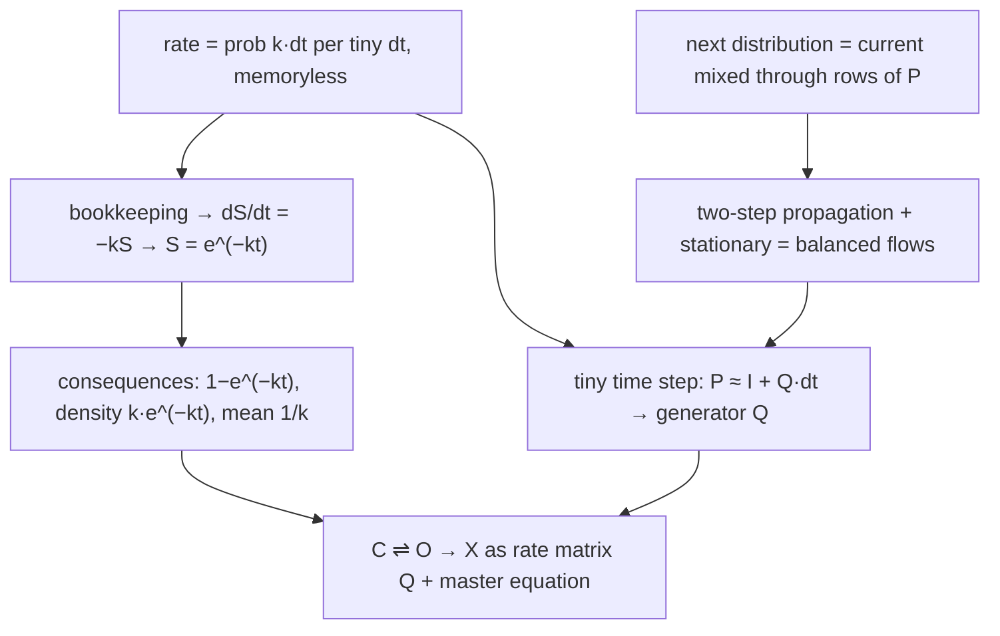

# HDX kinetics math (rates, Markov chains, first-order decay)

*The book of this lesson: only what the tutor wrote for you to read, in teaching order. Questions, answers and grades stay in the lesson log.*

**Goal.** Understand the math behind the HDX application: rates, first-order decay, transition matrices, generator Q; end by writing C⇌O→X as a rate matrix + master equation.

## Map

## Contents

1. rate = prob k·dt per tiny dt, memoryless (definition) *(not written yet)*
2. bookkeeping → dS/dt = −kS → S = e^(−kt) *(not written yet)*
3. consequences: 1−e^(−kt), density k e^(−kt), mean 1/k *(not written yet)*
4. next distribution = current mixed through rows of P *(not written yet)*
5. two-step propagation + stationary = balanced flows *(not written yet)*
6. tiny time step: P ≈ I + Q dt → generator Q *(not written yet)*
7. C ⇌ O → X as rate matrix Q + master equation *(not written yet)*
