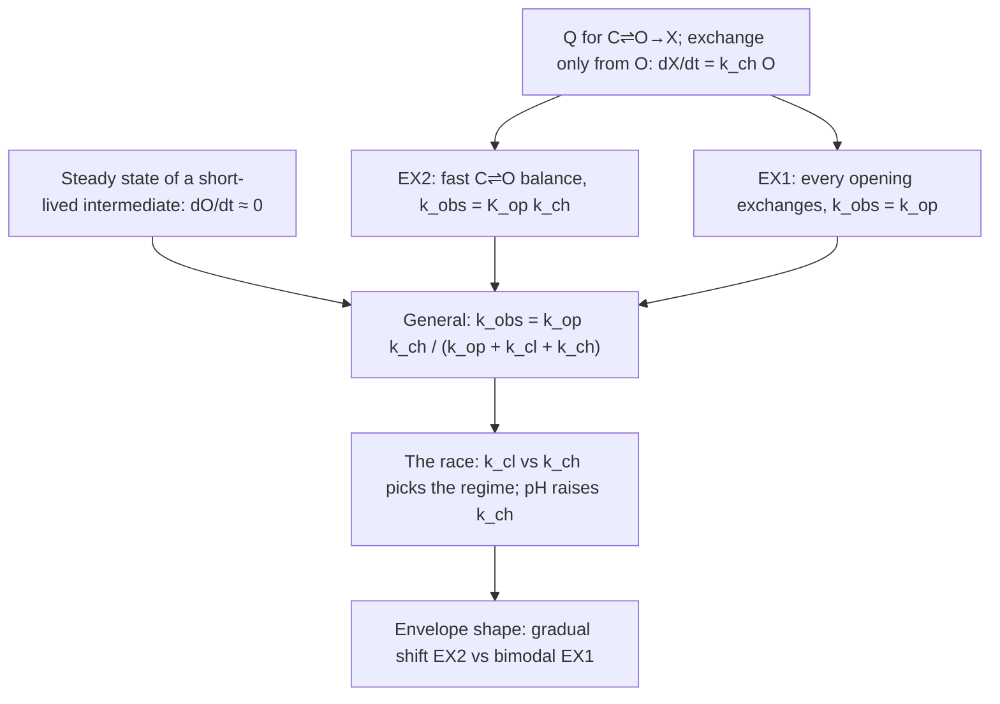

# EX1 vs EX2 from the master equation

*The book of this lesson: only what the tutor wrote for you to read, in teaching order. Questions, answers and grades stay in the lesson log.*

**Goal.** Derive k_obs for the Linderstrøm-Lang chain, get the EX1 and EX2 limits, and explain the envelope shapes

## Map

## Contents

1. Q for C⇌O→X; dX/dt = k_ch O *(not written yet)*
2. EX2: k_obs = K_op k_ch
3. EX1: k_obs = k_op
4. Steady state of short-lived O: dO/dt ≈ 0
5. General k_obs = k_op k_ch/(k_op+k_cl+k_ch)
6. Race k_cl vs k_ch; pH raises k_ch
7. Envelope shape: EX2 gradual vs EX1 bimodal

## 2. EX2: k_obs = K_op k_ch

### EX2: the fast balance turns into one rate, k_obs = K_op k_ch

#### Why this node now

You can write $Q$ for $C \rightleftharpoons O \to X$ and you know exchange happens only from $O$:

$$\frac{dX}{dt} = k_{ch}\,O.$$

That is the whole physics. But an HDX experiment does not see $O$. It sees one number: how fast the unexchanged pool $U = C + O$ drains, which it reports as a single rate $k_{obs}$ with $U(t) \approx U_0 e^{-k_{obs} t}$. So the question of this node is: **what is $O$, as a fraction of $U$, when opening and closing are fast?** Once we know that, $dX/dt = k_{ch} O$ becomes $dX/dt = k_{obs} U$ and we read off $k_{obs}$.

#### The derivation, move by move

**Move 1: compare the time scales.** In a folded protein, a typical amide opens rarely ($k_{op} \sim 1$ per s or slower) and, once open, snaps shut fast ($k_{cl} \sim 100$ to $1000$ per s). Chemical exchange from the open state is slow at neutral pH ($k_{ch} \sim 1$ to $10$ per s). So an open site closes many times before it ever exchanges. The $C \rightleftharpoons O$ hop happens over and over; $O \to X$ is a rare leak out of that back-and-forth.

**Move 2: a fast back-and-forth settles to its balanced split.** You already solved this for the two-state chain: the stationary split has equal flows both ways, $k_{op}\,C = k_{cl}\,O$. Since the leak to $X$ is slow, the pair $C, O$ reaches that balance long before much has leaked. So at any moment during the experiment,

$$\frac{O}{C} = \frac{k_{op}}{k_{cl}} \equiv K_{op}.$$

$K_{op}$ is an equilibrium constant: the open fraction relative to closed. For a stable amide, $K_{op} \ll 1$.

**Move 3: express $O$ as a fraction of the unexchanged pool.** $U = C + O$, and with $K_{op} \ll 1$, $C \approx U$, so $O \approx K_{op} U$. (Exactly: $O = \frac{K_{op}}{1 + K_{op}} U$; the $1 + K_{op}$ in the denominator is where the general formula will differ, so keep it in mind.)

**Move 4: substitute into the exchange current.**

$$\frac{dX}{dt} = k_{ch}\,O \approx k_{ch} K_{op}\,U.$$

Every exchanged site came out of $U$, so $dU/dt = -dX/dt = -(K_{op} k_{ch})\,U$. That is $dS/dt = -kS$ with

$$k_{obs} = K_{op}\,k_{ch} = \frac{k_{op}}{k_{cl}}\,k_{ch}.$$

This is the **EX2** limit. The name just means "exchange regime 2": closing wins the race against exchange, so many openings are needed per exchange event.

#### Worked instance, with numbers

$k_{op} = 1$, $k_{cl} = 100$, $k_{ch} = 10$ per second, 1000 unexchanged sites.

1. Balance: $k_{op} C = k_{cl} O \Rightarrow O = C/100$. With $C + O = 1000$: $O \approx 10$ sites open at any instant (exactly $1000/101 \approx 9.9$).
2. Current: $dX/dt = k_{ch} O = 10 \times 10 = 100$ sites per second.
3. Rate: $k_{obs} = 100 / 1000 = 0.1$ per second. Check against the formula: $K_{op} k_{ch} = (1/100)\times 10 = 0.1$. Same.

Compare with $k_{op} = 1$: sites open once a second, yet exchange ten times slower. Why: each opening lasts about $1/(k_{cl} + k_{ch}) \approx 1/110$ s, and in that window exchange fires with probability about $k_{ch}/(k_{cl} + k_{ch}) = 10/110 \approx 0.09$. So roughly one opening in eleven pays off, and $k_{obs} \approx k_{op} \times 0.09 \approx 0.09$. The balance argument and the per-opening argument give the same answer; that is the sign the picture is right.

#### What it hangs off

- $dX/dt = k_{ch} O$ (§1 (Q for C⇌O→X; dX/dt = k_ch O)): exchange only from the open state.
- Flow balance $k_{op}\pi_C = k_{cl}\pi_O$ for the two-state chain, which you solved numerically last session ($0.1\pi_C = 0.3\pi_O \Rightarrow 750/250$). Here it is the same equation with rates instead of per-step probabilities.
- $dS/dt = -kS$ gives $e^{-kt}$: once the current is proportional to $U$, you have a single rate.

The one assumption to carry forward: **$C \rightleftharpoons O$ settles much faster than $O$ leaks.** §3 (EX1: k_obs = k_op) is what happens when that fails.

### Why the balance holds: count what one opening does

#### The step that was missing

You wrote "since this is in equilibrium, $O/C$ is constant." True, but it is the conclusion, not the reason. The reason has to come from the rates, and it comes from looking at **one opening** and asking how it ends.

#### One opening, two exits

Once a site is open, it has exactly two ways out: close at $k_{cl}$, or exchange at $k_{ch}$. Two competing exits from one state. You already know what that means from $Q$: the total exit rate is $k_{cl} + k_{ch}$, and the share of each exit is its rate over the total. So

$$P(\text{opening ends in exchange}) = \frac{k_{ch}}{k_{cl} + k_{ch}}, \qquad P(\text{opening ends in closing}) = \frac{k_{cl}}{k_{cl} + k_{ch}}.$$

Why this formula and not something else: in a short slice $dt$, the site exchanges with probability $k_{ch}\,dt$ and closes with probability $k_{cl}\,dt$. Given that *something* happened in the slice, the exchange share is $k_{ch}\,dt / (k_{cl}\,dt + k_{ch}\,dt)$, and the $dt$ cancels. The same ratio holds in every slice, so it holds for the opening as a whole.

#### Worked numbers: $k_{cl} = 50$, $k_{ch} = 5$ per second

- Exchange share per opening: $5 / 55 \approx 0.09$. Out of 100 openings, about 9 exchange and about 91 close.
- So a typical site does $C \to O \to C \to O \to C \ldots$ about eleven times before a leak to $X$.
- The $C \rightleftharpoons O$ hop has therefore repeated many times before anything irreversible happens. A two-state hop that repeats many times settles to its balance $k_{op}C = k_{cl}O$ (this is the stationary split you solved last session). The leak to $X$ is then a slow drain *of an already balanced pool*.

That is what justifies $O/C = k_{op}/k_{cl}$ at every moment of the experiment.

#### The comparison, stated as an inequality

The balance argument needs most openings to close rather than exchange:

$$k_{cl} \gg k_{ch}.$$

This is **not** the same as $k_{cl} \gg k_{op}$. That second inequality says $O$ is small compared with $C$ (useful for $C \approx U$), but says nothing about whether the pair has time to settle. Here is a case that separates them: $k_{op} = 1$, $k_{cl} = 100$, $k_{ch} = 10^4$ per second (high pH). Still $k_{cl} \gg k_{op}$, so $O$ is tiny at any instant. But the exchange share per opening is $10^4 / (100 + 10^4) \approx 0.99$: almost every opening exchanges, the pair never gets to hop back and forth, and the balance argument fails. That is the EX1 side, which §3 (EX1: k_obs = k_op) covers.

#### Where this hangs

- Competing exits from one state: the row of $Q$ for $O$ is $(k_{cl}, -(k_{cl}+k_{ch}), k_{ch})$; the exit shares are just those off-diagonal entries divided by the total exit.
- Stationary split of a two-state chain: $k_{op}\pi_C = k_{cl}\pi_O$, reached only if the chain hops many times.

The single fact to carry into §3 (EX1: k_obs = k_op): **the regime is decided by which exit of $O$ wins, closing or exchange.**

### Two inequalities, two jobs: small O versus balanced O

#### What went wrong

You named $k_{ch} \ll k_{cl}$, which is the right one, and added $k_{op} \ll k_{cl}$. Both are true in a folded protein, but they do different jobs, and only one of them is the EX2 condition. This distinction is the hinge for §3 (EX1: k_obs = k_op) and §6 (Race k_cl vs k_ch; pH raises k_ch), so it is worth one page.

#### The two jobs

**Job 1: how big is $O$?** From the balance $k_{op}C = k_{cl}O$, the open fraction is $O/C = k_{op}/k_{cl}$. If $k_{op} \ll k_{cl}$, then $O \ll C$, which lets us write $C \approx U$. That is all $k_{op} \ll k_{cl}$ does: it makes $O$ **small**.

**Job 2: does the pair have time to settle?** That is decided by what one opening does. An open site has two exits, close at $k_{cl}$ and exchange at $k_{ch}$, so the share of openings that end in exchange is

$$\frac{k_{ch}}{k_{cl} + k_{ch}}.$$

Notice: no $k_{op}$ anywhere in this. If this share is small, the site hops $C \rightleftharpoons O$ many times before a leak, and the pair settles to its balance. That requires $k_{ch} \ll k_{cl}$. It makes $O$ **balanced**.

#### Worked example with the same $k_{op}, k_{cl}$ and two values of $k_{ch}$

$k_{op} = 1$, $k_{cl} = 100$ per second, 1000 sites.

**Case A: $k_{ch} = 10$.**
- Exchange share per opening: $10/110 \approx 0.09$. About eleven hops per leak, so the pair settles. Balance holds.
- Balanced split: $O/C = 1/100$, $O \approx 10$ sites.
- Current: $dX/dt = 10 \times 10 = 100$ per s, $k_{obs} = 0.1$ per s $= K_{op}k_{ch}$. EX2.

**Case B: $k_{ch} = 10^4$ (high pH, exchange chemistry very fast).**
- $k_{op} \ll k_{cl}$ is still true, so at any instant $O$ is still tiny.
- But exchange share per opening: $10^4/10100 \approx 0.99$. The first opening almost always exchanges. The site never hops back; there is no repeated back-and-forth to settle. Balance **fails**.
- What happens instead: every opening is a one-way trip $C \to O \to X$, so $X$ grows at the rate sites open: $k_{obs} \approx k_{op} = 1$ per s. (That is §3 (EX1: k_obs = k_op).) Check that EX2 would have been absurd here: $K_{op}k_{ch} = 0.01 \times 10^4 = 100$ per s, a hundred times faster than sites even open.

Same $k_{op}$, same $k_{cl}$, same "$O$ is small" inequality. Only $k_{ch}$ changed, and it flipped the regime. So the regime is decided by $k_{ch}$ versus $k_{cl}$, full stop.

#### One-line summary to carry

- $k_{op} \ll k_{cl}$: $O$ is small ($C \approx U$). Not the regime condition.
- $k_{ch} \ll k_{cl}$: $O$ is balanced, $k_{obs} = K_{op}k_{ch}$. This is EX2.
- $k_{ch} \gg k_{cl}$: every opening exchanges, $k_{obs} = k_{op}$. This is EX1.

## 3. EX1: k_obs = k_op

### EX1: when every opening exchanges, k_obs = k_op

#### Why this node now

§2 (EX2: k_obs = K_op k_ch) rested on one assumption: closing beats exchange, $k_{ch} \ll k_{cl}$. You have just seen the assumption fail (Case B, $k_{ch} = 10^4$). This node asks: what is $k_{obs}$ on the other side? The answer is simpler than EX2, and you already guessed it.

#### The derivation

**Move 1: what one opening does when exchange wins.** Exchange share per opening is $k_{ch}/(k_{cl} + k_{ch})$. If $k_{ch} \gg k_{cl}$, that share is close to 1: an open site exchanges before it can close. Each opening is a one-way trip $C \to O \to X$.

**Move 2: so the bottleneck is opening.** $X$ cannot grow faster than sites open, and now it grows exactly as fast as sites open, because nothing opened ever returns. The exchange current is the opening current:

$$\frac{dX}{dt} = k_{op}\,C.$$

**Move 3: $C$ is the unexchanged pool.** Sites that open leave $O$ almost instantly (exit rate $k_{cl} + k_{ch}$, huge), so $O \approx 0$ and $U = C + O \approx C$. Then $dU/dt = -k_{op} U$, a single rate:

$$k_{obs} = k_{op}.$$

This is **EX1**: the observed rate *is* the opening rate. The chemistry ($k_{ch}$) has dropped out entirely, and so has $k_{cl}$. Nothing about the closing or the chemistry can be read from the rate; only the opening dynamics.

**How you could have found it without Move 2.** Start from §1 (Q for C⇌O→X; dX/dt = k_ch O), $dX/dt = k_{ch} O$, and ask what $O$ is now. Open sites are created at $k_{op} C$ and destroyed at $(k_{cl} + k_{ch}) O$. Destruction is enormously fast, so $O$ stays at the tiny level where creation and destruction match: $O \approx k_{op} C/(k_{cl} + k_{ch})$. Substitute: $dX/dt = k_{ch} \cdot k_{op} C/(k_{cl} + k_{ch}) = k_{op} C \cdot \frac{k_{ch}}{k_{cl} + k_{ch}} \approx k_{op} C$ when $k_{ch} \gg k_{cl}$. Same answer, and notice the factor $\frac{k_{ch}}{k_{cl}+k_{ch}}$ is the exchange share per opening again. Keep this "creation equals destruction" move in mind: it is §4 (Steady state of short-lived O: dO/dt ≈ 0), and it will give the general formula in §5 (General k_obs = k_op k_ch/(k_op+k_cl+k_ch)).

#### Worked instance

$k_{op} = 1$, $k_{cl} = 100$, $k_{ch} = 10^4$ per second, 1000 unexchanged sites.

1. Exchange share per opening: $10^4 / 10100 \approx 0.99$. Essentially every opening exchanges.
2. Opening current: $k_{op} C \approx 1 \times 1000 = 1000$ sites per second at $t = 0$.
3. Open sites present: $O \approx k_{op}C/(k_{cl}+k_{ch}) = 1000/10100 \approx 0.1$ sites. So $U \approx C$ to one part in ten thousand.
4. $k_{obs} = 1000/1000 = 1$ per second $= k_{op}$. The EX2 formula would have said $K_{op} k_{ch} = 0.01 \times 10^4 = 100$ per second, which is impossible: sites cannot exchange faster than they open.

#### Where it hangs

- §1 (Q for C⇌O→X; dX/dt = k_ch O): $dX/dt = k_{ch} O$, exchange only from $O$.
- §2 (EX2: k_obs = K_op k_ch)'s hinge: the exchange share per opening $k_{ch}/(k_{cl}+k_{ch})$. Near 0 gives EX2; near 1 gives EX1.
- The constraint in both regimes: $k_{obs} \le k_{op}$ always. EX1 is the case where the bound is reached.

The thing to notice for the boundary check: EX1 **needs** $k_{ch} \gg k_{cl}$. It does not need $k_{op} \ll k_{cl}$; a stable protein and an unstable one both give $k_{obs} = k_{op}$ if exchange beats closing.

## 4. Steady state of short-lived O: dO/dt ≈ 0

### Steady state of a short-lived intermediate: dO/dt ≈ 0

#### Why we need this now

You have two limits of the chain $C \rightleftharpoons O \to X$ and each came from a different argument. EX2 ($k_{ch} \ll k_{cl}$) used "the $C \rightleftharpoons O$ balance is barely disturbed", giving $k_{obs} = K_{op}k_{ch}$. EX1 ($k_{ch} \gg k_{cl}$) used "every opening exchanges", giving $k_{obs} = k_{op}$. Two separate stories is exactly the disconnected-facts situation. We want one formula that produces both. The tool that does it is a single approximation about $O$, and you just predicted it: **$O$ never piles up**.

#### The idea, discovered

Write the exact balance for $O$ straight from the rate matrix you already own. Inflow is openings from $C$; outflow is closings and exchanges from $O$:

$$\frac{dO}{dt} = k_{op}\,C \;-\; (k_{cl} + k_{ch})\,O .$$

Now ask: how long does a molecule stay in $O$ once it gets there? Its total exit rate is $k_{cl} + k_{ch}$, so its mean lifetime is $1/(k_{cl}+k_{ch})$. Compare that to how fast $C$ itself changes, which is at most on the timescale $1/k_{op}$ (that's how fast $C$ is being drained). If

$$k_{cl} + k_{ch} \;\gg\; k_{op},$$

then $O$ relaxes far faster than $C$ moves. Picture a bucket ($O$) with a tiny inlet ($k_{op}C$) and a huge drain ($(k_{cl}+k_{ch})O$). The water level settles in a blink to whatever height makes drain equal inlet, and from then on it just *tracks* the slowly changing inlet. Settled means not changing:

$$\frac{dO}{dt} \approx 0 \quad\Longrightarrow\quad O \approx \frac{k_{op}}{k_{cl}+k_{ch}}\,C .$$

That is the **steady-state (quasi-stationary) approximation**. It does not say $O$ is constant forever; it says $O$ is always at its settled value *for the current* $C$. The error you make is the brief initial transient, of duration about $1/(k_{cl}+k_{ch})$, during which the bucket fills.

Notice what the condition does **not** require. It does not need $k_{cl} \gg k_{ch}$ (EX2) or $k_{ch} \gg k_{cl}$ (EX1). Either exit can be the big one. All it needs is that the *sum* of exits from $O$ dwarfs the inflow rate constant $k_{op}$. For backbone amides that is essentially always true: openings are rare, and an open amide either snaps shut or exchanges within milliseconds to seconds.

#### One worked instance

Take $k_{op} = 1$, $k_{cl} = 100$, $k_{ch} = 10$ per second, all sites in $C$ at $t = 0$.

1. Total exit rate from $O$: $k_{cl}+k_{ch} = 110$ per second. Mean lifetime of an open state: $1/110 \approx 0.009$ s. *Reason: lifetime is the reciprocal of the total exit rate, the $1/k$ you already have.*
2. Compare with the inflow rate constant $k_{op} = 1$ per second: $110 \gg 1$, so the approximation applies. *Reason: $O$ drains about a hundred times faster than $C$ can be depleted.*
3. Settled value: $O \approx \dfrac{1}{110}\,C \approx 0.0091\,C$. *Reason: set $dO/dt = 0$ in the balance and solve.*
4. Check it is small and tracks $C$: at the start $C \approx 1$ so $O \approx 0.009$. When later $C$ has dropped to $0.5$, $O$ has already followed down to $\approx 0.0045$, because the re-settling takes only $\sim 0.01$ s while $C$ halving takes seconds.

Your prediction (b) was exactly this: a small, nearly constant $O$ that slides down with $C$.

#### What it hangs off

Only $R1$: the balance equation for $O$ is the $O$-row of the master equation $\dot p = pQ$ you wrote with numbers, and "lifetime $= 1/(\text{total exit rate})$" is the same fact as $Q_{OO} = -(k_{cl}+k_{ch})$ being minus the total exit rate. The new ingredient is one move: when a state's exits are much faster than its inflow, set its time derivative to zero and solve algebraically. Next node, we feed this $O$ into $dX/dt = k_{ch}O$ and get $k_{obs}$ for every regime at once.

### Steady state, worked once more, with the checks a careful hand does

#### What this page is for

Your steady-state expression was right: $O \approx k_{op}C/(k_{cl}+k_{ch})$. The number came out wrong at the division. That is attention, not understanding, and attention is trained by building in checks. So here is the same computation done the way a careful hand does it: every number gets a cheap independent check before it is trusted.

#### Worked instance: $k_{op} = 3$, $k_{cl} = 400$, $k_{ch} = 50$ per second, 1000 sites nearly all closed

**Step 1: total exit rate from $O$.** Two exits, close at 400 and exchange at 50: $k_{cl} + k_{ch} = 450$ per second. *Check:* it must exceed the larger of the two (450 > 400). Yes.

**Step 2: mean open lifetime.** $1/450$ s $\approx 0.0022$ s, about 2 ms. *Check by rounding:* $1/500 = 0.002$ and $1/400 = 0.0025$; the answer must sit between them. $0.0022$ does.

**Step 3: steady-state open count.** Creation equals destruction: $k_{op}C = (k_{cl}+k_{ch})\,O$, so

$$O \approx \frac{3 \times 1000}{450} = \frac{3000}{450}.$$

*Check by rounding before dividing:* $3000/500 = 6$ and $3000/400 = 7.5$, so the answer must lie between 6 and 7.5. Now divide: $3000/450 = 6.67$. In range. (Had I written 3.33, the rounding check would have caught it immediately: 3.33 is below 6.)

**Step 4: second independent check, the lifetime route.** Open sites $=$ (openings per second) $\times$ (mean open lifetime) $= k_{op}C \times \frac{1}{k_{cl}+k_{ch}} = 3000 \times 0.0022 \approx 6.7$. Same number, computed in a different order. This is Little's law: population equals arrival rate times residence time. Two routes agreeing is the strongest check there is.

**Step 5: plausibility against $U$.** $O/U \approx 6.7/1000 \approx 0.7\%$. Small, as it must be for a folded amide with $k_{op} \ll k_{cl}$. If $O$ had come out as 300, something would be wrong.

#### The habit to take away

Before you trust a division, bracket it with two easy ones (round the denominator up and down). Before you trust a steady-state count, recompute it as rate $\times$ lifetime. Each check costs ten seconds and catches exactly the kind of slip that cost you the last answer. The grader does not care about arithmetic for its own sake; it matters because an open-site count that is off by a factor of 2 becomes a $k_{obs}$ off by a factor of 2, and in HDX that is the difference between two regimes.

#### Where it hangs

- Creation $k_{op}C$ and destruction $(k_{cl}+k_{ch})O$: the $O$ row of $Q$.
- Mean lifetime $1/k$ for exit rate $k$.
- Little's law, population $=$ rate $\times$ lifetime, is just the steady state read as a sentence.

### A short-lived state fills up fast: dO/dt ≈ 0

#### Why this node now

You have two answers for $k_{obs}$: $K_{op} k_{ch}$ when closing is fast (EX2) and $k_{op}$ when exchange is fast (EX1). They were derived by two different stories. One formula should contain both, and the tool that gives it is the fact on this page. It is also the fact your pretest guess missed, so it is worth getting straight.

#### Two clocks, not one

Look at the equation for $O$ alone. From the rate matrix $Q$ you already wrote:

$$\frac{dO}{dt} = k_{op} C - (k_{cl} + k_{ch})\, O$$

Inflow from $C$, outflow to $C$ and to $X$. Now ask the question you would ask of any one-exit-rate population: how fast does $O$ respond? The outflow term is $-(k_{cl}+k_{ch}) O$, the same shape as $dU/dt = -kU$, which you can already solve. So $O$ relaxes toward whatever the inflow supports with time constant

$$\tau_O = \frac{1}{k_{cl} + k_{ch}}$$

With $k_{cl} = 100$ and $k_{ch} = 10$ per second, $\tau_O = 1/110$ s, about $9$ ms. That is one clock.

The other clock is how fast the *unexchanged population* drains: $1/k_{obs}$. With $k_{obs} = 0.1$ per second that is $10$ s. In your guess you used this second clock to answer a question about the first. The two differ by a factor of a thousand, and that factor is the whole point.

#### Why $dO/dt \approx 0$ follows

If $O$ adjusts in $9$ ms but its inflow $k_{op} C$ only changes on a $10$ s scale, then from $O$'s point of view the inflow is constant. A population with constant inflow and first-order outflow goes to the level where the two match and stays there. So after the first few $\tau_O$:

$$k_{op} C \approx (k_{cl} + k_{ch})\, O \quad\Longleftrightarrow\quad \frac{dO}{dt} \approx 0$$

This is not "equilibrium". $C$ is still slowly draining into $X$. It is a *steady state of the fast variable*: $O$ tracks $C$ so closely that its own derivative is negligible next to its inflow and outflow, which are each about $1000$ per second while $dO/dt$ is at most a few per second. The name in chemistry is the steady-state approximation, and the condition for it is just that $O$'s relaxation is much faster than everything else: $k_{cl} + k_{ch} \gg k_{obs}$.

Notice what this does *not* need. It does not need $k_{cl} \gg k_{ch}$ (that was EX2) or $k_{ch} \gg k_{cl}$ (EX1). It only needs $O$ to be short-lived compared with the exchange time, which in practice is always true because $k_{op}$ is small. That is why it will give the general formula on the next page.

#### Worked instance

$k_{op} = 1$, $k_{cl} = 100$, $k_{ch} = 10$ per second, 1000 sites all closed at $t = 0$.

1. **Inflow at the start:** $k_{op} C = 1 \times 1000 = 1000$ open sites created per second. Reason: every closed site opens at rate $k_{op}$.
2. **Outflow per open site:** $k_{cl} + k_{ch} = 110$ per second. Reason: an open site has exactly two exits, and rates of independent exits add.
3. **Level:** inflow equals outflow when $1000 = 110\, O$, so $O \approx 9$ sites. Reason: that is the only $O$ at which $dO/dt = 0$.
4. **Time to get there:** $\tau_O = 1/110 \approx 9$ ms. After $30$ ms (three time constants) $O$ is within $5\%$ of $9$. Reason: $O$ relaxes like $1 - e^{-t/\tau_O}$, the same curve as $1 - e^{-kt}$.
5. **Check that $C$ hardly moved meanwhile:** in $30$ ms, exchanged sites are about $k_{obs} \times 0.03 \times 1000 = 3$. So $C$ is still $\approx 988$, and the inflow is still $\approx 1000$. The approximation is self-consistent.
6. **Sanity check on the level:** $O/C \approx 9/990 \approx 0.009$, close to $k_{op}/k_{cl} = 0.01$. The small difference is the $k_{ch}$ in the denominator, $k_{op}/(k_{cl}+k_{ch}) = 1/110$. That extra term is exactly what the EX2 story dropped, and it is what the general formula keeps.

#### What it hangs off

Two things you already own. First, $dU/dt = -kU$ relaxes on the time $1/k$: here the "$k$" for $O$ is its total exit rate $k_{cl}+k_{ch}$. Second, the row of $Q$ for $O$, which you wrote in the pretest: the diagonal entry $-(k_{cl}+k_{ch})$ is minus the total exit rate, and that same number is what sets $O$'s clock.

## 5. General k_obs = k_op k_ch/(k_op+k_cl+k_ch)

### The general k_obs = k_op k_ch / (k_op + k_cl + k_ch)

#### Why now

We have the settled $O$. Exchange happens only from $O$ at rate $k_{ch}$ ($R1$: $dX/dt = k_{ch}O$). Put the two together and $k_{obs}$ drops out for *any* values of the three rates. EX1 and EX2 will then be two corners of one formula instead of two separate stories.

#### The derivation

Unexchanged sites are $U = C + O$. Since $O$ is tiny compared with $C$ under the steady-state condition, $U \approx C$. The exchange flux is

$$\frac{dX}{dt} = k_{ch}\,O \approx k_{ch}\,\frac{k_{op}}{k_{cl}+k_{ch}}\,C \approx \frac{k_{op}k_{ch}}{k_{cl}+k_{ch}}\,U .$$

So $U$ decays as $dU/dt = -k_{obs}U$ with

$$k_{obs} \approx \frac{k_{op}\,k_{ch}}{k_{cl}+k_{ch}} .$$

Two readings of the same expression, both worth holding:

- **Product form:** $k_{obs} = k_{op}\cdot\dfrac{k_{ch}}{k_{cl}+k_{ch}}$. Openings happen at $k_{op}$; each opening exchanges with probability $\dfrac{k_{ch}}{k_{cl}+k_{ch}}$, the share of exits from $O$ that go to $X$ rather than back to $C$. (You used exactly this share when you found $k_{op}/2$ for $k_{ch} = k_{cl}$.)
- **Limits:** if $k_{ch} \ll k_{cl}$ the share is $\approx k_{ch}/k_{cl}$ and $k_{obs} \to K_{op}k_{ch}$ (EX2). If $k_{ch} \gg k_{cl}$ the share is $\approx 1$ and $k_{obs} \to k_{op}$ (EX1). Both earlier nodes fall out.

The full textbook formula has one more term in the denominator:

$$k_{obs} = \frac{k_{op}\,k_{ch}}{k_{op}+k_{cl}+k_{ch}} .$$

Where does the extra $k_{op}$ come from? From dropping the approximation $U \approx C$. Exactly, $U = C + O = C\left(1 + \frac{k_{op}}{k_{cl}+k_{ch}}\right) = C\,\frac{k_{op}+k_{cl}+k_{ch}}{k_{cl}+k_{ch}}$, so $C = U\,\frac{k_{cl}+k_{ch}}{k_{op}+k_{cl}+k_{ch}}$. Substituting into $dX/dt = k_{ch}\frac{k_{op}}{k_{cl}+k_{ch}}C$ gives the three-term denominator. When $k_{op} \ll k_{cl}+k_{ch}$, which is the steady-state condition itself, the extra term is negligible and the two forms agree. So the three-term formula is just the two-term one with the small correction for the few sites sitting in $O$ counted as still unexchanged.

#### Worked instance

$k_{op} = 2$, $k_{cl} = 30$, $k_{ch} = 70$ per second (your numbers from the last node).

1. Exchange share per opening: $\dfrac{70}{30+70} = 0.7$. *Reason: of every 100 exits from $O$, 70 go to $X$.*
2. $k_{obs} = k_{op}\times 0.7 = 1.4$ per second. *Reason: openings at 2/s, 70% of them exchange.*
3. Three-term check: $\dfrac{2\cdot 70}{2+30+70} = \dfrac{140}{102} \approx 1.37$ per second. *Reason: the $2$ in the denominator is the $O$ correction, a 2% effect because $k_{op}$ is 2% of the exits.*
4. Regime: neither limit cleanly. $k_{ch} > k_{cl}$ so it leans EX1 ($k_{obs}$ is 70% of $k_{op}$, not 100%), and far from EX2 ($K_{op}k_{ch} = 4.7$/s would be badly wrong).

#### What it hangs off

$R1$ supplies $dX/dt = k_{ch}O$. $R2$ supplies $O \approx \frac{k_{op}}{k_{cl}+k_{ch}}C$. $D1$ and $D2$ are the two corners you had already derived separately; now they are consequences, not assumptions. The only move added is multiplying the two and recognising the result as a first-order decay of $U$.

## 6. Race k_cl vs k_ch; pH raises k_ch

### The race k_cl vs k_ch picks the regime; pH turns the k_ch knob

#### Why now

The general formula is in hand:

$$k_{obs} = k_{op}\cdot\frac{k_{ch}}{k_{cl}+k_{ch}} .$$

The second factor is the whole story of EX1 versus EX2. It is the probability that an open site exchanges before it closes, and it is decided by a **race** between two exits from $O$: closing at $k_{cl}$ and exchange at $k_{ch}$. Whichever is faster wins most of the time. This node makes that race explicit and then asks the practical question: in an experiment, which of these rates can you actually turn?

#### The race, from the formula

Look at the share $\dfrac{k_{ch}}{k_{cl}+k_{ch}}$ as a function of the single ratio $r = k_{ch}/k_{cl}$:

$$\text{share} = \frac{r}{1+r}.$$

- $r \ll 1$ (closing wins): share $\approx r = k_{ch}/k_{cl}$, so $k_{obs} \approx k_{op}k_{ch}/k_{cl} = K_{op}k_{ch}$. **EX2.** A site opens and closes many times before one opening finally exchanges. $k_{obs}$ is proportional to $k_{ch}$, and it reports the *equilibrium* $K_{op}$, i.e. the stability $\Delta G_{op} = -RT\ln K_{op}$.
- $r \gg 1$ (exchange wins): share $\approx 1$, so $k_{obs} \approx k_{op}$. **EX1.** The first opening exchanges. $k_{obs}$ no longer depends on $k_{ch}$ at all, and it reports the *kinetics* of opening.
- $r = 1$: share $= 1/2$, the crossover. This is the $k_{op}/2$ you computed when $k_{ch} = k_{cl}$.

So the regime is not a property of the protein alone and not of the chemistry alone. It is a property of the ratio $k_{ch}/k_{cl}$.

#### Which knob can you turn? pH

$k_{op}$ and $k_{cl}$ belong to the protein's dynamics; you can nudge them with temperature or denaturant, but not cleanly. $k_{ch}$ is different: it is the chemistry of an exposed amide, and above about pH 3 it is **base-catalysed**: the rate-limiting step is attack by $\mathrm{OH^-}$ on the amide N–H. Since $[\mathrm{OH^-}]$ rises ten-fold per pH unit,

$$k_{ch} \propto [\mathrm{OH^-}] \quad\Longrightarrow\quad k_{ch} \text{ increases about } 10\times \text{ per pH unit.}$$

Orders of magnitude to hold: for a fully exposed amide at room temperature, $k_{ch}$ is of order $1$–$10$ per second at pH 7, about ten-fold more per unit above, and it bottoms out near pH 2.5–3 (which, together with $0\,^\circ$C, is why the quench in HDX-MS slows exchange by roughly four to five orders of magnitude).

Consequence: raising pH pushes **every** site toward EX1, because $k_{ch}$ climbs while $k_{cl}$ stays put. The pH at which a given site crosses over is the pH where $k_{ch}$ reaches that site's $k_{cl}$. Experimentally this is the standard test: if $k_{obs}$ scales ten-fold per pH unit, the site is EX2; if $k_{obs}$ stops responding to pH, it has gone EX1.

#### Worked instance

A site with $k_{op} = 0.01$ per second and $k_{cl} = 100$ per second ($K_{op} = 10^{-4}$, a well-protected amide). Take $k_{ch} = 10$ per second at pH 7.

1. **pH 7:** $r = 10/100 = 0.1$. Share $= 0.1/1.1 \approx 0.09$. $k_{obs} = 0.01 \times 0.09 \approx 9\times10^{-4}$ per second. *Reason: closing wins 10 to 1; EX2, and indeed $K_{op}k_{ch} = 10^{-4}\times 10 = 10^{-3}$ is within 10%.*
2. **pH 8:** $k_{ch} = 100$ per second, $r = 1$. Share $= 0.5$. $k_{obs} = 0.005$ per second. *Reason: the crossover; one pH unit multiplied $k_{ch}$ by 10 but $k_{obs}$ by only about 5, the first sign of leaving EX2.*
3. **pH 9:** $k_{ch} = 1000$ per second, $r = 10$. Share $\approx 0.91$. $k_{obs} \approx 0.0091$ per second. *Reason: exchange now wins 10 to 1; EX1, $k_{obs} \to k_{op} = 0.01$.*
4. **pH 10:** $k_{ch} = 10^4$, share $\approx 0.99$, $k_{obs} \approx 0.0099$. *Reason: saturated at $k_{op}$; another pH unit changed $k_{obs}$ by 9%.*

Across pH 7 to 10, $k_{ch}$ rose a thousand-fold but $k_{obs}$ rose only eleven-fold, from $9\times10^{-4}$ to $0.0099$ per second, and flattened. That flattening *is* the EX2 to EX1 transition, and its location told you $k_{cl} \approx 100$ per second.

#### What it hangs off

Entirely off §5 (General k_obs = k_op k_ch/(k_op+k_cl+k_ch)). Nothing new is derived; the share $k_{ch}/(k_{cl}+k_{ch})$ is simply reread as the outcome of a race, and one external fact is attached: $k_{ch}$ is the only one of the three rates with a clean experimental knob, and that knob is pH, ten-fold per unit.

## 7. Envelope shape: EX2 gradual vs EX1 bimodal

### Envelope shape: gradual shift (EX2) versus bimodal (EX1)

#### Why now

Everything so far was one amide. A mass spectrometer sees a **peptide** with $N$ exchangeable amides, and what it reports is the isotope envelope: a histogram of how many deuterons each peptide molecule carries. The question this whole lesson was aimed at: why does EX2 produce an envelope that slides gradually to higher mass, while EX1 produces two peaks whose heights trade places? The answer is a direct consequence of the race, applied to $N$ sites that open together.

#### The setup

Take a segment of $N$ amides that opens and closes **as a unit** (a cooperative unfolding event: the whole helix or hairpin frays at once). Every opening exposes all $N$ sites at the same time, for a lifetime of order $1/(k_{cl}+k_{ch})$. Ask of one opening event: how many of the $N$ sites exchange before the segment closes?

Each exposed site independently runs its own race against the same closing clock. The probability a given site exchanges during this opening is the share $s = \dfrac{k_{ch}}{k_{cl}+k_{ch}}$.

#### EX1: all or nothing per opening

$k_{ch} \gg k_{cl}$, so $s \approx 1$. In a single opening, essentially **all $N$ sites exchange**. A peptide molecule is therefore in one of two states: never yet opened (mass $+0$) or opened at least once (mass $+N$). Nothing in between exists, because an opening is never partial. The fraction that has opened by time $t$ is $1 - e^{-k_{op}t}$, so the envelope is **two peaks at fixed positions**, $+0$ and $+N$, with the low-mass peak draining into the high-mass peak at rate $k_{op}$. That is the bimodal signature. The peaks do not move; only their heights change.

#### EX2: a tiny bite per opening

$k_{ch} \ll k_{cl}$, so $s \ll 1$. In a single opening, each site exchanges with small probability $s$, independently of its neighbours. A typical opening exchanges zero or one site. Exchange is accumulated over **many** openings ($\sim 1/s$ of them per site), and because each site's successes are independent coin flips across openings, after time $t$ each site is exchanged with probability

$$p(t) = 1 - e^{-k_{obs}t}, \qquad k_{obs} = K_{op}k_{ch},$$

independently of the others. The number of deuterons on a peptide is then **binomial**, $\mathrm{Bin}(N, p)$: a single hump centred at $Np$ with width $\sqrt{Np(1-p)}$. As $t$ grows the hump **slides** from $0$ to $N$ through every intermediate position. That is the gradual, unimodal shift.

The key dependency: independence of sites comes from $s \ll 1$. When each opening exchanges at most one site, which sites exchange is uncorrelated, and a sum of $N$ independent coin flips is a binomial. When $s \approx 1$, every opening exchanges all sites, the coin flips are perfectly correlated, and the distribution collapses to two spikes. Both envelopes have the **same centroid**, $N(1 - e^{-k_{obs}t})$; only the shape distinguishes them. Centroid-only analysis cannot tell EX1 from EX2. The envelope width can.

#### Worked instance

$N = 10$ sites, $t$ chosen so that half the exchange is done, $k_{obs}t = \ln 2$ (e.g. $k_{obs} = 0.01$ per second, $t \approx 69$ s).

- **EX2:** $p = 0.5$ for each site. Deuteron count $\sim \mathrm{Bin}(10, 0.5)$: mean $5$, standard deviation $\sqrt{10\times0.25} \approx 1.6$. One peak centred at $+5$, spanning roughly $+2$ to $+8$. *Reason: 10 independent fair coins.*
- **EX1:** with $k_{op} = 0.01$ per second, half the molecules have opened. Half the intensity at $+0$, half at $+10$, nothing at $+5$. *Reason: each opening exchanges all 10 sites, so each molecule is all-or-nothing.* Centroid also $+5$.

Same centroid, opposite shapes. In an experiment, a stretched or bimodal envelope that persists over several time points, especially at raised pH, is the fingerprint of EX1 and hence of a cooperative opening whose $k_{op}$ you can read directly.

#### What it hangs off

§6 (Race k_cl vs k_ch; pH raises k_ch) supplies the share $s$ and the fact that pH pushes $s \to 1$. §3 (EX1: k_obs = k_op) supplies "every opening exchanges" for EX1 and §2 (EX2: k_obs = K_op k_ch) "many openings per exchange" for EX2. The one new idea is statistical: $N$ sites that open together are $N$ coin flips with success probability $s$ per opening, independent when $s \ll 1$ and perfectly correlated when $s \approx 1$. Independent flips give a binomial hump; correlated flips give two spikes.
