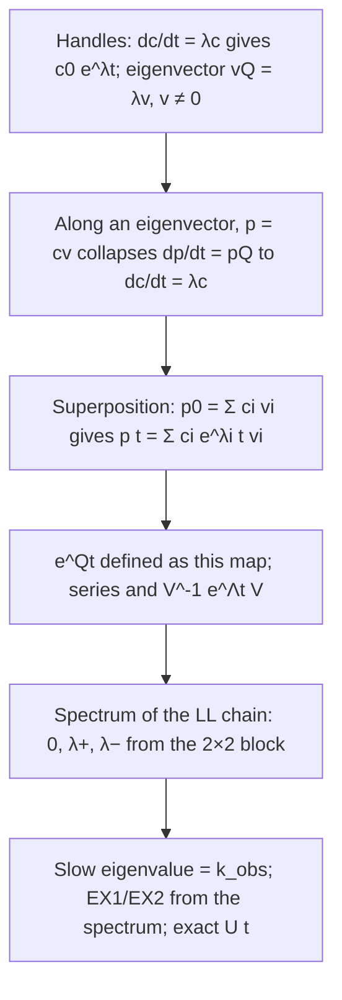

# Matrix exponential for linear ODEs: modes of the Linderstrøm-Lang chain

*The book of this lesson: only what the tutor wrote for you to read, in teaching order. Questions, answers and grades stay in the lesson log.*

**Goal.** Solve ṗ = pQ exactly via eigendecomposition / e^{Qt}, and read k_obs and the EX1/EX2 limits off the spectrum of the 3-state HDX rate matrix

## Map

## Contents

1. Handles: scalar ODE solution and eigenvector definition
2. Along an eigenvector the matrix ODE collapses to dc/dt = λc
3. Superposition: p(t) = Σ c_i e^{λ_i t} v_i
4. e^{Qt}: definition, series, V^{-1} e^{Λt} V
5. Spectrum of the 3-state LL chain
6. Slow eigenvalue = k_obs; EX1/EX2 from the spectrum *(not written yet)*

## 1. Handles: scalar ODE solution and eigenvector definition

### The two handles: the scalar ODE and the eigenvector equation

#### Why these two, now

Everything in this lesson is built by combining exactly two facts you already own, so it is worth stating them in the precise form we will use. Nothing else is needed: no new theorems, no linear algebra beyond what these say.

#### Handle 1: the scalar linear ODE

$$\frac{dc}{dt} = \lambda c \quad\Longrightarrow\quad c(t) = c(0)\,e^{\lambda t}.$$

This is $dS/dt = -kS$ with $\lambda = -k$. Two things to hold explicitly:

- **It is the only solution.** If $c(0)$ is given, $c(t)$ is fixed for all $t$. (Reason: the ODE tells you the slope at every point, so from the starting value the curve is traced out with no freedom. Formally, $\frac{d}{dt}\left(c\,e^{-\lambda t}\right) = \dot c e^{-\lambda t} - \lambda c e^{-\lambda t} = 0$, so $c\,e^{-\lambda t}$ is constant, equal to $c(0)$.)
- **The sign of $\lambda$ is the whole story.** $\lambda < 0$: decays at rate $|\lambda|$, lifetime $1/|\lambda|$. $\lambda = 0$: $c$ stays at $c(0)$ forever. $\lambda > 0$: grows. For rate matrices only the first two occur.

#### Handle 2: the eigenvector equation, in the row convention

For the master equation you write populations as a **row** $p = (p_C, p_O, p_X)$ and $\dot p = pQ$, with $Q_{ij}$ the rate from $i$ to $j$. Because $p$ multiplies from the left, the relevant eigenvectors are **left** eigenvectors, rows $v$ with

$$vQ = \lambda v, \qquad v \neq 0.$$

In words: $Q$ acting on $v$ gives back $v$, scaled by the number $\lambda$. The direction survives, only the length changes. ($v \neq 0$ is required because $0 \cdot Q = \lambda \cdot 0$ for every $\lambda$, which would make every number an eigenvalue.) Left and right eigenvectors have the same eigenvalues, since $\det(Q - \lambda I) = \det(Q^T - \lambda I)$, so the characteristic polynomial you computed yesterday is the same either way. Only the vectors differ.

Eigenvalues of a rate matrix carry the units of $Q$: per second. Keep that in view; it is the fastest way to catch "eigenvalue = population" type errors.

#### One worked instance

$Q = \begin{pmatrix} -1 & 1 \\ 4 & -4 \end{pmatrix}$ per second, two states, rates $1 \to 2$ at $1$/s and $2 \to 1$ at $4$/s. You found $\lambda^2 + 5\lambda = 0$, so $\lambda = 0$ and $\lambda = -5$.

1. **Left eigenvector for $\lambda = 0$.** Solve $vQ = 0$ with $v = (a, b)$: first component $-a + 4b = 0$, so $a = 4b$. Take $v_0 = (4, 1)$. *Reason: $vQ = 0$ is the same as $\dot p = 0$ for $p \propto v$, so this row is the stationary split: 80% in state 1, 20% in state 2. Check the flux balance: $1 \times 4 = 4 \times 1$.* That is your prediction made precise: the $\lambda = 0$ direction is not any population, it is the one split that balances every flux.
2. **Left eigenvector for $\lambda = -5$.** Solve $vQ = -5v$: first component $-a + 4b = -5a$, so $4a = -4b$, $b = -a$. Take $v_1 = (1, -1)$. Check the second component: $a - 4b = 1 + 4 = 5 = -5 \times (-1)$. *Reason: this row has total $0$; it moves population from state 2 to state 1 without changing the sum. It is the "imbalance" direction.*
3. **Lifetime.** Along $v_1$, Handle 1 says the imbalance decays as $e^{-5t}$: relaxation time $0.2$ s. Notice $5 = 1 + 4$, the sum of the two rates, as you would expect for a two-state relaxation.

#### What it hangs off

Handle 1 is the $k\,dt$ rule integrated. Handle 2 is the eigenvector definition you gave yesterday, restated for rows because $p$ sits on the left of $Q$. The next node puts them together: what happens to $\dot p = pQ$ when $p$ points along $v_1$.

## 2. Along an eigenvector the matrix ODE collapses to dc/dt = λc

### Along an eigenvector, the matrix equation collapses to the scalar one

#### Why now

$\dot p = pQ$ is three coupled equations: $\dot p_C$ depends on $p_O$, $\dot p_O$ on $p_C$, and so on. You cannot solve one without the others. The scalar handle $\dot c = \lambda c$ is uncoupled and trivial. The question that drives this whole lesson is: **is there any starting population for which the coupled system behaves like the uncoupled one?** If so, we have a foothold.

#### The discovery

Guess the simplest possible shape: all populations proportional to one fixed row, $p(t) = c(t)\,v$, with $v$ constant and only the overall scale $c(t)$ changing. Feed that guess into both sides of $\dot p = pQ$ and see what it demands.

- **Left side.** $v$ does not depend on time, so $\dot p = \dot c\,v$.
- **Right side.** $pQ = (c\,v)Q = c\,(vQ)$. For the guess to close, $vQ$ must again be a multiple of $v$, otherwise the right side points in a new direction and $p$ cannot stay proportional to $v$. So the guess works **exactly when $v$ is a left eigenvector**: $vQ = \lambda v$. Then $pQ = c\lambda\,v$.

Both sides are multiples of the same row $v$, so match the multipliers:

$$\dot c\,v = \lambda c\,v \quad\Longrightarrow\quad \dot c = \lambda c \quad\Longrightarrow\quad c(t) = c(0)\,e^{\lambda t}.$$

The matrix has vanished. Along an eigenvector, the three coupled equations are one scalar equation whose rate is the eigenvalue. The eigenvector is the **shape** that is preserved; the eigenvalue is the **rate** at which that shape's amplitude decays. That is why the eigenvalues of $Q$ are rates (per second) and never populations.

Notice what was *not* allowed: writing $e^{Qt}$ and treating $Q$ as a number. We never divided by $Q$ or took its logarithm. We only used $vQ = \lambda v$ to replace a matrix product by a scalar product, and then Handle 1.

#### Worked instance

$Q = \begin{pmatrix} -1 & 1 \\ 4 & -4 \end{pmatrix}$ per second, with $v_1 = (1, -1)$ and $v_1 Q = -5\,v_1$ from the last page.

Start at $p(0) = 0.1\,v_1 = (0.1, -0.1)$. (Negative population is fine here: this is a *deviation* from the stationary split, and deviations can have either sign. We add the stationary part back in the next node.)

1. Assume $p(t) = c(t)\,(1,-1)$ with $c(0) = 0.1$. *Reason: trying the one shape that $Q$ preserves.*
2. $\dot p = \dot c\,(1,-1)$. *Reason: the row is constant.*
3. $pQ = c\,(1,-1)Q = c\,(-5)(1,-1) = -5c\,(1,-1)$. *Reason: the eigenvector equation, verified on the last page.*
4. Match: $\dot c = -5c$, so $c(t) = 0.1\,e^{-5t}$. *Reason: Handle 1.*
5. Therefore $p(t) = (0.1\,e^{-5t},\ -0.1\,e^{-5t})$. Check at $t = 0.2$ s: $c = 0.1\,e^{-1} \approx 0.037$. The deviation has shrunk to 37% of its start in one lifetime $1/5$ s, both components together, shape intact.

Compare with what a wrong move gives: writing $p(t) = e^{Qt}$ with $Q$ left as a matrix produces no number at all for $p_1(0.2)$. The eigenvector route gives $0.037$.

#### What it hangs off

Handle 2 ($vQ = \lambda v$) is what lets the right side be rewritten as a scalar times $v$. Handle 1 then solves the scalar equation. The only new idea is the *guess* $p = c\,v$, motivated by asking which starting shapes make the coupled system uncoupled. Next node: a general $p(0)$ is not an eigenvector, but it is a sum of them, and the equation is linear.

### Along an eigenvector the matrix ODE becomes a scalar ODE

#### Why this node now

The master equation $\dot p = pQ$ is a system of coupled ODEs: every component of $p$ feeds every other through $Q$. You already own one ODE completely, the scalar one, $\dot c = \lambda c$, whose solution is $c(t) = c(0)\,e^{\lambda t}$. The whole strategy of this lesson is: find the directions in which the coupled system *is secretly* that scalar equation. Those directions are the eigenvectors. This node shows why.

#### The move you could have discovered

Ask: for which $p$ is the right-hand side $pQ$ easy? The right-hand side is a matrix acting on a vector, and in general it points somewhere new. But by definition, a left eigenvector $v \neq 0$ with $vQ = \lambda v$ is a direction that $Q$ does *not* turn: it only stretches it by $\lambda$. So suppose at some moment $p$ lies along $v$:

$$p(t) = c(t)\,v,$$

with $c(t)$ a scalar and $v$ a fixed vector (it does not depend on time). Now substitute into **both sides** of $\dot p = pQ$, one side at a time. Keeping the two sides separate is exactly the step that slipped last time.

**Left side.** $v$ is constant, so differentiating $p = c\,v$ only differentiates $c$:
$$\dot p = \dot c\, v.$$

**Right side.** Replace $p$ by $c\,v$, then pull the scalar $c$ out in front (scalars commute with everything), then use the eigenvector equation:
$$pQ = (c\,v)Q = c\,(vQ) = c\,(\lambda v) = \lambda c\, v.$$

Note the bookkeeping: $pQ$ is not $c\,v$. It is $c$ times $vQ$, and *only then* does $vQ = \lambda v$ get used to replace $vQ$ by $\lambda v$.

**Equate.** $\dot c\, v = \lambda c\, v$. Both sides are multiples of the same nonzero vector $v$, so the scalar coefficients must match:
$$\dot c = \lambda c \quad\Longrightarrow\quad c(t) = c(0)\,e^{\lambda t}.$$

This is where $v \neq 0$ earns its place in the definition: if $v$ were the zero vector, $\dot c\,v = \lambda c\,v$ would say $0 = 0$ and tell us nothing about $c$.

**Conclusion.** If $p$ starts along an eigenvector, it stays along it forever, and its length just scales as $e^{\lambda t}$:
$$p(t) = c(0)\,e^{\lambda t}\,v.$$

For a rate matrix, $\lambda = 0$ gives a mode that never changes (the stationary split you found last time), and $\lambda < 0$ gives a mode that decays with rate $|\lambda|$.

#### One worked instance

Take the $Q$ from last time:
$$Q = \begin{pmatrix} -1 & 1 \\ 4 & -4 \end{pmatrix}, \qquad \text{eigenvalues } 0 \text{ and } -5.$$

Find the left eigenvector for $\lambda = -5$. We need $vQ = -5v$. Try $v = (1, -1)$:
$$vQ = (1\cdot(-1) + (-1)\cdot 4,\; 1\cdot 1 + (-1)\cdot(-4)) = (-5,\; 5) = -5\,(1,-1). \checkmark$$

Now set $p(0) = 0.3\,(1,-1) = (0.3, -0.3)$. (Not a probability vector by itself; it is a *deviation* from the stationary split. That is fine, the equation is linear.)

- Left side: $\dot p = \dot c\,(1,-1)$.
- Right side: $pQ = 0.3\,(1,-1)Q = 0.3\,(-5)(1,-1) = -1.5\,(1,-1)$.
- Matching coefficients: $\dot c = -5c$, so $c(t) = 0.3\,e^{-5t}$.

So $p(t) = 0.3\,e^{-5t}\,(1,-1)$. At $t = 0.2$: $c = 0.3\,e^{-1} \approx 0.110$, so $p \approx (0.110, -0.110)$. The direction never moved; only the size shrank, with time constant $1/5$.

#### What it hangs off

Two handles you already hold: the scalar solution $\dot c = \lambda c \Rightarrow c = c(0)e^{\lambda t}$, and the definition $vQ = \lambda v$ with $v \neq 0$. Nothing else was used. The next node (§3 (Superposition: p(t) = Σ c_i e^{λ_i t} v_i)) asks: what if $p(0)$ is *not* along a single eigenvector? Answer: write it as a sum of eigenvectors and run this node on each piece.

## 3. Superposition: p(t) = Σ c_i e^{λ_i t} v_i

### Superposition: split p(0) into modes, let each decay on its own

#### Why we need this now

§2 (Along an eigenvector the matrix ODE collapses to dc/dt = λc) solved the ODE $\dot p = pQ$ only in one special case: when $p(0)$ already points along a left eigenvector $v$. Then $p(t) = c(0)\,e^{\lambda t}\,v$. But a real starting distribution, say $p(0) = (1, 0)$ ("site starts closed"), almost never points along an eigenvector. So §2 (Along an eigenvector the matrix ODE collapses to dc/dt = λc) alone is useless for actual initial conditions. We need a way to use it anyway.

#### The move, and how you could have found it

Two facts you already own:

1. **The equation is linear.** If $p_1(t)$ and $p_2(t)$ both solve $\dot p = pQ$, then so does $p_1 + p_2$, because $(p_1+p_2)Q = p_1 Q + p_2 Q$. Matrix multiplication distributes over addition; that is the whole reason.
2. **§2 (Along an eigenvector the matrix ODE collapses to dc/dt = λc):** along each eigenvector the solution is $c_i(0)\,e^{\lambda_i t}\,v_i$.

Put them together. If you can *write* $p(0)$ as a sum of eigenvectors,
$$p(0) = c_1 v_1 + c_2 v_2 + \dots + c_n v_n,$$
then each piece evolves on its own by §2 (Along an eigenvector the matrix ODE collapses to dc/dt = λc), and by linearity the sum of the evolved pieces is the solution:
$$p(t) = \sum_i c_i\, e^{\lambda_i t}\, v_i .$$

That is **superposition**. Nothing new was derived; we only noticed that linearity lets us add §2 (Along an eigenvector the matrix ODE collapses to dc/dt = λc) solutions, and that finding the $c_i$ is just solving a linear system (expand $p(0)$ in the basis $\{v_i\}$).

The one thing this needs: the eigenvectors must **span** the space, so that *every* $p(0)$ can be written this way. For $n$ distinct eigenvalues this is automatic. Keep that condition in mind; it is the boundary of the method.

#### Worked instance

$Q = \begin{pmatrix} -1 & 1 \\ 4 & -4 \end{pmatrix}$, eigenvalues $0$ and $-5$. You found the left eigenvectors before:
- $\lambda_1 = 0$: $v_1 = (4, 1)$ (check: $v_1 Q = (-4+4,\ 4-4) = (0,0)$).
- $\lambda_2 = -5$: $v_2 = (1, -1)$ (check: $v_2 Q = (-1-4,\ 1+4) = (-5, 5) = -5\,v_2$).

Start closed: $p(0) = (1, 0)$. Step 1, expand in the eigenbasis: solve $(1,0) = c_1 (4,1) + c_2 (1,-1)$.
Second component: $c_1 - c_2 = 0$, so $c_2 = c_1$. First component: $4c_1 + c_2 = 5c_1 = 1$, so $c_1 = c_2 = 0.2$.
Check: $0.2(4,1) + 0.2(1,-1) = (0.8+0.2,\ 0.2-0.2) = (1, 0)$. ✓

Step 2, let each mode go by §2 (Along an eigenvector the matrix ODE collapses to dc/dt = λc):
$$p(t) = 0.2\,e^{0\cdot t}(4,1) + 0.2\,e^{-5t}(1,-1) = (0.8 + 0.2 e^{-5t},\ \ 0.2 - 0.2 e^{-5t}).$$

Read it: at $t=0$ it is $(1,0)$ ✓. As $t \to \infty$ the second mode dies and $p \to (0.8, 0.2)$, the stationary distribution (the $\lambda = 0$ eigenvector, normalised). The approach is a single exponential with rate $5 = |\lambda_2|$. Note the total $0.8+0.2 e^{-5t} + 0.2 - 0.2e^{-5t} = 1$ always: the decaying mode $(1,-1)$ sums to zero, so it moves probability around without creating or destroying it. That is exactly why you called it a deviation, not a population.

#### What it hangs off

- **§2 (Along an eigenvector the matrix ODE collapses to dc/dt = λc)** gives each term $c_i e^{\lambda_i t} v_i$.
- **Linearity of $pQ$** lets you add the terms.
- **Spanning eigenvectors** lets you expand any $p(0)$ in the first place. Hold that one: the check next asks what happens when it fails.

### When no coefficients exist: the expansion step can be inconsistent

#### The step that failed

You said: with only two eigenvectors in 3D, "finding the $c_i$ is no longer analytically solvable." The step is right, the reason is wrong, and the difference matters. The problem is not that the $c_i$ are hard to find. It is that for most $p(0)$ **no $c_i$ exist at all**. The linear system is inconsistent. Here is that, with numbers.

#### Worked example

Suppose a 3-state $Q$ has only two independent left eigenvectors,
$$v_1 = (1, 0, 0), \qquad v_2 = (0, 1, 0).$$
We want to expand the initial distribution $p(0) = (0.5, 0.3, 0.2)$ as $c_1 v_1 + c_2 v_2$.

**Move 1: write out the combination.** Any mixture of $v_1$ and $v_2$ is
$$c_1 (1,0,0) + c_2 (0,1,0) = (c_1,\ c_2,\ 0).$$
Reason: scalar times vector, then add component-wise. Note the third slot is $0$ no matter what $c_1, c_2$ are, because both eigenvectors have a $0$ there.

**Move 2: match components with $p(0)$.** Setting $(c_1, c_2, 0) = (0.5, 0.3, 0.2)$ gives three equations:
$$c_1 = 0.5, \qquad c_2 = 0.3, \qquad 0 = 0.2 .$$
Reason: two vectors are equal only if every component agrees.

**Move 3: read the third equation.** $0 = 0.2$ is false for every $c_1, c_2$. There is nothing to solve; the system has **no solution**. This is what "inconsistent" means: not hard, impossible.

**Move 4: say it geometrically.** $v_1$ and $v_2$ span the plane $z = 0$. Any $p(0)$ with a nonzero third component sits off that plane, and no mixture of in-plane vectors can leave the plane. So the superposition recipe cannot even start for such a $p(0)$. (The ODE still has a solution; it just is not a pure sum of exponentials, and contains a $t\,e^{\lambda t}$ term. We do not need that case for the LL chain.)

#### Contrast: why the $2 \times 2$ case always worked

In the first reading, $v_1 = (4,1)$ and $v_2 = (1,-1)$ are two independent vectors in 2D. Two independent vectors in 2D span the whole plane, so for $p(0) = (1,0)$ the system
$$4c_1 + c_2 = 1, \qquad c_1 - c_2 = 0$$
had exactly one solution, $c_1 = c_2 = 0.2$. Same recipe, but here the count of independent eigenvectors equals the dimension. That count is the whole condition.

#### The guarantee

When does an $n \times n$ matrix have $n$ independent eigenvectors? Always when its $n$ eigenvalues are **distinct**: eigenvectors for different eigenvalues are automatically independent. The 3-state LL chain has eigenvalues $0, \lambda_+, \lambda_-$ which are distinct for any positive rates, so superposition applies there without worry.

#### What it hangs off

- Linearity of $pQ$ (lets us add modes) and §2 (Along an eigenvector the matrix ODE collapses to dc/dt = λc) (evolves each mode).
- Plain vector algebra: equality of vectors is equality of every component. That is where the inconsistency shows up.

### Why each coefficient obeys its own ċ = λc: the two-mode substitution

#### The step that failed

You can write $c_1(t) = c_1 e^{\lambda_1 t}$, but not say *why*. That is the memorized version. The understood version is one substitution, done once, and after that the formula is forced. Here it is with the numbers you already know.

#### Setup

$Q = \begin{pmatrix} -1 & 1 \\ 4 & -4 \end{pmatrix}$, with $v_1 = (4,1)$, $\lambda_1 = 0$ and $v_2 = (1,-1)$, $\lambda_2 = -5$. Suppose at some time $p(t) = c_1(t)\, v_1 + c_2(t)\, v_2$ with the coefficients $c_1(t), c_2(t)$ **unknown functions**. The question is: what equations do they obey?

#### Move 1: compute the right-hand side $pQ$

$$pQ = (c_1 v_1 + c_2 v_2)\,Q = c_1\,(v_1 Q) + c_2\,(v_2 Q).$$
Reason: matrix multiplication distributes over addition and commutes with scalars. This is the *only* place linearity is used, and it is what lets the two terms be handled separately.

Now use the eigenvector property on each term: $v_1 Q = 0 \cdot v_1$ and $v_2 Q = -5\, v_2$. So
$$pQ = 0\cdot c_1\, v_1 + (-5)\, c_2\, v_2 .$$
Notice what happened: the $v_1$ term produced only a $v_1$ term, and the $v_2$ term only a $v_2$ term. Nothing crossed over. That is the eigenvector property at work.

#### Move 2: compute the left-hand side $\dot p$

$v_1, v_2$ are constant vectors, so only the coefficients move:
$$\dot p = \dot c_1\, v_1 + \dot c_2\, v_2 .$$

#### Move 3: equate, and match coefficients

The ODE says $\dot p = pQ$:
$$\dot c_1\, v_1 + \dot c_2\, v_2 = 0\cdot c_1\, v_1 + (-5)\, c_2\, v_2 .$$
Since $v_1 = (4,1)$ and $v_2 = (1,-1)$ are independent, a vector has only one way to be written as a combination of them, so the $v_1$ coefficients must agree and the $v_2$ coefficients must agree:
$$\dot c_1 = 0 \cdot c_1, \qquad \dot c_2 = -5\, c_2 .$$
Two separate scalar ODEs, one per mode, each of the form $\dot c = \lambda c$. This is §2 (Along an eigenvector the matrix ODE collapses to dc/dt = λc), appearing once per eigenvector. The $v_2$ mode cannot feed into $\dot c_1$ because $v_2 Q$ has no $v_1$ component.

#### Move 4: solve each

From the handle you own: $\dot c = \lambda c \Rightarrow c(t) = c(0) e^{\lambda t}$. So
$$c_1(t) = c_1(0)\, e^{0 \cdot t} = c_1(0), \qquad c_2(t) = c_2(0)\, e^{-5t}.$$
With $p(0) = (1,0)$ we found $c_1(0) = c_2(0) = 0.2$, giving $p(t) = 0.2\,(4,1) + 0.2\, e^{-5t}\,(1,-1)$, the same answer as before, now derived rather than quoted.

#### The whole argument in one line

Substitute $p = \sum c_i v_i$ into $\dot p = pQ$; linearity plus $v_i Q = \lambda_i v_i$ turns the right side into $\sum \lambda_i c_i v_i$; independence of the $v_i$ lets you match coefficients to get $\dot c_i = \lambda_i c_i$ for each $i$. That is the sentence to be able to say.

## 4. e^{Qt}: definition, series, V^{-1} e^{Λt} V

### e^{Qt}: the propagator, its series, and V^{-1} e^{Λt} V

#### Why this node now

§3 (Superposition: p(t) = Σ c_i e^{λ_i t} v_i) gives you a *recipe*: expand $p(0)$ in left eigenvectors, scale each coefficient by $e^{\lambda_i t}$, add back up. That works, but it is a procedure you rerun for every new $p(0)$. The question that leads to this node: **is there a single matrix that does the whole recipe at once**, so that $p(t) = p(0)\,M(t)$ for any start? There is, it is called $e^{Qt}$, and it is the answer to your side-chat question: $Q$ is the generator, $e^{Qt}$ is the propagator (the transition matrix over a finite time $t$), and $Qt$ by itself is neither.

#### Discovery path 1: stack the slices

You already own $P(dt) = I + Q\,dt$ for one thin slice. Over a stretch $t$ cut into $n$ slices, the step matrices multiply:
$$P(t) = P(dt)^n = \Big(I + \frac{Qt}{n}\Big)^n .$$
This is exactly the compounding you did for the scalar case, $(1 - kt/n)^n \to e^{-kt}$, with the number $-k$ replaced by the matrix $Q$. The same limit, the same name:
$$e^{Qt} \;:=\; \lim_{n\to\infty}\Big(I + \frac{Qt}{n}\Big)^n \;=\; I + Qt + \frac{Q^2 t^2}{2!} + \frac{Q^3 t^3}{3!} + \cdots$$
The series is the definition. Two checks that it is the right object:
- At $t = 0$ it is $I$: nothing has happened yet.
- Differentiate the series term by term: $\frac{d}{dt}e^{Qt} = Q + Q^2 t + \frac{Q^3 t^2}{2!} + \cdots = Q\,e^{Qt}$. So $p(t) = p(0)e^{Qt}$ obeys $\dot p = p(0)\,Q e^{Qt}$. Since every term in the series is a power of $Q$, $Q$ commutes with $e^{Qt}$, so this is $p(0)e^{Qt}Q = p(t)Q$. It solves the master equation for every $p(0)$.

One warning that will come back: $e^{Qt}$ is **not** the matrix of entrywise exponentials $e^{Q_{ij}t}$. The series mixes entries through the powers $Q^2, Q^3, \dots$.

#### Discovery path 2: the series is the mode recipe in disguise

Why should the series agree with §3 (Superposition: p(t) = Σ c_i e^{λ_i t} v_i)? Stack the left-eigenvector equations $v_i Q = \lambda_i v_i$ as rows: let $V$ be the matrix whose rows are $v_1, v_2$, and $\Lambda = \mathrm{diag}(\lambda_1, \lambda_2)$. Then
$$VQ = \Lambda V \quad\Longrightarrow\quad Q = V^{-1}\Lambda V ,$$
where $V^{-1}$ exists exactly because the $v_i$ are independent (the same condition that let you match coefficients in §3 (Superposition: p(t) = Σ c_i e^{λ_i t} v_i)). Now powers collapse: $Q^2 = V^{-1}\Lambda V V^{-1}\Lambda V = V^{-1}\Lambda^2 V$, and in general $Q^k = V^{-1}\Lambda^k V$. Put that into the series, pull $V^{-1}$ and $V$ outside the sum:
$$e^{Qt} = V^{-1}\Big(\sum_k \frac{\Lambda^k t^k}{k!}\Big)V = V^{-1} e^{\Lambda t}\,V, \qquad e^{\Lambda t} = \mathrm{diag}(e^{\lambda_1 t}, e^{\lambda_2 t}).$$
Read it right to left as a story: $V^{-1}$ turns $p(0)$ into mode coefficients, $e^{\Lambda t}$ scales each coefficient by its own $e^{\lambda_i t}$, $V$ adds the modes back up. Exactly §3 (Superposition: p(t) = Σ c_i e^{λ_i t} v_i), written as one matrix.

#### Worked instance

$Q = \begin{pmatrix} -2 & 2 \\ 1 & -1 \end{pmatrix}$, $v_1 = (1,2)$ with $\lambda_1 = 0$, $v_2 = (1,-1)$ with $\lambda_2 = -3$.

**Step 1, build $V$ and $V^{-1}$.** $V = \begin{pmatrix} 1 & 2 \\ 1 & -1 \end{pmatrix}$, $\det V = -1 - 2 = -3$, so
$$V^{-1} = \frac{1}{-3}\begin{pmatrix} -1 & -2 \\ -1 & 1 \end{pmatrix} = \begin{pmatrix} 1/3 & 2/3 \\ 1/3 & -1/3 \end{pmatrix}.$$
Check: row 1 of $V$ times $V^{-1}$ is $(1/3 + 2/3,\; 2/3 - 2/3) = (1, 0)$. Good.

**Step 2, $e^{\Lambda t} = \mathrm{diag}(1, e^{-3t})$.** Write $\epsilon = e^{-3t}$ to keep the algebra readable.

**Step 3, multiply.** $V^{-1} e^{\Lambda t} = \begin{pmatrix} 1/3 & \tfrac{2}{3}\epsilon \\ 1/3 & -\tfrac{1}{3}\epsilon \end{pmatrix}$, then times $V$:
$$e^{Qt} = \frac{1}{3}\begin{pmatrix} 1 + 2\epsilon & 2 - 2\epsilon \\ 1 - \epsilon & 2 + \epsilon \end{pmatrix}.$$

**Step 4, three sanity checks** (do these every time; they catch most errors):
- $t = 0$, so $\epsilon = 1$: $\frac{1}{3}\begin{pmatrix} 3 & 0 \\ 0 & 3 \end{pmatrix} = I$. Good.
- Each row sums to $1$: $(1 + 2\epsilon + 2 - 2\epsilon)/3 = 1$. Probability conserved, as rows of $Q$ summing to zero demand.
- $t \to \infty$, so $\epsilon \to 0$: both rows become $(1/3, 2/3)$, the stationary split $v_1/3$. Every start forgets where it began.

**Step 5, use it.** Start in state 1, $p(0) = (1, 0)$: $p(t)$ is row 1,
$$p(t) = \Big(\tfrac{1}{3} + \tfrac{2}{3}e^{-3t},\; \tfrac{2}{3} - \tfrac{2}{3}e^{-3t}\Big).$$
Compare with the §3 (Superposition: p(t) = Σ c_i e^{λ_i t} v_i) recipe: $(1,0) = c_1(1,2) + c_2(1,-1)$ gives $c_1 = 1/3$, $c_2 = 2/3$, so $p(t) = \tfrac{1}{3}(1,2) + \tfrac{2}{3}e^{-3t}(1,-1)$, the same vector. The matrix did the recipe for you, and row $i$ of $e^{Qt}$ is simply $p(t)$ for the pure start in state $i$.

#### What it hangs off

- The series hangs off $P(dt) = I + Q\,dt$ and the compounding limit you did for $e^{-kt}$.
- The factorisation $V^{-1} e^{\Lambda t} V$ hangs off §2 (Along an eigenvector the matrix ODE collapses to dc/dt = λc) ($v_i Q = \lambda_i v_i$, stacked into $VQ = \Lambda V$) and on the independence of the $v_i$, which is what makes $V^{-1}$ exist. If $Q$ is defective (§3 (Superposition: p(t) = Σ c_i e^{λ_i t} v_i)'s boundary case), $V$ is not square-invertible and this formula is unavailable, but the series still is.

### The matrix exponential: one object that carries all the modes at once

#### What this section is about

Superposition solves $\dot p = pQ$ mode by mode: expand $p(0) = \sum_i c_i v_i$ in left eigenvectors ($v_i Q = \lambda_i v_i$), then $p(t) = \sum_i c_i e^{\lambda_i t} v_i$. That is a *recipe*. This section packages the recipe into a single matrix, $e^{Qt}$, so that the whole solution is one multiplication:

$$p(t) = p(0)\, e^{Qt}.$$

The payoff: $e^{Qt}$ is exactly the propagator $P(t)$ you already know from the chain, its entries are the transition probabilities over a time $t$, and later it lets us read $k_{obs}$ straight off the eigenvalues.

#### Why we need it

The recipe has a hidden step. Substituting $p = c_1 v_1 + c_2 v_2$ into $\dot p = pQ$ gives one vector equation, $\dot c_1 v_1 + \dot c_2 v_2 = \lambda_1 c_1 v_1 + \lambda_2 c_2 v_2$, and we split it into two scalar ones, $\dot c_i = \lambda_i c_i$. What allows the split is that $v_1, v_2$ are **linearly independent**: a vector has only one expansion in an independent set, so equal vectors have equal coefficients. (Linearity of $pQ$ did a different job earlier: it let $pQ$ be spread over the sum as $c_1 v_1 Q + c_2 v_2 Q$. It does not justify matching.) Once the modes are independent, the recipe is a *linear map* from $p(0)$ to $p(t)$, and every linear map on row vectors is multiplication by some matrix. Let us find that matrix.

#### How you could have discovered it

For the scalar equation $\dot c = \lambda c$ the solution is $c(0)e^{\lambda t}$, and the exponential is the power series

$$e^{\lambda t} = \sum_{k=0}^\infty \frac{(\lambda t)^k}{k!}.$$

The only thing that series uses about $\lambda$ is that you can multiply it by itself. A square matrix can also be multiplied by itself. So *define*

$$e^{Qt} = \sum_{k=0}^\infty \frac{(Qt)^k}{k!} = I + Qt + \frac{Q^2 t^2}{2} + \cdots$$

Does it solve the matrix equation? Differentiate term by term: $\frac{d}{dt}\frac{Q^k t^k}{k!} = \frac{Q^k t^{k-1}}{(k-1)!}$, so the derivative of the series is $Q(I + Qt + \cdots) = Q\,e^{Qt}$, and also $e^{Qt}Q$ (every term is a power of $Q$, so $Q$ commutes with all of them). Hence $p(t) = p(0)e^{Qt}$ satisfies $\dot p = p(0)e^{Qt}Q = pQ$ with $p(0)$ at $t=0$, because the series at $t=0$ is $I$. This is the solution.

Now connect it to the modes. Hit the series with a left eigenvector: $v_i Q^k = \lambda_i^k v_i$ (apply $v_i Q = \lambda_i v_i$ $k$ times), so

$$v_i\, e^{Qt} = \sum_k \frac{t^k}{k!}\lambda_i^k v_i = e^{\lambda_i t} v_i.$$

Each mode just gets multiplied by its own scalar exponential. Then for a general $p(0) = \sum_i c_i v_i$,

$$p(0)e^{Qt} = \sum_i c_i\, v_i e^{Qt} = \sum_i c_i e^{\lambda_i t} v_i,$$

which is the superposition formula word for word. **So $e^{Qt}$ is the superposition recipe written as a matrix.** Nothing new was added; the series is just a way of writing the same map without naming the modes.

#### The closed form $V^{-1} e^{\Lambda t} V$

Stack the left eigenvectors as the rows of a matrix $V$, and put the eigenvalues on a diagonal $\Lambda$. The $n$ eigenvector equations $v_i Q = \lambda_i v_i$ become one matrix equation, $VQ = \Lambda V$. If the $v_i$ are independent, $V$ is invertible, and

$$Q = V^{-1}\Lambda V, \qquad Q^k = V^{-1}\Lambda^k V$$

(the inner $V V^{-1}$ pairs cancel). Feed that into the series:

$$e^{Qt} = V^{-1}\Big(\sum_k \frac{\Lambda^k t^k}{k!}\Big)V = V^{-1} e^{\Lambda t} V, \qquad e^{\Lambda t} = \mathrm{diag}(e^{\lambda_1 t},\dots,e^{\lambda_n t}).$$

Reading it right to left: $V$ decomposes $p(0)$ into mode coefficients ($p(0) = cV$ means $c = p(0)V^{-1}$), $e^{\Lambda t}$ lets each mode decay at its own rate, $V^{-1}$ reassembles the vector. Same three steps as the recipe.

#### Worked instance

$Q = \begin{pmatrix} -3 & 3 \\ 1 & -1 \end{pmatrix}$, left eigenvectors $v_1 = (1,3)$ with $\lambda_1 = 0$ and $v_2 = (1,-1)$ with $\lambda_2 = -4$. (Check one: $(1,-1)Q = (-3-1,\ 3+1) = (-4, 4) = -4\,(1,-1)$.)

**Step 1, build $V$ and $\Lambda$.** Rows are the eigenvectors: $V = \begin{pmatrix} 1 & 3 \\ 1 & -1 \end{pmatrix}$, $\Lambda = \mathrm{diag}(0,-4)$.

**Step 2, invert $V$.** $\det V = (1)(-1) - (3)(1) = -4$, so $V^{-1} = \frac{1}{-4}\begin{pmatrix} -1 & -3 \\ -1 & 1 \end{pmatrix} = \begin{pmatrix} 1/4 & 3/4 \\ 1/4 & -1/4 \end{pmatrix}$. (Check: first row of $V$ times first column of $V^{-1}$ is $1/4 + 3/4 = 1$.)

**Step 3, multiply.** $V^{-1}e^{\Lambda t} = \begin{pmatrix} 1/4 & \tfrac34 e^{-4t} \\ 1/4 & -\tfrac14 e^{-4t} \end{pmatrix}$ (each column of $V^{-1}$ scaled by its exponential). Then times $V$:

$$e^{Qt} = \begin{pmatrix} \tfrac14 + \tfrac34 e^{-4t} & \tfrac34 - \tfrac34 e^{-4t} \\ \tfrac14 - \tfrac14 e^{-4t} & \tfrac34 + \tfrac14 e^{-4t} \end{pmatrix}.$$

**Step 4, sanity checks, each one a reason to trust it.** At $t = 0$ it is the identity (nothing has happened yet). Each row sums to 1 (probability is conserved; this is the $\lambda_1 = 0$ mode). As $t\to\infty$ every row tends to $(1/4, 3/4)$, which is $v_1$ normalised: whatever you start in, you forget it and land on the stationary split. And the derivative at $t=0$ of the top row is $(-3, 3)$, the first row of $Q$: for small $t$, $e^{Qt} \approx I + Qt$, the one-slice transition matrix. So the entry $(e^{Qt})_{ij}$ is the probability of being in state $j$ at time $t$ having started in state $i$. **$e^{Qt}$ is the propagator $P(t)$, and $Q$ is its generator.**

#### What it hangs off

Two things you already own. The scalar fact $\dot c = \lambda c \Rightarrow c(0)e^{\lambda t}$, whose series we copied with $Q$ in place of $\lambda$. And superposition, $p(t) = \sum_i c_i e^{\lambda_i t} v_i$, which is what $p(0)e^{Qt}$ expands to once you apply $v_i Q^k = \lambda_i^k v_i$ term by term. The one new ingredient is that independence of the $v_i$ makes $V$ invertible, which is exactly what $V^{-1}$ needs.

## 5. Spectrum of the 3-state LL chain

### The spectrum of the 3-state Linderstrøm-Lang chain

#### What this section is about

The Linderstrøm-Lang chain is the three-state model behind hydrogen-deuterium exchange: a site is **closed** ($C$, protected), opens to **open** ($O$, exposed) at rate $k_{op}$, closes back at $k_{cl}$, and from the open state exchanges irreversibly at the chemical rate $k_{ch}$ into **exchanged** ($E$). This section finds the eigenvalues of its rate matrix. Those three numbers are the whole story of the kinetics: by the matrix exponential, every population is a sum of $e^{\lambda_i t}$ terms, so the eigenvalues are the only rates that can ever appear in a measured uptake curve.

#### Why we need it now

We have $p(t) = p(0)e^{Qt} = \sum_i c_i e^{\lambda_i t} v_i$. For the chain, $p = (p_C, p_O, p_E)$ and what you measure is the unexchanged fraction $U(t) = p_C + p_O = 1 - p_E$. So $U(t)$ is a sum of exponentials with the eigenvalues of $Q$ as the decay rates. The question "what is $k_{obs}$?" is literally "what is the slowest nonzero eigenvalue?" We cannot answer it until we have the spectrum.

#### Build the generator

Rows are "from", columns are "to", off-diagonal entries are jump rates, diagonals are minus the total exit rate so every row sums to zero (conservation). With the ordering $(C, O, E)$:

$$Q = \begin{pmatrix} -k_{op} & k_{op} & 0 \\ k_{cl} & -(k_{cl}+k_{ch}) & k_{ch} \\ 0 & 0 & 0 \end{pmatrix}.$$

The last row is all zeros because $E$ is absorbing: nothing leaves it.

#### How you could have found the eigenvalues

Eigenvalues are the roots of $\det(Q - \lambda I) = 0$. Before expanding anything, look at the shape. The third row of $Q - \lambda I$ is $(0, 0, -\lambda)$. Expanding the determinant along that row gives

$$\det(Q - \lambda I) = -\lambda \cdot \det(A - \lambda I), \qquad A = \begin{pmatrix} -k_{op} & k_{op} \\ k_{cl} & -(k_{cl}+k_{ch}) \end{pmatrix}.$$

So one eigenvalue is $\lambda_0 = 0$ **immediately**, and it is the absorbing state's: the left eigenvector is $v_0 = (0,0,1)$ (check: $(0,0,1)Q$ is the zero row). This is the stationary split, everything exchanged. The other two eigenvalues come from the $2\times 2$ block $A$, which is just the $C \rightleftharpoons O$ system with an extra leak $k_{ch}$ out of $O$.

For a $2\times 2$ matrix, $\det(A - \lambda I) = \lambda^2 - (\operatorname{tr} A)\lambda + \det A$. Here

$$\operatorname{tr} A = -(k_{op} + k_{cl} + k_{ch}) \equiv -S, \qquad \det A = k_{op}(k_{cl}+k_{ch}) - k_{op}k_{cl} = k_{op}k_{ch} \equiv P.$$

Notice the cancellation in the determinant: the $k_{op}k_{cl}$ terms kill each other and only the *product of the two rates along the exit path* survives, $k_{op}k_{ch}$. The characteristic equation is

$$\lambda^2 + S\lambda + P = 0, \qquad \lambda_\pm = \frac{-S \pm \sqrt{S^2 - 4P}}{2}.$$

Both roots are real and negative: $S^2 - 4P = (k_{op} - k_{ch})^2 + k_{cl}^2 + 2k_{cl}(k_{op}+k_{ch}) > 0$, and since $S > 0$ and $P > 0$ both roots are negative (sum $-S$, product $P$). So the spectrum is $\{0, \lambda_-, \lambda_+\}$ with $\lambda_- < \lambda_+ < 0$. One mode is stationary, one is fast, one is slow.

#### The approximation you will actually use

In HDX, $P = k_{op}k_{ch}$ is almost always tiny compared to $S^2$ (opening is rare, or closing is fast, or both). For a quadratic with $P \ll S^2$, the two roots are very unequal and you can read them off without the square root. The product of the roots is $P$ and their sum is $-S$: if one root is tiny, the other must carry the whole sum, so

$$\lambda_{\text{fast}} \approx -S, \qquad \lambda_{\text{slow}} \approx -\frac{P}{S} = -\frac{k_{op}k_{ch}}{k_{op}+k_{cl}+k_{ch}}.$$

(Same thing from the square root: $\sqrt{S^2 - 4P} \approx S - 2P/S$ to first order.) The slow one is the rate the experiment sees over long times, and when $k_{op} \ll k_{cl} + k_{ch}$ it reduces to the formula you already carry: $k_{obs} = \dfrac{k_{op}k_{ch}}{k_{cl}+k_{ch}}$.

#### Worked instance

Take $k_{op} = 1$, $k_{cl} = 100$, $k_{ch} = 10$ (all per second).

**Step 1, $S$ and $P$.** $S = 1 + 100 + 10 = 111$. $P = 1 \times 10 = 10$. (Only the product along the exit path enters $P$; $k_{cl}$ shows up in $S$ alone.)

**Step 2, discriminant.** $S^2 - 4P = 12321 - 40 = 12281$, $\sqrt{12281} \approx 110.82$. The $4P$ is a tiny correction under the root: the roots are going to be very unequal.

**Step 3, roots.** $\lambda_+ = \frac{-111 + 110.82}{2} \approx -0.090$ per second, $\lambda_- = \frac{-111 - 110.82}{2} \approx -110.9$ per second.

**Step 4, check against the shortcut.** $-P/S = -10/111 = -0.0901$. Agrees to three figures. And the familiar $k_{op}k_{ch}/(k_{cl}+k_{ch}) = 10/110 = 0.0909$, off by one percent because it drops $k_{op}$ from the denominator. Fast mode: $-S = -111$ versus the exact $-110.9$.

**Step 5, read it.** The spectrum is $\{0, -0.09, -111\}$. Within about $1/111 \approx 0.01$ s the fast mode is gone: the $C \rightleftharpoons O$ pre-equilibrium has settled. After that, the unexchanged fraction decays as a single exponential with $k_{obs} \approx 0.09$ per second, a thousandfold slower. The ratio $\lambda_-/\lambda_+ \approx 1200$ is what makes the one-exponential description of HDX work.

#### What it hangs off

The matrix exponential: $p(t) = p(0)e^{Qt} = \sum_i c_i e^{\lambda_i t} v_i$ says the only rates that can appear in any population are eigenvalues of $Q$, which is why we hunt for them. The $2\times 2$ eigenvalue formula from trace and determinant is the same handle you used to find $(3,2)$ and $(1,-1)$ earlier. And the zero eigenvalue is the same conservation mode as before, now sitting on the absorbing state instead of on a stationary split between live states.

### The spectrum of the three-state Linderstrøm-Lang chain

This section finds the eigenvalues and left eigenvectors of the rate matrix for the Linderstrøm-Lang chain $C \rightleftharpoons O \to X$ (closed, open, exchanged), so that the superposition formula $p(t) = \sum_i c_i e^{\lambda_i t} v_i$ can be written out for it explicitly.

#### Why we need this now

Everything built so far (the collapse of $\dot p = pQ$ to $\dot c = \lambda c$ along an eigenvector, superposition, $e^{Qt} = V^{-1} e^{\Lambda t} V$) begins with the words "given the left eigenvectors $v_i$ and eigenvalues $\lambda_i$ of $Q$". For a general $3\times3$ matrix that means a cubic equation. The exchange chain is not a general matrix, though: it has structure, and the structure does most of the work.

#### The rate matrix

States in the order $(C, O, X)$, rows = FROM, columns = TO. Rates: $k_{op}$ for $C \to O$, $k_{cl}$ for $O \to C$, $k_{ch}$ for $O \to X$. Each diagonal entry is minus the total exit rate from that state, so each row sums to zero:

$$Q = \begin{pmatrix} -k_{op} & k_{op} & 0 \\ k_{cl} & -(k_{cl}+k_{ch}) & k_{ch} \\ 0 & 0 & 0 \end{pmatrix}$$

The third row is all zeros because nothing leaves $X$: it is absorbing.

#### Step 1: the absorbing state hands us one eigenvalue for free

We want $v$ and $\lambda$ with $vQ = \lambda v$. Try the simplest candidate, $v = (0,0,1)$. Multiplying on the left picks out row 3 of $Q$, which is $(0,0,0)$. So $vQ = 0 = 0 \cdot v$: the eigenvalue is $\lambda_0 = 0$ with left eigenvector $(0,0,1)$. Meaning: the population "everything in $X$" never changes. That is the stationary mode, and it is where every start ends up.

#### Step 2: the other two eigenvalues come from the $2\times2$ block

Write $v = (a, b, c)$ and look at the first two components of $vQ = \lambda v$. Because column 1 and column 2 of $Q$ have a zero in the third row, $c$ never appears in them:

$$(a, b)\, A = \lambda\,(a, b), \qquad A = \begin{pmatrix} -k_{op} & k_{op} \\ k_{cl} & -(k_{cl}+k_{ch}) \end{pmatrix}$$

So $(a,b)$ must be a left eigenvector of the $2\times2$ block $A$ (the $C$–$O$ part of the chain, with the leak to $X$ showing up only inside the diagonal entry $-(k_{cl}+k_{ch})$). The third component then follows from column 3: $b\,k_{ch} = \lambda c$, so $c = b\,k_{ch}/\lambda$.

For a $2\times2$ matrix the eigenvalues solve $\lambda^2 - (\mathrm{tr}\,A)\lambda + \det A = 0$. Here

$$\mathrm{tr}\,A = -(k_{op} + k_{cl} + k_{ch}) \equiv -S, \qquad \det A = k_{op}(k_{cl}+k_{ch}) - k_{op}k_{cl} = k_{op}k_{ch}.$$

Notice the cancellation in the determinant: the $k_{op}k_{cl}$ from the back-and-forth between $C$ and $O$ drops out, leaving only the product of the two rates on the one-way path $C \to O \to X$. So

$$\lambda^2 + S\lambda + k_{op}k_{ch} = 0, \qquad \lambda_{\pm} = \frac{-S \pm \sqrt{S^2 - 4k_{op}k_{ch}}}{2}.$$

Both roots are real and negative: the discriminant equals $(k_{op} - k_{cl} - k_{ch})^2 + 4k_{op}k_{cl} > 0$, and the roots have sum $-S < 0$ and product $k_{op}k_{ch} > 0$. So the full spectrum is

$$\{\,0,\ \lambda_+,\ \lambda_-\,\}, \qquad 0 > \lambda_+ > \lambda_-,$$

one stationary mode and two decaying modes, one slow ($\lambda_+$, closer to zero) and one fast ($\lambda_-$).

#### A check that costs nothing: nonzero-eigenvalue modes are deviations

Each row of $Q$ sums to zero, i.e. $Q\mathbf{1} = 0$ with $\mathbf{1} = (1,1,1)^T$. Multiply $vQ = \lambda v$ on the right by $\mathbf{1}$: the left side is $v(Q\mathbf{1}) = 0$, the right side is $\lambda\,(v\cdot\mathbf{1})$. So whenever $\lambda \neq 0$, the entries of $v$ must sum to zero. This is the three-state version of the $(1,-1)$ story: every decaying mode is a redistribution, not a population, and if a computed eigenvector for $\lambda_\pm$ does not sum to zero, something is wrong.

#### Worked instance

Take $k_{op} = 2$, $k_{cl} = 4$, $k_{ch} = 5$ (per second).

$$Q = \begin{pmatrix} -2 & 2 & 0 \\ 4 & -9 & 5 \\ 0 & 0 & 0 \end{pmatrix}$$

**Eigenvalues.** $S = 2 + 4 + 5 = 11$, $k_{op}k_{ch} = 10$. The quadratic is $\lambda^2 + 11\lambda + 10 = (\lambda + 1)(\lambda + 10) = 0$, so $\lambda_+ = -1$, $\lambda_- = -10$, plus $\lambda_0 = 0$. Sanity: sum of the two roots is $-11 = -S$, product is $10 = k_{op}k_{ch}$.

**Left eigenvector for $\lambda_+ = -1$.** Write $v = (a,b,c)$ and read $vQ = -v$ one column at a time.
- Column 1: $-2a + 4b = -a \Rightarrow a = 4b$. Pick $b = 1$, so $a = 4$.
- Column 3: $5b = -c \Rightarrow c = -5$.
- Column 2 as a check: $2a - 9b = 8 - 9 = -1$, and $\lambda b = -1$. Consistent.

So $v_+ = (4, 1, -5)$. Entries sum to zero, as they must.

**Left eigenvector for $\lambda_- = -10$.**
- Column 1: $-2a + 4b = -10a \Rightarrow 8a = -4b \Rightarrow b = -2a$. Pick $a = 1$, $b = -2$.
- Column 3: $5b = -10c \Rightarrow c = -b/2 = 1$.
- Column 2 check: $2a - 9b = 2 + 18 = 20$, and $\lambda b = (-10)(-2) = 20$. Consistent.

So $v_- = (1, -2, 1)$, again summing to zero.

**Stationary mode.** $v_0 = (0,0,1)$ with $\lambda_0 = 0$.

The three vectors are linearly independent (three distinct eigenvalues guarantee it), so any start $p(0)$ expands uniquely as $c_0 v_0 + c_+ v_+ + c_- v_-$, and

$$p(t) = c_0\,(0,0,1) + c_+ e^{-t}\,(4,1,-5) + c_- e^{-10t}\,(1,-2,1).$$

Since $p(t) \to c_0 (0,0,1)$ and total population is conserved, $c_0$ must equal the total, here 1 for a probability vector.

#### What this hangs off

The eigenvalue-zero mode is the same object as the stationary split you found for $2\times2$ chains by solving $vQ = 0$; here the absorbing row makes it trivial. The two decaying modes are the three-state version of the $(1,-1)$ deviation mode: the sum-to-zero argument is literally $vQ\mathbf{1} = 0$. And once the $v_i$ and $\lambda_i$ are in hand, the superposition formula and $e^{Qt} = V^{-1}e^{\Lambda t}V$ apply verbatim. The next section reads the physics off this spectrum: the slow eigenvalue $\lambda_+$ is the observed exchange rate, and the EX1 and EX2 limits are what $\lambda_+$ becomes when $k_{ch} \gg k_{cl}$ or $k_{ch} \ll k_{cl}$.
