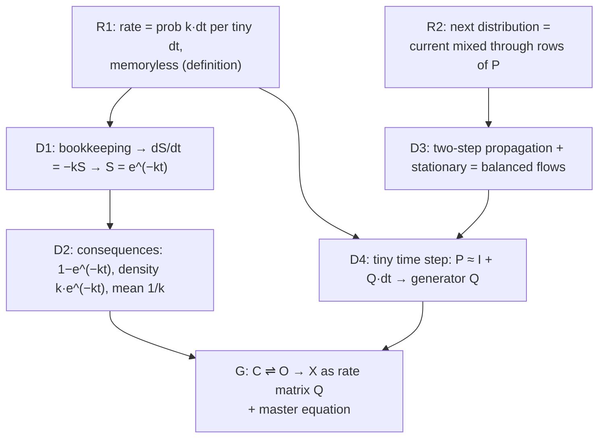

 # let's continue from the last lesson

> [!quote] YOU

> [!note] SKILL loaded: teach

Teach me: let's continue from the last lesson. Use lesson slug "let-s-continue-from-the-last-lesson" and note "lessons/let-s-continue-from-the-last-lesson.md". No fixed time budget.

> [!question] Recall — Recall
> A protein flips between two conformations, **C** (closed) and **O** (open), checked once per nanosecond (discrete time). Each step:
> - from C: stays C with prob $0.9$, goes to O with prob $0.1$
> - from O: goes to C with prob $0.5$, stays O with prob $0.5$
>
> 1. Write this as a $2\times 2$ transition matrix $P$ (rows = "from").
> 2. If it starts in C with certainty, what's the probability distribution over {C, O} after **two** steps?
> 3. What's the long-run fraction of time spent in O?
>
> Work on paper and send a photo from the `/phone` page, or type it. If part of it is unfamiliar, give your best guess for that part instead of skipping it.
>
> Work it on paper and send a photo from your phone, or type your answer.

> [!warning] Recall — partial ◐ (40%)
> Your answer (photo):
> ![[work-20261006-181445.jpg|500]]
> Confidence: 10% · 219s
> Read as: Part 1: P labelled rows C, O and columns C, O: [[0.9, 0.1],[0.5, 0.5]]. Part 2: 'if we start in C, step 1: 0.9 (C), 0.1 (O)'; 'Step 2: {0.9,0.1}⊗{0.9,0.1} + {0.9,0.1}⊗{0.5,0.5}' (one trailing '⊗{0.5,0.5}' in the first term is crossed out). No final numbers. Part 3: 'convolution of state O through these sets'. No number.
> First error: Part 2: the step-2 combination ('{0.9,0.1}⊗{0.9,0.1} + {0.9,0.1}⊗{0.5,0.5}') is not well-defined and is never evaluated to a final distribution.
>
> Your transition matrix is correct and clearly labelled, and your one-step distribution (0.9, 0.1) is right. For step 2, the next distribution is the current one times P: 0.9 × (row C) + 0.1 × (row O). Add those up to get actual numbers. For the long run, look for a distribution that P leaves unchanged; a balance between flow C→O and flow O→C will give it.

> [!question] Recall — Recall
> Pure arithmetic, no probability. Let
> $$A = \begin{pmatrix} 2 & 1 \\ 0 & 3 \end{pmatrix}, \qquad \mathbf{v} = (1,\ 4) \text{ (a row vector).}$$
> Compute the row vector $\mathbf{v}A$. Then say in one line what $\mathbf v A$ is in terms of the rows of $A$.

> [!warning] Recall — partial ◐ (70%)
> Your answer (photo):
> ![[work-20261006-181836.jpg|500]]
> Confidence: 100% · 150s
> Read as: Photo is rotated 90°. Top line (partly scribbled out): 'convolution of state 0 through these steps'. Then: 'A = (2 1; 0 3), v = (1, 4) => vA = (1,4)(2 1; 0 3) = (2, 13)'. No statement interpreting vA in terms of the rows of A.
> First error: Did not answer the second part: no description of vA in terms of the rows of A.
>
> Your product (2, 13) is correct. You skipped the second part of the question, which asks what vA is in terms of A's rows. Look at how each entry of v multiplies an entire row of A, and say that in one line.

> [!question] Recall — Recall
> A quantity $S(t)$ obeys
> $$\frac{dS}{dt} = -k\,S, \qquad S(0)=1.$$
> 1. What is $S(t)$?
> 2. Show that your answer really satisfies the equation (differentiate it).
> 3. In words: what is this equation saying about how $S$ shrinks?

> [!failure] Recall — incorrect ✗ (5%)
> Your answer (photo):
> ![[work-20261006-182347-1.jpg|500]]
> ![[work-20261006-182347-2.jpg|500]]
> Confidence: 70% · 267s
> Read as: Photo 1 (bottom section, under '1)'): the learner copied the equation as "s(t) obeys dS/dt = -k, S(0)=1", omitting the factor S. They then wrote "dS = -k dt => S = -kt + 1" (boxed). Photo 2: "2) dS/dt = d/dt[-kt+1] = -k" with "dS/dt = -k" boxed. "3) S gets infinitely negative, so it 'shrinks' linearly." The earlier content in photo 1 (Markov steps, a matrix product) belongs to other questions and was ignored.
> First error: Copying the equation as dS/dt = -k, dropping the factor S on the right-hand side; this led to S = 1 - kt instead of an exponential.
>
> Your integration and differentiation steps were done cleanly, and S(0)=1 checks out. However, you dropped the S on the right side: the equation is dS/dt = -k·S, so the rate of change depends on how much S is left. Redo it with that factor; try separating variables (dS/S = -k dt). Then ask what it means for the loss rate to be proportional to the amount remaining, and whether S could ever go negative.

> [!question] Recall — Recall
> A population of unexchanged amides, as a fraction $S(t)$, obeys
> $$\frac{dS}{dt} = -2\,S(t), \qquad S(0)=1$$
> (note: $S$ appears on **both** sides).
> 1. Solve for $S(t)$; separating variables works.
> 2. Is $S$ ever negative? Why or why not?

> [!warning] Recall — cancelled
> (user skipped)

> [!quote] YOU

> [!note] SKILL loaded: teach

Continue the lesson "HDX kinetics math (rates, Markov chains, first-order decay)" (slug: let-s-continue-from-the-last-lesson). No fixed time budget.

> [!abstract] PI

Picking up where we stopped. The probe has covered enough, so I'll skip the last two questions and go to the plan.

**What the probe found:**
- **Rates.** You know the answer $e^{-kt}$ but not why it's true. You were 100% sure that $k = 0.1\ \text{s}^{-1}$ means "probability exactly $0.1$ per second". That's the central misconception. It's also why your density was missing its factor of $k$.
- **First-order decay.** Your calculus is clean. But you read $\frac{dS}{dt} = -kS$ as $\frac{dS}{dt} = -k$. The idea that **the loss is proportional to what's left** hasn't sunk in yet.
- **Matrices.** You can write the transition matrix and compute $\mathbf{v}A$ correctly. What's missing is what that product *means*: the next distribution is a mix of the rows, weighted by the current distribution. That's why the two-step propagation stalled.

**The approach.** Everything in your bleed.py note rests on one idea, rates, so we start there and build up:
1. **What a rate is.** This is a definition you can take as given: the probability of the event in a tiny interval $dt$ is $k\,dt$, regardless of history.
2. **Bookkeeping.** Of the sites still unexchanged, a fraction $k\,dt$ is lost in each $dt$. That gives $\frac{dS}{dt} = -kS$ and then $e^{-kt}$. You'll derive it yourself.
3. **Consequences.** We'll get the probability of exchange by time $t$, the density $k e^{-kt}$, and the mean lifetime $1/k$. We'll also see why the answer for one second is $0.095$, not $0.1$.
4. **The Markov side,** in parallel. Your next distribution is your current one mixed through the rows of $P$. From that: two-step propagation, and the stationary state as a balance of flows.
5. **Merge the two.** Take the time step down to a tiny $dt$, so $P \approx I + Q\,dt$. Rates then become the entries of the generator $Q$.
6. **Goal.** Write closed ⇌ open → exchanged as a 3-state rate matrix and its master equation. That's the first real step toward your HDX milestone (Linderstrøm-Lang → EX1/EX2), and it's item 1 of your bleed.py roadmap.

Steps R1 to D2 are where you're weakest, so I'll work one full example first and then fade into you doing the steps. The Markov stretch will be more Socratic, since the floor there is already solid.

Does this plan work for you, or would you change the scope? For example, we could stop at D2 and do the matrix side another day.

> [!quote] YOU

let's begin

> [!question] Recall — Predict
> Start with 1000 unexchanged amide sites. Chop one second into 10 slices of 0.1 s. In each slice, every site that is STILL unexchanged has probability 0.01 of exchanging in that slice (that's k = 0.1 per second times 0.1 s). Exchanged sites stay exchanged.
>
> Roughly how many sites are still unexchanged after the full second? Exactly 900, more than 900, or fewer than 900? Commit to an answer and give your reason. You don't need an exact number, but you can compute one if you like.

> [!warning] Recall — cancelled
> (user skipped)

> [!quote] YOU

> [!note] SKILL loaded: teach

Continue the lesson "HDX kinetics math (rates, Markov chains, first-order decay)" (slug: let-s-continue-from-the-last-lesson). No fixed time budget.

> [!question] Recall — Predict
> 1000 unexchanged amide sites. Split one second into 10 slices of 0.1 s. In each slice, every site that is STILL unexchanged has a 1% chance of exchanging (exchanged sites stay exchanged).
>
> After the full second, are there exactly 900 unexchanged, more than 900, or fewer than 900? One line of reasoning is enough.

> [!warning] Recall — hint requested
> No attempt yet; asked for a hint.

> [!abstract] PI

Hint: forget the whole second for now and go one slice at a time.

> [!question] Recall — Predict
> Same setup: 1000 unexchanged sites, and each slice every still-unexchanged site has a 1% chance to exchange.
>
> 1. How many sites exchange in slice 1, and how many unexchanged are left?
> 2. How many exchange in slice 2? (1% of what?)
> 3. From that: after all 10 slices, exactly 900 left, more than 900, or fewer?

> [!warning] Recall — partial ◐ (60%)
> Your answer: 1% exchange in slice 1. Ahh I see, so the raw number of 1% get's smaller and smaller eachslice, so it must be greater than 900
> Confidence: 70% · 73s
> Read as: The learner said '1% exchange in slice 1' and that the raw number lost each slice (1% of the current pool) gets smaller, so more than 900 remain after 10 slices. They gave no counts for slice 1 or slice 2.
> First error: Part 1: only says '1% exchange' instead of giving the counts (10 exchange, 990 left), and part 2 never states the base or the count for slice 2.
>
> Your conclusion of more than 900 is correct, and the reason is right: each slice removes 1% of a shrinking pool, so the absolute loss gets smaller. However, you didn't answer parts 1 and 2 with numbers. You never stated how many sites exchange and remain after slice 1, or what slice 2's 1% is taken of.

> [!abstract] PI

Now the explain-back to close R1. Work from memory, not by scrolling up.

> [!question] Recall — Explain it back
> In your own words:
> 1. What does it mean for an amide to exchange with rate k = 2 per second? (State the definition.)
> 2. Why is the chance of exchanging within 0.5 s NOT 2 x 0.5 = 100%? What does the definition say that rules it out?

> [!warning] Recall — partial ◐ (40%)
> Your answer: 1. it means that exchanged population goes as 1-e(-2t). The unexchanged population decreases at the rate of -2e^-2t
> 2. It's a differential dependent on the current population.
> Confidence: 70% · 367s
> Read as: The learner says part 1 means the exchanged population follows 1 - e^(-2t), with the unexchanged population decreasing at rate -2e^(-2t). For part 2, they say it is a differential that depends on the current population.
> First error: Part 1 gives the solution 1 - e^(-2t) instead of the definition. It never says that k·dt is the probability of exchanging in a tiny interval dt for an amide that has not yet exchanged.
>
> Your exponential formula is right, and in part 2 you correctly sense that the rate depends on the current (surviving) population. However, part 1 states a result, not what k = 2/s means; nothing in your answer says that 2·dt is a probability only for a tiny dt. Part 2 doesn't explain why multiplying 2 × 0.5 fails, namely how applying the rate only to the shrinking pool of survivors makes the losses compound.

> [!question] Recall — Explain it back
> An amide that is still unexchanged has rate k = 2 per second.
>
> 1. What is its probability of exchanging in the next 0.001 s? Which rule gives you that number?
> 2. Someone uses the same rule for 0.5 s and gets 2 x 0.5 = 1, i.e. 100%. In one or two sentences: what does the rule assume that stops being true over 0.5 s?

> [!failure] Recall — incorrect ✗ (5%)
> Your answer: so the change in entropy is ds/dt = -2s. meaning the  entropy in time is s(t) = e^-2t. Probability of being unexchanged  s(t)/z = 1/2e^(-2t). so probability is 1/2e^(-0.002)
> 2. it's 1/2 e^(-1)
> Confidence: 10% · 422s
> Read as: The learner wrote ds/dt = -2s, giving s(t) = e^(-2t), called it 'entropy', and divided by an unexplained z to get a probability of (1/2)e^(-0.002) for part 1. For part 2 they wrote only '1/2 e^(-1)'.
> First error: Part 1: s(t) is labeled 'entropy' and divided by an undefined z, so the result (1/2)e^(-0.002) is not the probability of exchanging in 0.001 s. The k·dt rule and the value 0.002 never appear.
>
> Writing the survival curve as ds/dt = -2s, s = e^(-2t), shows you see the exponential decay behind this problem. However, s is not entropy, the division by z has no basis, and (1/2)e^(-0.002) is not the probability of exchanging in 0.001 s; the simple rule that gives that number is never named. Part 2 gives only a number, with no statement of what the rule assumes or why that assumption fails over 0.5 s.

> [!abstract] PI

Let's stop and look at what happened, because it's useful. You got the right ODE, $dS/dt = -2S$, which you'd dropped last time. Then you pulled in entropy and a partition function $z$. Neither one belongs here. Your 10% confidence was accurate: you were reaching for heavy machinery because the question looked like it ought to need some.

**It doesn't.** Part 1 is just one multiplication. That's the whole point of the definition. Here's a worked example from start to finish. Read it, and then you'll do the next one.

---

### Worked example: $k = 5\ \text{s}^{-1}$

**Q1. Chance of exchanging in the next $0.0001$ s?**

The definition says: tiny interval, so the probability is $k \cdot dt$.
$$
5 \times 0.0001 = 0.0005
$$
That's it. No exponential and no ODE. *Why is it safe?* Over an interval that short, the chance is so small ($0.05\%$) that two exchanges in the same slice are out of the question. It's also linear: double a tiny interval and you double the chance.

**Q2. Chance of exchanging within $0.2$ s?** Naively it's $5 \times 0.2 = 1$, i.e. 100%. Is that right?

No. $k\,dt = 1$ isn't small, so we're outside the region where the definition applies. What we do is cut $0.2$ s into tiny slices where the rule *does* hold, and chain them:
- Use 1000 slices of $0.0002$ s. In each slice a survivor exchanges with probability $5 \times 0.0002 = 0.001$, so it stays unexchanged with probability $0.999$.
- Staying unexchanged through **all** 1000 slices: $0.999^{1000} \approx 0.368 = e^{-1}$.
- So the chance of exchanging within 0.2 s is $1 - 0.368 \approx 0.63$, not 1.

The naive answer failed because $k \cdot t$ counts every slice as though the site were still there to exchange. Sites that have already exchanged can't exchange again, so the losses compound.

**The pattern:**
- **Tiny interval:** multiply, $k\,dt$.
- **Long interval:** chain tiny slices on survivors, which gives $e^{-kt}$ unexchanged.

The $e^{-kt}$ you already know is what you get from chaining. It isn't the definition.

---

Your turn. This one has the same structure, and I've already done most of part 2.

> [!question] Recall — Explain it back
> Rate k = 10 per second.
>
> 1. Probability an unexchanged site exchanges in the next 0.00001 s? (One multiplication.)
> 2. Probability it exchanges within 0.1 s. Naive k t = 10 x 0.1 = 1 is wrong. Chain 1000 slices of 0.0001 s:
>    - per-slice chance of exchanging = ?
>    - chance of surviving all 1000 slices = ?^1000 ≈ ?
>    - so P(exchanged within 0.1 s) ≈ ?

> [!failure] Recall — incorrect ✗ (25%)
> Your answer (photo):
> ![[work-20261010-113615-1.png|500]]
> ![[work-20261010-113615-2.png|500]]
> Confidence: 10% · 1163s
> Read as: Part 1: k=10, t=10^-5, P_exch ≈ k·t = 10^-4 (boxed). Part 2: writes ds/dt = -10s ⇒ s(t)=e^{-10t}, then normalizes to a density P(t)=10e^{-10t} (noting 'this feels wrong...'); per slice ≈ 10^-4; chance of surviving 1000 slices ≈ (1-10^-4)^1000 with 'dt=10^-5' noted; final P(0.1) = 10e^{-10·0.1} = 10/e (boxed). The '1000' exponent and 'dt=10^-5' annotation are small and slightly hard to read but appear as transcribed.
> First error: Part 2 per-slice chance given as 10^-4 (uses dt=10^-5 instead of the 0.0001 s slice width; should be 10 × 0.0001 = 0.001).
>
> Part 1 is correct (k·dt = 10^-4), and the survival equation ds/dt = -10s ⇒ s(t) = e^{-10t} is right. In part 2 the per-slice chance uses the part-1 slice width (10^-5 s) instead of the stated 0.0001 s slices, so the survival product (1-10^-4)^1000 is off and is never evaluated. The final answer 10/e evaluates a probability density at t=0.1 rather than the probability of having exchanged by then, and since it is greater than 1 it cannot be a probability.

> [!abstract] PI

That one took nearly 20 minutes, which tells me this is real effort, not coasting.

> [!question] Question
> How do you want to continue?
>
> 1. One more short go at the chaining step, then keep going (Recommended)
> 2. One more short go, then pause for today
> 3. Pause now

> [!example] Answer
> 1. One more short go at the chaining step, then keep going (Recommended)

> [!question] Recall — Explain it back
> Rate k = 4 per second. We want P(exchanged within 0.25 s). Don't use any formula you've memorized; just chain slices.
>
> Cut 0.25 s into 1000 slices.
> 1. Width of one slice = ?
> 2. Chance a survivor exchanges in one slice = k x width = ?
> 3. Chance it survives all 1000 slices = (1 - that)^1000 ≈ ?   (hint: 0.999^1000 ≈ 0.368)
> 4. P(exchanged within 0.25 s) = ?
> 5. One line: why is it not 4 x 0.25 = 1?

> [!failure] Recall — incorrect ✗ (30%)
> Your answer: 1. 0.25/1000
> 2. 0.25/1000 * 4
> 3. (1 - 0.25/1000 * 4)^1000
> 4.  1/4 e^-(1)
> 5. because k ~ t, so we cannot utilize a linear approximation.
> Confidence: 70% · 222s
> Read as: The learner gave expressions rather than numbers for 1–3: width = 0.25/1000, per-slice chance = 4·0.25/1000, survival = (1 − 4·0.25/1000)^1000. For 4 they wrote (1/4)·e^(−1), and for 5 they said 'because k ~ t, so we cannot utilize a linear approximation.'
> First error: Step 4: P(exchanged) was given as (1/4)e^(−1) ≈ 0.092 instead of 1 minus the survival probability from step 3.
>
> Your slice setup in steps 1–3 is right: width 0.25/1000, per-slice chance 4 × that, and survival as that factor raised to the 1000th power. You left them as expressions, though, not numbers. Step 4 does not follow from step 3: (1/4)e^(−1) ≈ 0.09 is neither the survival chance nor its complement, and the 1/4 factor has no basis in the slice chain. Step 5 does not name why 4 × 0.25 fails; 'k ~ t' says nothing about who is left to exchange in each slice.

> [!question] Recall — Explain it back
> No memorized formulas, and no 'e' allowed in your answer.
>
> Your step 3 gave survival through 0.25 s = (1 - 0.001)^1000 ≈ 0.368.
>
> 1. P(exchanged by 0.25 s) = ?  Say why in one line.
> 2. Now a different site: its chain gives survival through some time ≈ 0.05. P(exchanged by then) = ?

> [!failure] Recall — incorrect ✗ (0%)
> Your answer: 1. its approximately 0.368 since we're taking small slices through the entire inveral of time
> 2. it's (1 - 0.001)^2000
> Confidence: 70% · 133s
> Read as: Part 1: the learner says P(exchanged by 0.25 s) is approximately 0.368, reasoning that we take small slices across the whole interval. Part 2: the learner gives (1 - 0.001)^2000 as the probability of being exchanged.
> First error: Part 1: the survival probability 0.368 is reported as the probability of being exchanged, without taking the complement.
>
> You correctly recalled that 0.368 comes from multiplying many small-slice survival factors. However, 0.368 is the chance of surviving all slices, not the chance of being exchanged, and your answer never explains how those two events relate. In part 2, (1 - 0.001)^2000 is still a survival-style product and doesn't use the given survival value of 0.05.

> [!question] Recall — Explain it back
> A tube holds 1000 amide sites. Every site is in exactly one of two states: unexchanged (still H) or exchanged (now D).
>
> After 0.25 s you count 368 sites still unexchanged.
>
> 1. How many sites are exchanged?
> 2. So what fraction of sites is exchanged?
> 3. In general: if a fraction S of sites is still unexchanged, what fraction is exchanged?

> [!success] Recall — correct ✓ (100%)
> Your answer: 1. there are 632 exchanged sites
> 2. 632/1000
> 3. (1-S)
> Confidence: 100% · 122s
> Read as: The learner answered: (1) 632 sites are exchanged, (2) the exchanged fraction is 632/1000, (3) if a fraction S is unexchanged, the exchanged fraction is 1 − S.
>
> All three are right: 632 exchanged sites, a fraction of 632/1000 (0.632), and 1 − S in general. These follow from each site being in exactly one of the two states. You did not spell out that reason, but the answers are consistent with it.

> [!question] Recall — Explain it back
> Tube of 1000 sites, rate k = 4 per second, time 0.5 s. Cut 0.5 s into 1000 slices. Give NUMBERS.
>
> 1. Chance a still-unexchanged site exchanges in one slice = ?
> 2. Fraction surviving all 1000 slices ≈ ?   (use: 0.998^1000 ≈ 0.135)
> 3. How many of the 1000 sites are exchanged at 0.5 s?
> 4. P(one site exchanged by 0.5 s) = ?

> [!failure] Recall — incorrect ✗ (5%)
> Your answer: 1. dt = 5*10^-5. So dt * 4 = 2 * 10^-4
> 2.  0.81
> 3. 190
> 4. 0.81
> Confidence: 70% · 253s
> Read as: Learner wrote dt = 5×10^-5 s and k·dt = 2×10^-4 per slice; fraction surviving 0.81; 190 sites exchanged; P(one site exchanged) = 0.81.
> First error: Step 1: slice width computed as 5×10^-5 s instead of 0.5/1000 = 5×10^-4 s, giving k·dt = 2×10^-4 rather than 0.002.
>
> You set up step 1 the right way, multiplying the rate by the slice width. But the slice width is off by a factor of 10, and that error carries into steps 2 and 3 instead of using the given 0.998^1000 ≈ 0.135. In step 4, your 0.81 is your own surviving fraction, not the exchanged fraction, so it contradicts your answer of 190 exchanged in step 3.

> [!question] Recall — Explain it back
> Label every number with what it is, e.g. "0.6 = fraction unexchanged".
>
> Tube of 1000 sites. At some time, the slice chain says (1 - 0.002)^1000 ≈ 0.135.
>
> 1. 0.135 = fraction ______ (fill in the word).
> 2. Number of exchanged sites = ? (label it)
> 3. P(one chosen site is exchanged) = ? (label it)

> [!failure] Recall — incorrect ✗ (0%)
> Your answer: 1. exchanged
> 2. 135
> 3. 0.135
> Confidence: 70% · 220s
> Read as: The learner wrote: 1. 0.135 = fraction exchanged; 2. 135 (no label); 3. 0.135 (no label).
> First error: Part 1: labeled 0.135 as fraction 'exchanged'. (1-0.002)^1000 is the product of per-slice survival probabilities, so it is the fraction that was never exchanged.
>
> Your answers are consistent with each other, but they all rest on reading 0.135 as the exchanged fraction. (1 - 0.002) is the chance a site is NOT exchanged in one slice, so raising it to the 1000th power gives the fraction that survived every slice. That inversion carries into parts 2 and 3, and those two answers also have no labels, which the question asked for.

> [!question] Recall — Explain it back
> 1000 sites. In each slice, 20% of the sites that are still unexchanged exchange.
>
> 1. Unexchanged after slice 1 = ?   After slice 2 = ?
> 2. What does the number 0.8 stand for here? (one phrase)
> 3. 0.8^2 = 0.64 is the fraction ______ after 2 slices. So the fraction exchanged after 2 slices = ?

> [!warning] Recall — partial ◐ (50%)
> Your answer: 1. 800, 640
> 2. it is the fraction of sites unechanged
> 3. unexchanged
> Confidence: 70% · 310s
> Read as: Learner answered: (1) 800 and 640; (2) 0.8 is 'the fraction of sites unexchanged'; (3) filled the blank with 'unexchanged' but gave no value for the fraction exchanged after 2 slices.
> First error: Part 2: 0.8 is described as 'the fraction of sites unexchanged' without the per-slice sense (the share of still-unexchanged sites that survive one slice).
>
> Your counts after slices 1 and 2 (800, 640) are correct, and 0.64 is correctly labeled as the fraction unexchanged. Your description of 0.8 leaves out that it applies per slice to the sites still unexchanged, and could be confused with the overall unexchanged fraction. Part 3's second question, the fraction exchanged after 2 slices, was not answered.

> [!question] Recall — Explain it back
> One question, two numbers.
>
> Each slice, 50% of the still-unexchanged sites exchange. After 3 slices:
> - fraction still unexchanged = ?
> - fraction exchanged = ?

> [!success] Recall — correct ✓ (90%)
> Your answer: (0.5^3) unexchanged fraction
> (1-0.5^3) exchanged
> Confidence: 70% · 132s
> Read as: The learner gave unexchanged = 0.5^3 and exchanged = 1 − 0.5^3, as unevaluated expressions.
>
> Both quantities are right: 0.5^3 correctly compounds the 50% survival per slice over 3 slices, and the exchanged fraction is correctly its complement, 1 − 0.5^3. The answers are left as expressions rather than evaluated to decimal values.

> [!question] Question
> You've put in a long stretch, and the last few answers took longer and were shorter, which looks like fatigue. Do the R1 explain-back now, or pause?
>
> 1. Pause now; start next time with the R1 explain-back (Recommended)
> 2. Do the R1 explain-back now

> [!example] Answer
> 2. Do the R1 explain-back now

> [!question] Recall — Explain it back
> Explain in your own words, no memorized end-formulas:
>
> An amide exchanges with rate k = 3 per second.
> 1. What does "rate 3 per second" mean? State it as a rule about a tiny time slice dt.
> 2. How would you use that rule to get the chance it is still unexchanged after 1 second? Describe the steps (slices → per-slice factor → combine).
> 3. Why is P(exchanged within 1 s) not 3 x 1 = 300%?

> [!failure] Recall — incorrect ✗ (15%)
> Your answer: 1. rate 3 per second actually means, rate 3 per second... that's the definition of a rate... Additionally, we can get a decay function e^-kt that descibes the population change over time. for t << k this is linear, so probability of exchange is ds = k * dt where dt is very small. (this is because a change in entropy IS a probability)
> 2. we can extend that approximation by multiplying the probability of exchange with itself by the number of slices to fill the bigger interval. 
> 3. because in this regiem t and k are comprable.
> Confidence: 100% · 392s
> Read as: The learner says the rate is a 'definition of a rate', invokes the end-formula e^-kt, and says for small times the exchange probability is k·dt (justified via entropy). For part 2 they multiply the probability of exchange by itself once per slice; for part 3 they say t and k are comparable.
> First error: Part 1: the k·dt rule is not tied to still-unexchanged sites and is justified by the memorized e^-kt and a false entropy claim. The decisive error is Part 2: multiplying the exchange probability by itself instead of the per-slice survival factor (1 − k·dt).
>
> You correctly gave probability ≈ k·dt for a very small dt, but you got there from the memorized e^-kt and a claim that entropy change is a probability, which is not true. In part 2, multiplying the exchange probability k·dt by itself across slices computes the wrong quantity: it shrinks toward zero rather than giving the chance of staying unexchanged, and nothing links it to the exchanged fraction. In part 3, 'k and t are comparable' says k·t is not small but does not explain why the k·t estimate overshoots.

> [!abstract] PI

We're stopping here for today. We didn't get past the first node, R1 (what a rate is), and it's still not confirmed.

**What you showed you can do:**
- Your prediction was right: when 1% of the remaining sites exchange in each slice, more than 900 of 1000 are left after 10 slices, because the pool shrinks.
- You worked out $k \cdot dt$ for a tiny time slice on your own.
- With counts, you chain survival factors and take the complement correctly ($0.5^3$ unexchanged, $1 - 0.5^3$ exchanged).

**Still shaky:**
- Doing the same thing abstractly. In the final explain-back you multiplied $k\,dt$ by itself instead of multiplying the survival factors $(1 - k\,dt)$.
- Mixing up a density and a probability: $10/e$ came out bigger than 1, so it can't be a probability.
- Entropy keeps creeping in. I'm fairly sure the letter $S$ is setting it off.

**One thing to notice before next time:** at the last step, you tend to drop your own working and reach for a remembered formula, usually feeling sure about it. When you catch yourself doing that, finish from the line you just wrote instead.

**Next time** we start with the R1 explain-back, writing the unexchanged fraction as $U(t)$ instead of $S$: counts first, then the general rule. After that comes D1, where $dU/dt = -kU$ falls straight out of the slice picture. I saved one review card on survival factors.

> [!quote] YOU

> [!note] SKILL loaded: teach

Continue the lesson "HDX kinetics math (rates, Markov chains, first-order decay)" (slug: let-s-continue-from-the-last-lesson). No fixed time budget.

> [!abstract] PI

Picking the lesson back up at R1, the rate definition. Last time the concrete counting worked and the abstract version didn't, so I'll rebuild R1 with one fully worked example in $U(t)$ notation, then hand the next one to you with blanks, then the full explain-back. Then D1.

**Notation for the whole lesson:** $U(t)$ = the number of sites still **u**nexchanged at time $t$. Nothing else. Not entropy, not probability. A count.

**Worked example.** A tube with 1000 sites, rate $k = 2$ per second. Cut time into slices of width $dt = 0.01$ s.

- **The rule (R1):** in one slice, each still-unexchanged site exchanges with probability $k\,dt = 2 \times 0.01 = 0.02$. The site has no memory: this probability is the same in every slice, no matter how long the site has already survived.
- **Slice 1.** $U(0) = 1000$. Sites that exchange in this slice: $0.02 \times 1000 = 20$. So $U(0.01) = 1000 - 20 = 980$. Note that $980 = 1000 \times (1 - 0.02) = 1000 \times 0.98$. The factor $0.98$ is the **survival factor**: the share of the still-unexchanged sites that make it through one slice.
- **Slice 2.** The rule applies to the 980 survivors, not to the original 1000. Exchange: $0.02 \times 980 = 19.6$. So $U(0.02) = 980 \times 0.98 = 960.4 = 1000 \times 0.98^2$.
- **Slice $n$.** Every slice multiplies $U$ by the same $0.98$: $U(n\,dt) = 1000 \times 0.98^n$.
- **Exchanged by then** is whatever is missing from the tube: $1000 - U(n\,dt)$. That is the only place a "1 minus" appears, and it is a subtraction of counts.

Two things to notice. The number that gets multiplied slice after slice is the survival factor $1 - k\,dt$, never $k\,dt$ itself. And the amount exchanged in a slice ($20$, then $19.6$, ...) shrinks, because the rule is applied to a shrinking pool.

Now the same structure with different numbers. Fill in the blanks.

> [!question] Recall — Problem
> Tube of 400 sites, rate $k = 5$ per second, slice width $dt = 0.01$ s. Label every number with what it is.
>
> 1. $k\,dt = $ ? and the survival factor for one slice $= $ ?
> 2. $U(0.01) = $ ? (number of sites still unexchanged after slice 1)
> 3. $U(0.03) = $ ? (after 3 slices), and the number of sites exchanged by $t = 0.03$ s $= $ ?

> [!warning] Recall — partial ◐ (70%)
> Your answer: 1. 5 * 0.01 = 0.05
> 2. U(0.01) = (1-0.05) * 400 =  400 - 20 * 10^-2 = 398
> 3. 342.95 unexchanged, 57.05 exchanged
> Confidence: 100% · 343s
> Read as: The learner wrote $k\,dt = 5 \times 0.01 = 0.05$ with no label and no separate survival factor. They set up $U(0.01) = (1-0.05) \times 400$ but evaluated it as $400 - 20 \times 10^{-2} = 398$, and gave $342.95$ unexchanged and $57.05$ exchanged at $t = 0.03$ s.
> First error: Part 2: $(1-0.05) \times 400$ was evaluated as $400 - 20 \times 10^{-2} = 398$; the 20 exchanged sites were wrongly scaled by $10^{-2}$.
>
> Your method is right: you multiply by $(1-0.05)$ per slice, and part 3 ($342.95$ unexchanged, $57.05$ exchanged) is correct and well labelled. Part 2 has an arithmetic error: $(1-0.05) \times 400$ is not $398$, because the $20$ exchanged sites were turned into $20 \times 10^{-2}$. This also makes part 2 inconsistent with part 3. In part 1, $0.05$ is not labelled as a per-slice probability, and the survival factor is never stated.

> [!abstract] PI

Your method was right: multiply $U$ by the survival factor $0.95$ each slice, and exchanged $= 400 - U$. That is R1 working. The miss is arithmetic in part 2. Here is your line again:

$$U(0.01) = (1 - 0.05) \times 400 = 400 - 20 \times 10^{-2} = 398$$

Your part 3 says $342.95$ sites remain after three slices, which cannot follow from $398$ after one slice. Look at the step from $(1-0.05)\times 400$ to $400 - 20\times10^{-2}$. Tell me where it goes wrong and what $U(0.01)$ should be, and I'll pose it formally for grading.

> [!quote] YOU

what went wrong is that I didn't multipy the magnitude of 400 into the rhs.

> [!abstract] PI

Right: $0.05 \times 400 = 20$ already, so the $10^{-2}$ was applied twice. Confirm it with the number:

> [!question] Recall — Find the flaw
> Your line was $U(0.01) = (1 - 0.05) \times 400 = 400 - 20 \times 10^{-2} = 398$.
>
> Rewrite it correctly: $U(0.01) = $ ? sites unexchanged, and ? sites exchanged in slice 1.

> [!success] Recall — correct ✓ (90%)
> Your answer: U(0.01) = (1-5*10^-2) * 4*10^2 = (400 - 20) = 380
> Confidence: 100% · 47s
> Read as: The learner wrote $U(0.01) = (1-5\times 10^{-2}) \times 4\times 10^{2} = 400 - 20 = 380$. This gives $380$ unexchanged. The $20$ appears as the amount subtracted, but it is not explicitly labeled as the number exchanged.
>
> You computed $0.05 \times 400 = 20$ correctly, which fixes the earlier slip of writing it as $20 \times 10^{-2}$, and you got $U(0.01) = 380$ unexchanged. The $20$ exchanged in slice 1 shows up only as the subtracted term in $400 - 20$; it was not stated as the answer to the second blank.

> [!abstract] PI

Good, $380$ left and $20$ gone. Logging that, then the abstract version of R1.

> [!question] Recall — Explain it back
> In your own words, with $U(t)$ = number of sites still unexchanged at time $t$:
>
> 1. What does "rate $k$" mean for one still-unexchanged site during a tiny slice $dt$? One sentence.
> 2. Write how $U(t + dt)$ follows from $U(t)$, and say in words why that factor is what gets multiplied slice after slice (rather than $k\,dt$).

> [!failure] Recall — incorrect ✗ (5%)
> Your answer (photo):
> ![[work-20261010-144557.png|500]]
> Confidence: 10% · 1465s
> Read as: The learner wrote $\frac{dU}{dt} = kU(t)$ (labelling $k$ as 'rate' and $U(t)$ as 'population'), then $\frac{dU}{dt}\frac{1}{U} = k$, and for part 1: 'For a tiny slice, rate $k$ is the rate it will exchange at, at any time.' For part 2 they wrote $U(t) = e^{-kt}$, $dU = U(t+dt)$, and 'dt is a small change / infinitesimal.'
> First error: Part 1 never states that a surviving site exchanges with probability $k\,dt$ in the slice, and the ODE is written as $\frac{dU}{dt} = kU$ with the wrong sign.
>
> Your answer to part 1 does not say what happens to a single surviving site in one slice $dt$; calling $k$ 'the rate it will exchange at' just repeats the word. Your equation $\frac{dU}{dt} = kU$ has a sign error. In part 2, $U(t) = e^{-kt}$ is the end result rather than the slice-to-slice step, $dU = U(t+dt)$ is not correct, and there is no relation between $U(t+dt)$ and $U(t)$ and no explanation of which factor carries over from slice to slice.

> [!abstract] PI

Here's what happened: the moment letters showed up, you dropped the slice picture and reached for remembered fragments ($e^{-kt}$, a $dU/dt$ equation). That is the same move as last session, and none of it is needed yet. The abstract line is literally your concrete line with the numbers replaced by their names.

Your concrete line was $U(0.01) = 400 \times 0.95$, where $400 = U(0)$ and $0.95 = 1 - 0.05 = 1 - k\,dt$.

Swap each number for its symbol and write the general one-slice step: $U(t + dt) = \;?$ No $e$, no derivatives, just the swap. Type it and I'll put it to the grader.

> [!quote] YOU

yes but that doesn't say WHY at all. Me doing that will just be "Because this result needs to fill the interval under the change in time, So we just multiply the slice out until we've completed the number of dt to make our time"

> [!abstract] PI

Fair, and that's the right thing to want. Here's the why, in two moves.

**Why $k\,dt$ at all.** "Rate $k = 5$ per second" is a chance per unit time. A chance per second times a stretch of seconds is a chance. For a tiny stretch $dt$ that's $k\,dt$. It only works for tiny $dt$ because a site that already left can't leave again, so over a long stretch the chance can't keep growing linearly. That's all a rate is: the constant that turns a tiny time into a probability.

**Why the thing you multiply is $1 - k\,dt$.** Ask what a site has to do to still be in the tube after two slices. It has to survive slice 1 **and** survive slice 2. Two independent things both happening: multiply their chances, $(1 - k\,dt)(1 - k\,dt)$. The survivors are the only sites still playing the game, so "survive, then survive, then survive" is the chain, and each link is $1 - k\,dt$.

Now ask what $(k\,dt)(k\,dt)$ would mean: exchange in slice 1 **and** exchange in slice 2. A site exchanges once and leaves. That event is impossible. So $k\,dt$ never chains; it is the chance of the one exit, applied each slice to whoever is still there. And "exchanged by $t$" is just "didn't survive every slice", which is why it is $1$ minus the survival product.

So your sentence, "multiply the slice out until we've filled the time", is right about the *number* of factors. The why is: each factor is a survival because surviving is the only thing a site can do repeatedly.

Give that back to me:

> [!question] Recall — Explain it back
> A site is still unexchanged at the start of slice 1, each slice has width $dt$, rate $k$.
>
> 1. Why is the chance it is still unexchanged after two slices $(1 - k\,dt)^2$?
> 2. Why is $(k\,dt)^2$ not the chance it has exchanged by the end of slice 2, and what is that chance instead?

> [!failure] Recall — incorrect ✗ (20%)
> Your answer: I just want to note that you NEVER told me this was a probability per second, and if fact that STILL doesn't make any sense. 
> 1. because we're evaluating the ODE. It's a self referential relationship that we're probing how the "chance" of something exchanging from something that hasn't exchanged yet across perious time.
> 2. (k dt) can't be evaluated because that is impossible to occur. So it has no realistic physical interpretation here since the chance something exchanges after it exchanges is meaninless.
> Confidence: 40% · 324s
> Read as: Part 1: the learner attributes $(1-k\,dt)^2$ to 'evaluating the ODE', a self-referential relationship about the chance of exchanging among sites not yet exchanged, with no mention of surviving slice 1 and slice 2 or multiplying independent survivals. Part 2: the learner says $(k\,dt)^2$ is impossible because a site cannot exchange after it has already exchanged, but gives no expression for the actual chance of having exchanged by the end of slice 2.
> First error: Part 1 explains $(1-k\,dt)^2$ as 'evaluating the ODE' instead of as surviving slice 1 and surviving slice 2, each with chance $1-k\,dt$, with the two multiplied.
>
> In part 2 you correctly saw why $(k\,dt)^2$ fails: a site cannot exchange after it has already exchanged. But part 1 points to the ODE and never explains where the square comes from in terms of what has to happen in each slice. Part 2 also stops at saying $(k\,dt)^2$ is impossible and never gives the actual chance of having exchanged by the end of slice 2.

> [!abstract] PI

You're right, and that's the actual root. I used "chance per unit time" as if it were obvious, and it isn't. Nothing above it can lock in until it does, so we go back to counts, where you're solid, and *define* the rate from them. No ODE exists yet, by the way: we derive it later (D1) from the slice step. Until then, no derivatives, no $e$.

**What a rate is, from counts.** Tube with 1000 unexchanged sites. Watch it for a short window, $0.01$ s. Count how many exchange: say 50.

Definition: $$k = \frac{\text{number that left}}{\text{number present} \times \text{time watched}} = \frac{50}{1000 \times 0.01\ \mathrm{s}} = 5\ \text{per second}.$$

That is the whole meaning of "per second": we divided a count by seconds. $k$ is exits, per site present, per second. Exactly like speed is meters per second: a measured thing, not a probability yet.

**Where the probability comes from.** Rearrange the definition: number that left $= k \times (\text{present}) \times (\text{time}) = 5 \times 1000 \times 0.01 = 50$. Fraction of the present sites that left $= k \times \text{time} = 0.05$. For any single one of those sites, "the fraction of my group that left" is my chance of having left. So $k\,dt$ is a probability for the same reason $v\,dt$ is a distance: rate times a stretch of time.

**Why the stretch must be tiny.** Watch for a full second instead: $k \times 1\ \mathrm{s} = 5$, so 5000 of 1000 sites leave. Impossible. The formula pretends the pool stayed at 1000 the whole time, but the pool drains as sites leave. The fix is the only honest one: cut the second into slices so short that the pool barely changes inside one slice, and redo the count each slice **with the current pool**. That is the entire reason slicing exists.

**The chain, with the reason for each line.**
- Slice 1: 1000 present. Leave: $5 \times 1000 \times 0.01 = 50$. Remain: $950 = 1000 \times 0.95$. The $0.95$ is "fraction that did not leave" $= 1 - k\,dt$.
- Slice 2: the rule applies to who is present now, 950. Leave: $5 \times 950 \times 0.01 = 47.5$. Remain: $902.5 = 950 \times 0.95 = 1000 \times 0.95 \times 0.95$.
- So the square is two slices, two "did not leave" fractions, each applied to the pool the previous one left behind. That is why $(1 - k\,dt)^2$: it's "stayed, then stayed."
- Exchanged by the end of slice 2: whoever isn't in the tube, $1000 - 902.5 = 97.5$. As a fraction, $1 - 0.95^2$. That is the answer to the question you left blank: the chance of having exchanged is $1$ minus the chance of having stayed every slice.

Now one with the last step left blank. Tube of 2000 sites, $k = 2$ per second, slices of $dt = 0.01$ s.

- Fraction leaving per slice $= k\,dt = 0.02$. Fraction staying $= 0.98$.
- After slice 1: $U = 2000 \times 0.98 = 1960$.
- After slice 2: $U = 1960 \times 0.98 = 2000 \times 0.98^2 = 1920.8$.
- Number exchanged by the end of slice 2 $= \;?$

Type the number and one phrase saying why that's the right subtraction.

> [!quote] YOU

> [!note] SKILL loaded: teach

Continue the lesson "HDX kinetics math (rates, Markov chains, first-order decay)" (slug: let-s-continue-from-the-last-lesson). No fixed time budget.

> [!abstract] PI

Picking up where we left off: R1 (what "rate k" means) is close but shaky in the abstract form. I'll warm it up with concrete counts, then do the explain-back, then move to D1.

> [!question] Recall — Problem
> Tube of 1000 unexchanged sites, rate $k = 2$ per second, slice width $dt = 0.05$ s. Label every number.
>
> 1. What is $k\,dt$, and what is it the probability of (for which sites)?
> 2. $U$ after slice 1 = ? After slice 2 = ? (You may leave slice 2 as a product.)

> [!warning] Recall — partial ◐ (60%)
> Your answer: 1. k dt is rate of a likelyhood for exchange for any site. k * dt = 0.1. So there is a 10% chance of exchange within the first slice (dt) for all sites.
> 2. U(0.1) = (1- 0.1) * 1000=  900
> U(0.2) = (1-0.1)^2 *1000.
> Confidence: 5% · 439s
> Read as: The learner wrote $k\,dt = 0.1$, described as a 10% chance of exchange within the first slice "for all sites". They then wrote $U(0.1) = (1-0.1)\times 1000 = 900$ and $U(0.2) = (1-0.1)^2 \times 1000$.
> First error: Part 1: $k\,dt = 0.1$ is described as the exchange probability "for all sites" rather than for sites still unexchanged at the start of the slice.
>
> Your value $k\,dt = 0.1$ is correct, and so is the multiplication by the survival factor $1 - 0.1 = 0.9$ to get $900$ and $1000 \times 0.9^2$. But $0.1$ is not a chance for "all sites" or only the first slice; it applies to whichever sites are still unexchanged at the start of each slice. Your time labels are also off: with $dt = 0.05$ s, the two slices end at $t = 0.05$ s and $t = 0.1$ s, not $0.1$ and $0.2$.

> [!abstract] PI

Right computation, wrong label. $0.1$ is the per-slice chance for each site that is **still unexchanged** at the start of that slice. It applies again in slice 2, slice 3, and so on, but only to the survivors; the sites that already exchanged are out. Also, slices are $0.05$ s wide, so slice 2 ends at $t = 0.1$ s.

Next I'll pose one narrow question on exactly that point: in slice 2, which pool does the 10% act on, and how many exchange. Say "go" when you're ready.

> [!quote] YOU

> [!note] SKILL loaded: teach

Continue the lesson "HDX kinetics math (rates, Markov chains, first-order decay)" (slug: let-s-continue-from-the-last-lesson). No fixed time budget.

> [!quote] YOU

> [!note] SKILL loaded: teach

Continue the lesson "HDX kinetics math (rates, Markov chains, first-order decay)" (slug: let-s-continue-from-the-last-lesson). No fixed time budget.

> [!abstract] PI

I'll pick up where we paused: R1 is shaky, so I'll warm it up with counts before trying the abstract explain-back again. Let me check the lesson note first.

> [!abstract] PI

Picking up at the exact point we left: the per-slice 10% acts on the survivors, not on everyone. One narrow question on that, then the explain-back.

> [!question] Recall — Problem
> Same tube: 1000 sites at $t=0$, $k = 2$ per second, $dt = 0.05$ s, so $k\,dt = 0.1$. After slice 1 there are $U = 900$ unexchanged.
>
> In slice 2, how many sites exchange? State which pool the $0.1$ acts on and give the number.

> [!warning] Recall — partial ◐ (50%)
> Your answer: In slice 2, we see that we have 1000 * (1-0.1)^2 - 900 have exchanged: 90
> Confidence: 100% · 190s
> Read as: The learner wrote that in slice 2, $1000 \cdot (1-0.1)^2 - 900$ have exchanged, giving $90$. They did not say which pool the $0.1$ acts on.
> First error: The pool the $0.1$ acts on is never stated. The expression $1000 \cdot (1-0.1)^2 - 900$ also has its sign reversed: it equals $-90$, not $90$.
>
> Your number $90$ is right, and taking the difference of survivor counts, $810$ versus $900$, is a valid route to it. However, you never said which pool the $0.1$ acts on, which the question explicitly asked for. Your expression $1000(1-0.1)^2 - 900$ also evaluates to $-90$ as written, because the subtraction is backwards.

> [!abstract] PI

Diagnosis: the number 90 was right, but the route hid the mechanism. The direct route is that the per-slice chance $0.1$ acts on the pool present at the start of slice 2, which is the 900 survivors of slice 1, so $0.1 \times 900 = 90$ exchange. Separately, your written expression $1000 \cdot 0.9^2 - 900$ equals $810 - 900 = -90$: the subtraction is backwards; it should be survivors before minus survivors after. Now find both of those in your own line.

> [!abstract] PI

The number 90 was right, but the route hid the mechanism, and the written line has a slip. Two things to find:

- **Which pool the 0.1 acts on.** In slice 2 the per-slice chance $0.1$ applies to the sites present at the start of slice 2, which are the 900 survivors of slice 1, not the original 1000. So the direct route is $0.1 \times 900 = 90$.
- **The subtraction is reversed.** $1000 \cdot 0.9^2 = 810$, so your expression gives $810 - 900 = -90$. It should be survivors before minus survivors after, $900 - 810$.

Next I'll hand you your own line back as a find-the-flaw and ask you to rewrite the 90 as $0.1 \times (\ldots)$ with the pool named in words. Say "go" when ready.

> [!question] Recall — Find the flaw
> Here is your line: "In slice 2, $1000 \cdot (1-0.1)^2 - 900$ have exchanged, giving 90."
>
> Is this right as written? If not, where does it go wrong, and rewrite the 90 directly as $0.1 \times (\ldots)$, filling in the number and saying in words which sites that number counts.

> [!warning] Recall — partial ◐ (50%)
> Your answer: almost, the signs need to be flipped. 900 - 1000⋅(1−0.1) ^2
> Confidence: 0% · 242s
> Read as: The learner said the line is almost right but the signs need flipping, and rewrote it as $900 - 1000\cdot(1-0.1)^2$.
> First error: No rewrite of 90 as $0.1 \times 900$, and no statement that 900 counts the sites still unexchanged at the start of slice 2.
>
> You correctly spotted that the subtraction is reversed: $1000\cdot 0.9^2 - 900 = 810 - 900 = -90$, so the order must be swapped to get 90. Missing: the direct expression of 90 as $0.1 \times (\ldots)$ with the number filled in, and a statement in words of which sites that number counts.

> [!abstract] PI

You found the sign flip. The piece still missing is the direct count, so here it is worked fully with a fresh tube, every move with its reason.

**Worked example.** Tube of 500 sites, $k = 4$ per second, $dt = 0.05$ s.

- $k\,dt = 4 \times 0.05 = 0.2$. Reason: rate times a short stretch of time is the fraction of the *present* pool that leaves in that stretch. So $0.2$ is each present site's chance of exchanging in one slice.
- Slice 1: present $= 500$. Exchange $= 0.2 \times 500 = 100$. Reason: the $0.2$ acts on the 500 present at the start of slice 1. Survivors $= 500 - 100 = 400$.
- Slice 2: present $= 400$, because the 100 that exchanged are gone and the rule only applies to who is still there. Exchange $= 0.2 \times 400 = 80$. Survivors $= 400 - 80 = 320$.
- Check by the other route: survivors before minus survivors after $= 400 - 320 = 80$. Same number, two routes.

The sentence to own: **exchanged in a slice $= k\,dt \times$ (number still unexchanged at the start of that slice).** The pool shrinks each slice, so the count shrinks too: 100, then 80.

Next comes the same structure with one blank for slice 3.

> [!quote] YOU

okay you can mark this as complete. I understand now. k * dt is the odds of exchange from the current population. So if we look out into time, we need to run through the time, which means current population is based on dt_{n-1}. which is why we do the product. and why the 90 get's written as 0.1 x 900.

> [!abstract] PI

That's the right model, stated cleanly: $k\,dt$ acts on the current population, the current population is what the previous slice left, hence the product, hence $0.1 \times 900$. One blank to confirm it, then R1 closes.

> [!question] Recall — Problem
> Tube of 500 sites, $k = 4$ per second, $dt = 0.05$ s, so $k\,dt = 0.2$.
>
> - Slice 1: exchange $= 0.2 \times 500 = 100$, survivors $= 400$.
> - Slice 2: exchange $= 0.2 \times 400 = 80$, survivors $= 320$.
> - Slice 3: exchange $= 0.2 \times (\ldots) = \;?$
>
> Fill the blank with the number and say in one phrase which sites that number counts.

> [!success] Recall — correct ✓ (90%)
> Your answer: 0.2 * 320 = 64. we have 64 exchanged sites from this slice. so that brings the survivors to 320 - 64 = 256
> Confidence: 100% · 208s
> Read as: The learner wrote $0.2 \times 320 = 64$, described $64$ as the sites exchanged in slice 3, and computed the new survivor count as $320 - 64 = 256$. This treats $320$ as the survivors going into slice 3.
>
> You correctly multiplied $k\,dt = 0.2$ by $320$, the survivors from slice 2, to get $64$. Your survivor update $320 - 64 = 256$ is also right. Your phrase described the $64$ exchanged sites; you identified $320$ as the unexchanged sites entering slice 3 only implicitly, through your survivor subtraction, not in so many words.

> [!question] Recall — Recall
> One slice: $U_{\text{new}} = U - k\,dt\,U$.
>
> Rearrange this to give the change per unit time, $\dfrac{U_{\text{new}} - U}{dt}$, as an expression in $k$ and $U$ only. Then say in one phrase what that quantity becomes when $dt$ is made tiny.

> [!failure] Recall — incorrect ✗ (15%)
> Your answer (photo):
> ![[work-20261010-153548-1.png|500]]
> ![[work-20261010-153548-2.png|500]]
> Confidence: 45% · 306s
> Read as: Photo 1: $U_n = U - k\,dt\,U$, then $U_n - U = k\,dt\,U$, boxed $\dfrac{U_n - U}{dt} = kU$. Below: 'when $dt$ is very small', $U_n = U + k\,dt\,U$ with the $k\,dt$ crossed out and marked $\to 0$, 'since $dt \ll U$'. Photo 2, boxed: '$U_n \approx U$ when $dt$ is small'.
> First error: Going from $U_n = U - k\,dt\,U$ to $U_n - U = k\,dt\,U$, the minus sign was lost, which leads to $\dfrac{U_n - U}{dt} = kU$ instead of a negative expression.
>
> The rearrangement idea was right: subtract $U$, then divide by $dt$. But the sign was dropped between your first and second lines, so your boxed $kU$ has the wrong sign; the survivor count is decreasing. For the tiny-$dt$ part, '$U_n \approx U$' only says the change shrinks to zero. It doesn't say what the ratio of change to $dt$ becomes, and the ratio is what was asked about.

> [!abstract] PI

Two things went wrong. First, a sign slip: subtracting $U$ from both sides of $U_n = U - k\,dt\,U$ leaves $U_n - U = -k\,dt\,U$; the minus has to survive, because survivors go down. Second, "$U_n \approx U$" is true but only says the change vanishes; the question is about the change *divided by* $dt$, and that ratio does not vanish, it settles to a definite speed, the one we want. Next I'll hand you your own two lines back to find the slip and box the corrected expression.

> [!question] Recall — Find the flaw
> Here are your two lines: "$U_n = U - k\,dt\,U$, so $U_n - U = k\,dt\,U$, so $\dfrac{U_n - U}{dt} = kU$."
>
> Is this right? If not, where exactly does it go wrong, and what is the corrected boxed expression for $\dfrac{U_n - U}{dt}$?

> [!success] Recall — correct ✓ (100%)
> Your answer (photo):
> ![[work-20261010-153853-1.png|500]]
> ![[work-20261010-153853-2.png|500]]
> Confidence: 100% · 142s
> Read as: The learner wrote "1) no — I lost the sign", then $U_n = U - k\,dt\,U$, boxed the corrected second line $U_n - U = -k\,dt\,U$, and then boxed $\dfrac{U_n - U}{dt} = -kU$ (marked with a star). The handwriting is clear.
>
> You correctly rejected the argument and found the dropped minus sign in the second line: $U_n - U = -k\,dt\,U$, not $+k\,dt\,U$. Your boxed result $\dfrac{U_n - U}{dt} = -kU$ is correct.

> [!question] Recall — Explain it back
> In your own words, on paper. $U(t)$ = number of sites still unexchanged at time $t$, rate $k$.
>
> 1. Starting from the one-slice rule $U_{\text{new}} = U - k\,dt\,U$ (which you can already write), derive $\dfrac{dU}{dt} = -kU$ and say in one sentence what the equation says about how survivors disappear.
> 2. Say why the solution is $U_0 e^{-kt}$ and not $U_0(1 - kt)$: where does the $e$ come from?
>
> Work it on paper and send a photo from your phone, or type your answer.

> [!question] Recall — I don't know
> Your answer: I don't know

> [!abstract] PI

No problem; an "I don't know" on the full thing is fine. We'll take only the first half, and it is nothing new: it is the three lines you boxed a few minutes ago (subtract $U$, divide by $dt$), plus one sentence about what the left side turns into when $dt$ is made tiny. The one idea to hold onto is that "change in $U$ divided by the time it took" is a speed, and as the slice shrinks that speed becomes the derivative $\frac{dU}{dt}$. Next I'll pose just that half.

> [!quote] YOU

so here's my confusion. how do I keep the term from vanishing? le-hospital's rule?

> [!abstract] PI

Good question, and the answer is simpler than L'Hôpital: **there is no 0/0 to rescue.** Look at the line you boxed:
$$\frac{U_{\text{new}} - U}{dt} = -kU.$$
Both sides are *exact*, for every $dt$. The numerator $U_{\text{new}} - U = -k\,dt\,U$ does shrink to zero as $dt \to 0$, but it shrinks *in proportion to* $dt$, so dividing by $dt$ cancels it out before any limit is taken. The ratio is $-kU$ when $dt = 0.05$, when $dt = 0.001$, when $dt = 10^{-9}$. Nothing vanishes.

The limit does only one job: it gives the left side its *name*. For finite $dt$ it is the average speed of $U$ across the slice; as $dt \to 0$ it is the instantaneous speed, $\frac{dU}{dt}$. The right side is untouched.

Concretely, with $U = 1000$, $k = 2$:

| $dt$ | $U_{\text{new}} - U$ | $(U_{\text{new}} - U)/dt$ |
|---|---|---|
| 0.05 | $-100$ | $-2000$ |
| 0.001 | $-2$ | $-2000$ |
| 0.000001 | $-0.002$ | $-2000$ |

Now the first half of the explain-back, on paper.

> [!question] Recall — Explain it back
> Starting from the one-slice rule $U_{\text{new}} = U - k\,dt\,U$, get to $\dfrac{dU}{dt} = -kU$. Then one sentence: what does that equation say about how the survivors disappear, and why doesn't the ratio vanish as $dt \to 0$?
>
> Work it on paper and send a photo from your phone, or type your answer.

> [!warning] Recall — partial ◐ (30%)
> Your answer (photo):
> ![[work-20261010-155802.png|500]]
> Confidence: 75% · 284s
> Read as: Line 1: $U_{\text{new}} = U - k\,dt$ (no factor of $U$ after $dt$ is visible). Line 2: $\dfrac{U_{\text{new}} - U}{dt} = -kU$. Boxed: $\dfrac{dU}{dt} = -kU$. There is no written sentence about how survivors disappear and no explanation of why the ratio does not vanish as $dt \to 0$.
> First error: The first line reads $U_{\text{new}} = U - k\,dt$, which is missing the factor $U$ in $k\,dt\,U$. As written, it does not lead to $-kU$ in the next line.
>
> You kept the minus sign and reached the correct boxed result $\dfrac{dU}{dt} = -kU$. However, your starting line $U_{\text{new}} = U - k\,dt$ is missing the factor $U$, so your second line does not follow from it. The passage from the difference quotient to $dU/dt$ is not stated. The answer also leaves out the two required explanations: what the equation says about the rate at which survivors disappear, and why the ratio does not go to zero as $dt \to 0$.

> [!abstract] PI

The algebra landed (minus sign kept, boxed result right), but the first line dropped the factor $U$, and the two sentences weren't written. Those sentences are the understanding, not decoration, so here is the whole step worked with numbers, each move with its reason.

**Worked example.** $U = 1000$ survivors, $k = 2$ per second, $dt = 0.001$ s.

- One-slice rule: $U_{\text{new}} = U - k\,dt\,U$. The last term is "fraction $k\,dt$ of the *current pool* $U$," so $U$ must be there: $k\,dt\,U = 2 \times 0.001 \times 1000 = 2$ sites leave. $U_{\text{new}} = 998$.
- Change: $U_{\text{new}} - U = -2$. Negative because survivors go down.
- Change per second: $\dfrac{-2}{0.001} = -2000$ per second. Compare with $-kU = -2 \times 1000 = -2000$. Same thing, and it has to be: $\dfrac{-k\,dt\,U}{dt} = -kU$, the $dt$ cancels.
- Shrink the slice to $dt = 0.0001$: $2 \times 0.0001 \times 1000 = 0.2$ leave, change $= -0.2$, change per second $= -0.2/0.0001 = -2000$. Unchanged. The numerator shrank tenfold, the denominator shrank tenfold, so the ratio does not vanish; it is $-kU$ for every $dt$.
- Name the limit: as $dt \to 0$, "change per second across a slice" is the instantaneous speed, $\dfrac{dU}{dt}$. So $\dfrac{dU}{dt} = -kU$.
- What it says: the survivors disappear at a speed proportional to how many there are. $1000$ survivors lose $2000$ per second; $500$ survivors would lose $1000$ per second. More survivors, faster loss, because each survivor independently carries the same $k\,dt$ chance.

Next comes the same chain with one blank for you to fill.

> [!quote] YOU

I can just do that? convert U_new - U to dU?

> [!abstract] PI

Yes, and that isn't a trick; it is the *definition* of the derivative. $\dfrac{dU}{dt}$ is defined as
$$\frac{dU}{dt} \;=\; \lim_{dt \to 0} \frac{U(t + dt) - U(t)}{dt},$$
and $U(t+dt)$ is just $U_{\text{new}}$ under another name. So the difference quotient $\dfrac{U_{\text{new}} - U}{dt}$ is not something you *convert* into $\dfrac{dU}{dt}$; it *is* $\dfrac{dU}{dt}$ before the limit has been taken. Because our quotient equals $-kU$ for every $dt$, the limit is just $-kU$ too.

Two cautions so the shorthand doesn't mislead you. $dU$ on its own is not a number; it is only meaningful inside the ratio or inside a limit. And "$U_{\text{new}} - U \approx dU$" is only legitimate when $dt$ is tiny; for a fat slice the difference is an average speed, not the instantaneous one, which is exactly why R1 insisted on tiny slices.

Now the chain with one blank.

> [!question] Recall — Problem
> $U = 400$ survivors, $k = 5$ per second.
>
> - $dt = 0.01$ s: leave $= 5 \times 0.01 \times 400 = 20$; change $= -20$; change per second $= -20/0.01 = -2000$.
> - $dt = 0.001$ s: leave $= 5 \times 0.001 \times 400 = 2$; change $= -2$; change per second $= -2/0.001 = -2000$.
> - $dt = 0.00001$ s: change per second $= \;?$
>
> Fill the blank, then one sentence: why is it the same number every time, and what does that number equal in terms of $k$ and $U$?

> [!warning] Recall — partial ◐ (70%)
> Your answer: change per second = -2000. as dt -> 0 the numerator and denominator change exactly the same.
> The quotient equals -kU for every dt.
> Confidence: 100% · 459s
> Read as: The learner answered $-2000$ per second for $dt = 0.00001$ s. They said that as $dt \to 0$ the numerator and denominator "change exactly the same," and that the quotient equals $-kU$ for every $dt$.
> First error: "as $dt \to 0$ the numerator and denominator change exactly the same": this does not state that the numerator is $k\,dt\,U$, proportional to $dt$, so that the $dt$ cancels.
>
> The value $-2000$ is correct, and identifying the quotient as $-kU$ for every $dt$ is exactly right. The explanation of why it stays constant is vague. Saying the numerator and denominator "change exactly the same" does not name the actual mechanism: the number leaving is proportional to $dt$, so the $dt$ cancels in the quotient. Tying it to $dt \to 0$ also blurs the fact that the ratio is exactly constant at every slice width, not just in a limit.

> [!abstract] PI

That's right in substance, and I'd count it. The precise version of "numerator and denominator change exactly the same" is: the numerator is $-k\,dt\,U$, which contains $dt$ as a factor, so dividing by $dt$ removes it, leaving $-kU$ at *every* slice width, not just in the limit. Hold that wording; it's the mechanism. The first half of D1 is in place: $\dfrac{dU}{dt} = -kU$, survivors vanish at a speed proportional to their number.

**Second half: where $e$ comes from.** We know the answer in slice form exactly: after $n$ slices, $U = U_0 (1 - k\,dt)^n$. The only question is what this becomes when the slices are made tiny. Worked with numbers, $k = 1$ per second, target time $t = 1$ s, so $k t = 1$:

- Slices of $dt = 0.2$ s: $n = t/dt = 5$ slices, each keeps fraction $1 - 0.2 = 0.8$. Survivors $= 0.8^5 = 0.328$ of $U_0$.
- $dt = 0.05$ s: $n = 20$, keep $0.95$ each. $0.95^{20} = 0.358$.
- $dt = 0.01$ s: $n = 100$, keep $0.99$ each. $0.99^{100} = 0.366$.
- $dt = 0.001$ s: $n = 1000$, keep $0.999$ each. $0.999^{1000} = 0.3677$.

Reason the numbers climb: a fat slice over-removes, because it charges $k\,dt$ against the pool as it stood at the start of the slice even though the pool was draining inside the slice. Thinner slices correct that, and the correction runs out at $0.3679 = e^{-1}$. In general, with $n = t/dt$ so $k\,dt = kt/n$:
$$U(t) = U_0 \left(1 - \frac{kt}{n}\right)^n \;\longrightarrow\; U_0\, e^{-kt} \quad (n \to \infty).$$
That limit is the *definition* of $e$ doing its job; nothing is pulled from a hat. Cross-check against the first half: the derivative of $e^{-kt}$ is $-k\,e^{-kt}$, which is $-k$ times itself, so it satisfies $\frac{dU}{dt} = -kU$. The two halves agree.

Why not $U_0(1 - kt)$? That is the $n = 1$ row: a single fat slice, pretending the pool stays at $U_0$ for the whole second. It gives $0$ at $t = 1$ s and goes negative after, which no count can do.

Next comes the same table with one blank, for $kt = 2$.

> [!quote] YOU

let's proceed

> [!question] Recall — Problem
> $k = 1$ per second, target time $t = 2$ s, so $kt = 2$. Survivors as a fraction of $U_0$:
>
> - $n = 2$ slices, $dt = 1$ s, keep $1 - 1 = 0$ each: $0^2 = 0$.
> - $n = 10$, $dt = 0.2$ s, keep $0.8$ each: $0.8^{10} = 0.107$.
> - $n = 100$, $dt = 0.02$ s, keep $0.98$ each: $0.98^{100} = 0.133$.
> - $n \to \infty$: the fraction $\to \;?$ (give it as a power of $e$, and the decimal; use $e^{-2} \approx 0.135$ if you need it)
>
> Then one phrase: why does the $n = 2$ row give a nonsense zero?

> [!failure] Recall — incorrect ✗ (25%)
> Your answer: because the slices are comparable to the rate, meaning we are not in the linear approximation regieme anymore.
> Confidence: 100% · 79s
> Read as: The learner gave no value for the $n \to \infty$ limit. For the $n = 2$ row they wrote that the slices are comparable to the rate, so we are no longer in the linear approximation regime.
> First error: The $n \to \infty$ limit is not given at all. Neither $e^{-2}$ nor $0.135$ appears.
>
> You correctly sensed that the $n = 2$ row fails because $k\,dt = 1$ is not small, so the linear step $1 - k\,dt$ is not a valid approximation. However, the answer gives no limit for $n \to \infty$. The explanation also names the regime and not the mechanism: it does not say that the step charges removal from the starting pool as if it stayed constant through the slice, while the pool actually drains within the slice, which is what drives the result to a spurious $0$.

> [!abstract] PI

Two things. The question had two parts and you answered only the second; the limit value, $e^{-kt} = e^{-2} \approx 0.135$, never appeared. Read the whole prompt back before sending. Second, "not in the linear regime" names *where* it fails, not *why*. The why is a bookkeeping error inside a fat slice. Worked with numbers:

**Worked example.** $U_0 = 1000$, $k = 1$ per second, watch for $1$ s.

- One fat slice, $dt = 1$ s. The rule bills $k\,dt\,U = 1 \times 1 \times 1000 = 1000$ removals, charging the *starting* pool of 1000 for the whole second. Survivors $= 0$. But the pool wasn't 1000 all second; it was draining the moment the slice began, so there were never 1000 sites available to be billed. Over-removal.
- Two slices of $0.5$ s. Slice 1 bills $0.5 \times 1000 = 500$, leaving 500. Slice 2 now bills against 500, not 1000: $0.5 \times 500 = 250$, leaving 250. Rebilling against the shrunken pool is what rescues the 250 that the fat slice wrongly removed.
- Ten slices of $0.1$ s: $0.9^{10} = 0.349$, so 349 left. A thousand slices: $0.999^{1000} = 0.368$, so 368 left.
- The numbers climb, 0, 250, 349, 368, because each refinement catches more of the draining that happened *inside* the previous slices. They converge to $1000\,e^{-1} = 368$. That is $U(t) = U_0 e^{-kt}$: the exact answer, equal to "rebill against the current pool infinitely often."

The one-sentence mechanism: **a slice charges $k\,dt$ against the pool as it stood at the start of the slice; the pool actually shrinks during the slice; so fat slices over-remove, and only the $dt \to 0$ limit gets it right.** $1 - kt$ is the one-fat-slice answer, which is why it hits zero at $t = 1/k$.

Next is the same scenario with one blank.

> [!quote] YOU

you just asked about n=2, literally nothing else......

> [!abstract] PI

Fair pushback, and the layout was mine. The limit was buried as the last bullet of the table, "$n \to \infty$: the fraction $\to\ ?$", and the question in prose was only about $n = 2$. That's easy to read as one question. I'll keep the asks out of the tables from now on. No penalty intended; let's just do the blank.

> [!question] Recall — Problem
> $U_0 = 1000$, $k = 1$ per second, watch for $t = 2$ s.
>
> One fat slice ($dt = 2$ s) bills $1 \times 2 \times 1000 = 2000$ removals: nonsense. Two slices of $1$ s: $0^2$, still $0$. Four slices of $0.5$ s: $0.5^4 \times 1000 = 62.5$ left. Twenty slices: $0.9^{20} \times 1000 = 122$ left.
>
> Question: as the slices become infinitely thin, how many sites are left? Write it as $1000 \times e^{(\ldots)}$ and give the number (use $e^{-2} \approx 0.135$).

> [!success] Recall — correct ✓ (95%)
> Your answer (photo):
> ![[work-20261010-161719.png|500]]
> Confidence: 60% · 318s
> Read as: The learner wrote: $U_0 = 1000,\ k = 1,\ t = 2$; then $U(t) = U_0 e^{-kt}$ (the argument looks like $U(1)$ and the $k$ in the exponent resembles an $x$, but in context these are read as $U(t)$ and $-kt$); then $U(2) = 1000 \times e^{-2}$, with a boxed $= 135$.
>
> Correct: the infinitely-thin-slice limit is $U_0 e^{-kt}$, the exponent is $-kt = -2$, and $1000 \times e^{-2} \approx 135$ sites remain. Minor notation points: the left side reads like $U(1)$ rather than $U(t)$, and since $e^{-2}$ is approximated, the result is $\approx 135$ rather than exactly $135$.

> [!question] Question
> D1 is in place: $\frac{dU}{dt} = -kU$ from the slice rule, and $e^{-kt}$ as the thin-slice limit. You've been at this a while. Continue to D2 (what $1-e^{-kt}$, the density $k e^{-kt}$ and the mean $1/k$ mean), or pause here?
>
> 1. Continue to D2
> 2. Pause here

> [!example] Answer
> 1. Continue to D2

> [!question] Recall — Predict
> D2 starts here. HDX-MS doesn't see survivors; it sees deuterium that got in, i.e. the sites that have exchanged.
>
> Survivor fraction is $S(t) = e^{-kt}$. Write the fraction exchanged by time $t$ as a formula, then evaluate it for $k = 0.1$ per second at $t = 1$ s (use $e^{-0.1} \approx 0.905$). Is it bigger or smaller than $k t = 0.1$?

> [!success] Recall — correct ✓ (90%)
> Your answer (photo):
> ![[work-20261010-162256.png|500]]
> Confidence: 55% · 271s
> Read as: The learner wrote $S(t) = e^{-kt}$, then $1 - S(t) = u(t)$, then (boxed) $u(1) = 1 - e^{-0.1} \approx 1 - 0.905 = 0.095 < 0.1$, labeled "smaller".
>
> Defining the exchanged fraction as $u(t) = 1 - S(t)$ with $S(t) = e^{-kt}$ is correct. So is evaluating $u(1) = 1 - e^{-0.1} \approx 0.095$, which is smaller than $kt = 0.1$. The general formula $1 - e^{-kt}$ only shows up through substitution, and no explanation is given for why it falls below $kt$.

> [!question] Recall — Recall
> $U_0 = 1000$ sites, $k = 2$ per second. At $t = 1$ s there are $U(1) = 1000\,e^{-2} \approx 135$ left.
>
> How many sites exchange in the thin slice from $t = 1$ s to $t = 1 + dt$, with $dt = 0.001$ s? Then: how many per second is that, at that moment, and is it larger or smaller than the rate at $t = 0$?

> [!success] Recall — correct ✓ (95%)
> Your answer (photo):
> ![[work-20261010-164540-1.png|500]]
> ![[work-20261010-164540-2.png|500]]
> Confidence: 70% · 1331s
> Read as: The learner wrote $U(1) = 100\,e^{-2} \approx 135$ (the $100$ is likely a slip for $1000$; the value $135$ is right). They computed the slice as $dU(1+dt) \approx 135 \cdot [2 \cdot 0.001] = 0.27$, then $\frac{dU}{dt} = \frac{0.27}{0.001} = 270$. At $t=0$ they wrote $1000 \cdot 2 \cdot 0.001 = 2$, so $\frac{dU}{dt}\big|_{t=0} = \frac{2}{0.001} = 2000$, and concluded $2000 > 270$, "so it is smaller than $t=0$".
>
> You got all three parts right: about $0.27$ sites exchange in the slice ($k\,dt\,U(1)$), that is $270$ per second, and this is smaller than the $2000$ per second at $t=0$. There are small slips that don't change the answers: $U(1)$ is written as $100\,e^{-2}$ instead of $1000\,e^{-2}$, and the justification "$dt \ll k$" compares quantities with different units.

> [!question] Recall — Boundary
> A colleague reads off the density at $t = 0$ for a fast amide with $k = 5$ per second and says: "$k\,e^{-k \cdot 0} = 5$, so this site has a 500% chance of having exchanged at $t = 0$. Something is broken."
>
> What has the colleague confused, and what is the actual probability that this site has exchanged by $t = 0$ and by $t = 0.2$ s? (Use $e^{-1} \approx 0.37$.)

> [!warning] Recall — partial ◐ (70%)
> Your answer (photo):
> ![[work-20261010-165011.png|500]]
> Confidence: 70% · 233s
> Read as: The learner wrote: 'They have a probability density function so they must integrate.' For $t=0$: $\int_0^0 k e^{-kt}\,dt = 0$ (boxed; the box contains an overwritten/struck character, but it reads as $0$). For $t=0.2$: $\int_0^{0.2} k e^{-kt}\,dt = -e^{-kt}\big|_0^{0.2} = 1 - e^{-1} \approx 0.63$ (boxed).
> First error: The explanation of the confusion stops at 'must integrate'. It never says that $k e^{-kt}$ has units of $1/\text{s}$ and can exceed 1, whereas the cumulative $1-e^{-kt}$ is dimensionless and $\le 1$.
>
> Both values are correct: $0$ at $t=0$ and $1-e^{-1}\approx 0.63$ at $t=0.2$ s. You correctly recognized that $k e^{-kt}$ is a density that must be integrated to get a probability. What's missing is why the colleague's $5$ isn't a probability: the answer doesn't address the units of the density (per second) versus the dimensionless cumulative probability, or why a density can exceed 1.

> [!abstract] PI

The numbers are right and "it's a density, so integrate" is the correct instinct; that misconception is on its way out. What's missing is the one-line reason the colleague's $5$ cannot be a probability at all, before any integral: it carries units. $k\,e^{-kt}$ is "per second," because it came from $k\,U(t)/U_0$ and $k$ is per second. A probability is a pure number. Multiplying a per-second quantity by a time, $f(t)\,dt$, is what turns it into a probability, and that is the integral in miniature. Next I'll ask you for just that units argument.

> [!question] Recall — Boundary
> Same colleague, $k = 5$ per second, $f(0) = k\,e^{0} = 5$.
>
> In one or two sentences: what are the units of $f(t) = k\,e^{-kt}$, why does that alone rule out reading $5$ as a probability, and what do you multiply $f(0)$ by to get an actual probability (of what)?

> [!warning] Recall — partial ◐ (35%)
> Your answer: This function is a probability density where density is 1/s, the k is the normalizing factor. If you were to integrate 0-inf on f(t), then you would get 1.
> Confidence: 10% · 221s
> Read as: The learner says $f(t)$ is a probability density with units $1/\mathrm{s}$, that $k$ is the normalizing factor, and that $\int_0^\infty f(t)\,dt = 1$.
> First error: The answer does not explain why the units $1/\mathrm{s}$ rule out reading $5$ as a probability. It also never names multiplying by $dt$ to get $f(0)\,dt$ as the probability of exchanging within the thin slice $[0, dt]$.
>
> You correctly identified the units as $1/\mathrm{s}$ and that $f$ is a density. The normalization $\int_0^\infty f(t)\,dt = 1$ is also true. However, you didn't explain why having units means $5$ can't be a probability, and you didn't say what to multiply $f(0)$ by or what event that probability describes.

> [!abstract] PI

Units $1/\mathrm{s}$ and the normalization are right. The missing link is the one back to R1, so here it is worked with numbers.

**Worked example.** $k = 5$ per second, so $f(0) = 5$ per second.

- Why $5$ can't be a probability: a probability is a count divided by a count (sites exchanged over sites present), so it is a pure number between 0 and 1. $f(0) = 5$ per second is a count divided by a count *and by a time*. Different kind of object, just as "$5$ meters per second" is not a distance. Units alone settle it.
- What turns it into a probability: multiply by a time. Take $dt = 0.01$ s. $f(0)\,dt = 5 \times 0.01 = 0.05$. Pure number. It is the chance a site exchanges in the slice from $0$ to $0.01$ s. This is just R1's $k\,dt$ again, because $f(0) = k$.
- At a later time it carries the survival factor: $f(0.2)\,dt = 5 e^{-1} \times 0.01 \approx 0.0184$, the chance an *originally present* site exchanges in the slice from $0.2$ to $0.21$ s. Smaller, because only $37\%$ of sites are still around to do it.
- Adding those thin-slice probabilities from $0$ to $t$ is the integral and gives $1 - e^{-kt}$; adding all the way to $\infty$ gives 1, your normalization: every site exchanges eventually.

So the chain is: density $\xrightarrow{\times\, dt}$ thin-slice probability $\xrightarrow{\sum}$ cumulative probability. Next is one blank on the middle step.

> [!quote] YOU

ah so the f(0) is invalid because the function is mean to evaluate f(dt).

> [!abstract] PI

Not quite, and this one matters. $f(0) = 5$ per second is perfectly valid; it's the exchange rate at $t = 0$, a real and useful number. What's invalid is *calling it a probability*. The function is meant to be evaluated at any time $t$, including $0$; it's just that its value is a rate. To get a probability you multiply that rate by a slice width: $f(t)\,dt$. So the fix is "evaluate $f$ at $t$, then multiply by $dt$," not "evaluate $f$ at $dt$."

> [!question] Recall — Problem
> $k = 5$ per second, $f(t) = 5 e^{-5t}$ per second.
>
> - At $t = 0$: $f(0) = 5$ per second; chance of exchanging in the slice $[0,\ 0.01]$ s is $f(0) \times 0.01 = 0.05$.
> - At $t = 0.2$ s: $f(0.2) = 5 e^{-1} \approx 1.84$ per second; chance of exchanging in $[0.2,\ 0.21]$ s is $1.84 \times 0.01 \approx 0.018$.
> - At $t = 0.4$ s: $f(0.4) = 5 e^{-2} \approx 0.68$ per second; chance of exchanging in $[0.4,\ 0.41]$ s is $\;?$
>
> Fill the blank, and say in a phrase what that number is the probability of.

> [!success] Recall — correct ✓ (95%)
> Your answer: 0.01 * 0.68 = 0.0068.
> is is the approximate probability of exchanging within the time [0.4,0.41]
> Confidence: 55% · 252s
> Read as: The learner computed $0.01 \times 0.68 = 0.0068$ and described it as the approximate probability of exchanging within the time interval $[0.4,\ 0.41]$.
>
> Your value $0.68 \times 0.01 \approx 0.0068$ is right, and you correctly identified it as the (approximate) probability of exchanging during the thin slice $[0.4,\ 0.41]$ s, not of having exchanged by $0.4$ s. Calling it approximate is also apt, since $f(t)\,\Delta t$ is a small-slice approximation.

> [!question] Question
> That closes the first-order-decay stretch (R1, D1, D2). You've been at it a long while and confidence has been dropping, which usually means the next node won't stick. Pause here, or push on to R2 (Markov transition matrices, a fresh strand)?
>
> 1. Pause here (Recommended)
> 2. Push on to R2

> [!example] Answer
> 2. Push on to R2

> [!abstract] PI

Mapping the matrix strand before building on it. One probe:

> [!question] Recall — Problem
> Quick probe, no teaching yet. A protein site is either Closed ($C$) or Open ($O$). In one time step, a closed site opens with probability $0.2$ (else stays closed); an open site closes with probability $0.5$ (else stays open).
>
> Right now 1000 sites are closed and 0 are open. After one step, how many are closed and how many open? After a second step?

> [!success] Recall — correct ✓ (100%)
> Your answer: just like from last example (though now we have a population that needs to be tracked). 
> In step 1: 0.2 * 1000 = 200 open, and 800 closed
> in step 2: (200 * 0.5)[open->closed] + 800[1-0.2] [closed->closed] = 100+640=740 Closed
> (200*0.5)[open->open] + 800*0.2[closed->open] = 100+160 = 260 Open
> Confidence: 100% · 281s
> Read as: Step 1: $0.2 \times 1000 = 200$ open, $800$ closed. Step 2: closed $= 200 \times 0.5 + 800 \times (1-0.2) = 100 + 640 = 740$; open $= 200 \times 0.5 + 800 \times 0.2 = 100 + 160 = 260$.
>
> Correct throughout: step 1 gives $800$ closed and $200$ open, and in step 2 you counted both inflows to each state, $640 + 100 = 740$ closed and $160 + 100 = 260$ open, with the total preserved at $1000$.

> [!abstract] PI

Floor found on this strand: you did the bookkeeping fully, both inflows to each state, total conserved. That computation *is* R2; what's left is to recognize its shape. Predict before I show it:

> [!question] Recall — Predict
> Put the four switching probabilities into a $2 \times 2$ matrix $P$ with rows = state you come FROM and columns = state you go TO (order $C, O$). Write the current counts $(800, 200)$ as a vector.
>
> Predict: to reproduce your step-2 result $(740, 260)$ as a matrix product, does the vector multiply $P$ from the left as a row, or does $P$ multiply it from the right as a column? Write the product out and check it gives $740, 260$.
>
> Work it on paper and send a photo from your phone, or type your answer.

> [!warning] Recall — partial ◐ (30%)
> Your answer (photo):
> ![[work-20261010-171818.png|500]]
> Confidence: 50% · 599s
> Read as: Matrix $T = \begin{pmatrix}0.8 & 0.2\\ 0.5 & 0.5\end{pmatrix}$ and vector $P_0 = \begin{pmatrix}800\\200\end{pmatrix}$ written as a column. Then $P_1 = P_0 T = \begin{pmatrix}800\\200\end{pmatrix}\begin{pmatrix}0.8 & 0.2\\0.5 & 0.5\end{pmatrix} = \begin{pmatrix}800\cdot0.8 + 200\cdot0.2\\ 800\cdot0.5 + 200\cdot0.5\end{pmatrix} = \begin{pmatrix}740\\260\end{pmatrix}$. No typed explanation of row vs column.
> First error: Writing $P_0 = \begin{pmatrix}800\\200\end{pmatrix}$ as a column in $P_0 T$, then expanding as $800\cdot0.8+200\cdot0.2$ and $800\cdot0.5+200\cdot0.5$.
>
> Your matrix $T$ is correct, and putting the vector on the left in $P_0 T$ is the right order. But you wrote $P_0$ as a column, which makes $P_0 T$ undefined. Your expansion actually computes $T P_0$: $800\cdot0.8+200\cdot0.2 = 680$ and $800\cdot0.5+200\cdot0.5 = 500$, not the $740, 260$ you wrote, so the final answer doesn't follow from your working.

> [!abstract] PI

The matrix is right and so is the order, vector on the left. Two things went wrong. You drew the vector as a column, and a column can't sit on the left of a $2 \times 2$ matrix. Then the expansion you wrote, $800 \cdot 0.8 + 200 \cdot 0.2$, runs along a *row* of $T$; it computes $T$ times the vector and equals $680$, not $740$. The $740$ you boxed was carried over from your earlier hand calculation, not produced by the working. The right move: lay the vector flat as a row $(800, 200)$, and each new entry is that row dotted with one *column* of $T$. Column $C$ of $T$ is $(0.8, 0.5)$: the two ways to arrive in $C$, from $C$ and from $O$. Next I'll have you compute exactly that one dot product.

> [!question] Recall — Problem
> Row vector $v = (800, 200)$, matrix $T = \begin{pmatrix} 0.8 & 0.2 \\ 0.5 & 0.5 \end{pmatrix}$ (rows from $C, O$; columns to $C, O$).
>
> Compute the first entry of $v\,T$ by dotting $v$ with the first column of $T$. Write the two products and their sum, and say in words what each product counts.

> [!warning] Recall — partial ◐ (50%)
> Your answer (photo):
> ![[work-20261010-172335-1.png|500]]
> ![[work-20261010-172335-2.png|500]]
> Confidence: 50% · 272s
> Read as: Photo 1 writes $vT = (800\cdot 0.8 + 200\cdot 0.5,\ 800\cdot 0.2 + 200\cdot 0.5) = (640+100,\ 160+100) = (740,\ 260)$. Photo 2 is blank. There is no written explanation of what any product means.
> First error: No verbal interpretation is given for $800\cdot 0.8 = 640$ or $200\cdot 0.5 = 100$.
>
> Your computation is correct: dotting with the first column gives $800\cdot 0.8 + 200\cdot 0.5 = 640 + 100 = 740$, and your second entry $260$ is also right. However, the question also asked what each of the two products counts in terms of sites, and your work never says what $640$ and $100$ represent.

> [!question] Question
> R2 is established. It's been a long session with several half-answered prompts, which is usually fatigue. Pause now, or do the R2 completion check and continue to D3?
>
> 1. Pause here (Recommended)
> 2. Continue

> [!example] Answer
> 1. Pause here (Recommended)

> [!abstract] PI

Session closed. Where things stand:

- **Confirmed:** R1. "Rate $k$" means a fraction $k\,dt$ of the sites *currently* unexchanged leave in each thin slice. Two misconceptions from earlier sessions are now resolved.
- **Established, still shaky:** D1 ($\frac{dU}{dt} = -kU$ and $e^{-kt}$ as the thin-slice limit), D2 (fraction exchanged, density as per-second, mean $1/k$), and R2 (row vector times $P$). You got each right through completion problems, but none has a clean unaided explain-back yet.
- **Pattern to watch:** several prompts had two parts and you answered one. The math was right each time; the missing half is where the grader docked you.

Next session opens with a quick D1 explain-back on paper and a 3-state $vP$ check, then D3: applying $P$ twice and the stationary distribution as balanced flows. That leads to the rate matrix $Q$ and the $C \rightleftharpoons O \to X$ goal, which unlocks the Linderstrøm-Lang milestone in the HDX goal.
