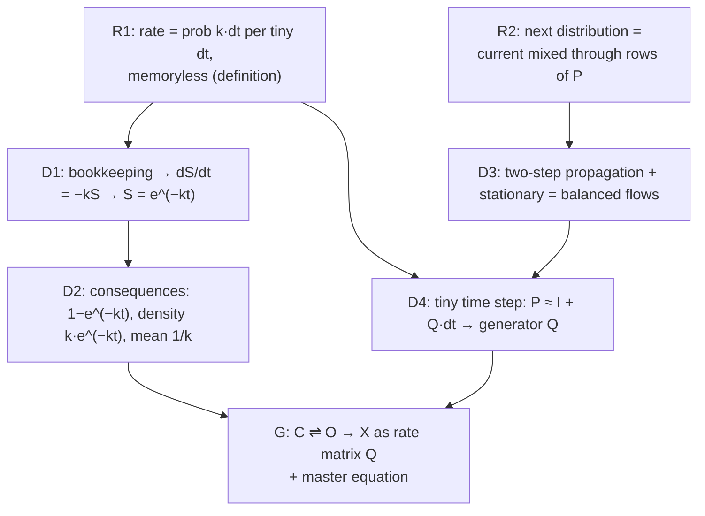

# let's continue from the last lesson

> [!quote] YOU

> [!note] SKILL loaded: teach

Teach me: let's continue from the last lesson. Use lesson slug "let-s-continue-from-the-last-lesson" and note "lessons/let-s-continue-from-the-last-lesson.md". No fixed time budget.

> [!question] Recall — Recall
> A protein flips between two conformations, **C** (closed) and **O** (open), checked once per nanosecond (discrete time). Each step:
> - from C: stays C with prob $0.9$, goes to O with prob $0.1$
> - from O: goes to C with prob $0.5$, stays O with prob $0.5$
>
> 1. Write this as a $2\times 2$ transition matrix $P$ (rows = "from").
> 2. If it starts in C with certainty, what's the probability distribution over {C, O} after **two** steps?
> 3. What's the long-run fraction of time spent in O?
>
> Work on paper and send a photo from the `/phone` page, or type it. If part of it is unfamiliar, give your best guess for that part instead of skipping it.
>
> Work it on paper and send a photo from your phone, or type your answer.

> [!warning] Recall — partial ◐ (40%)
> Your answer (photo):
> ![[work-20261006-181445.jpg|500]]
> Confidence: 10% · 219s
> Read as: Part 1: P labelled rows C, O and columns C, O: [[0.9, 0.1],[0.5, 0.5]]. Part 2: 'if we start in C, step 1: 0.9 (C), 0.1 (O)'; 'Step 2: {0.9,0.1}⊗{0.9,0.1} + {0.9,0.1}⊗{0.5,0.5}' (one trailing '⊗{0.5,0.5}' in the first term is crossed out). No final numbers. Part 3: 'convolution of state O through these sets'. No number.
> First error: Part 2: the step-2 combination ('{0.9,0.1}⊗{0.9,0.1} + {0.9,0.1}⊗{0.5,0.5}') is not well-defined and is never evaluated to a final distribution.
>
> Your transition matrix is correct and clearly labelled, and your one-step distribution (0.9, 0.1) is right. For step 2, the next distribution is the current one times P: 0.9 × (row C) + 0.1 × (row O). Add those up to get actual numbers. For the long run, look for a distribution that P leaves unchanged; a balance between flow C→O and flow O→C will give it.

> [!question] Recall — Recall
> Pure arithmetic, no probability. Let
> $$A = \begin{pmatrix} 2 & 1 \\ 0 & 3 \end{pmatrix}, \qquad \mathbf{v} = (1,\ 4) \text{ (a row vector).}$$
> Compute the row vector $\mathbf{v}A$. Then say in one line what $\mathbf v A$ is in terms of the rows of $A$.

> [!warning] Recall — partial ◐ (70%)
> Your answer (photo):
> ![[work-20261006-181836.jpg|500]]
> Confidence: 100% · 150s
> Read as: Photo is rotated 90°. Top line (partly scribbled out): 'convolution of state 0 through these steps'. Then: 'A = (2 1; 0 3), v = (1, 4) => vA = (1,4)(2 1; 0 3) = (2, 13)'. No statement interpreting vA in terms of the rows of A.
> First error: Did not answer the second part: no description of vA in terms of the rows of A.
>
> Your product (2, 13) is correct. You skipped the second part of the question, which asks what vA is in terms of A's rows. Look at how each entry of v multiplies an entire row of A, and say that in one line.

> [!question] Recall — Recall
> A quantity $S(t)$ obeys
> $$\frac{dS}{dt} = -k\,S, \qquad S(0)=1.$$
> 1. What is $S(t)$?
> 2. Show that your answer really satisfies the equation (differentiate it).
> 3. In words: what is this equation saying about how $S$ shrinks?

> [!failure] Recall — incorrect ✗ (5%)
> Your answer (photo):
> ![[work-20261006-182347-1.jpg|500]]
> ![[work-20261006-182347-2.jpg|500]]
> Confidence: 70% · 267s
> Read as: Photo 1 (bottom section, under '1)'): the learner copied the equation as "s(t) obeys dS/dt = -k, S(0)=1", omitting the factor S. They then wrote "dS = -k dt => S = -kt + 1" (boxed). Photo 2: "2) dS/dt = d/dt[-kt+1] = -k" with "dS/dt = -k" boxed. "3) S gets infinitely negative, so it 'shrinks' linearly." The earlier content in photo 1 (Markov steps, a matrix product) belongs to other questions and was ignored.
> First error: Copying the equation as dS/dt = -k, dropping the factor S on the right-hand side; this led to S = 1 - kt instead of an exponential.
>
> Your integration and differentiation steps were done cleanly, and S(0)=1 checks out. However, you dropped the S on the right side: the equation is dS/dt = -k·S, so the rate of change depends on how much S is left. Redo it with that factor; try separating variables (dS/S = -k dt). Then ask what it means for the loss rate to be proportional to the amount remaining, and whether S could ever go negative.

> [!question] Recall — Recall
> A population of unexchanged amides, as a fraction $S(t)$, obeys
> $$\frac{dS}{dt} = -2\,S(t), \qquad S(0)=1$$
> (note: $S$ appears on **both** sides).
> 1. Solve for $S(t)$; separating variables works.
> 2. Is $S$ ever negative? Why or why not?

> [!warning] Recall — cancelled
> (user skipped)

> [!quote] YOU

> [!note] SKILL loaded: teach

Continue the lesson "HDX kinetics math (rates, Markov chains, first-order decay)" (slug: let-s-continue-from-the-last-lesson). No fixed time budget.

> [!abstract] PI

Picking up where we stopped. The probe has covered enough, so I'll skip the last two questions and go to the plan.

**What the probe found:**
- **Rates.** You know the answer $e^{-kt}$ but not why it's true. You were 100% sure that $k = 0.1\ \text{s}^{-1}$ means "probability exactly $0.1$ per second". That's the central misconception. It's also why your density was missing its factor of $k$.
- **First-order decay.** Your calculus is clean. But you read $\frac{dS}{dt} = -kS$ as $\frac{dS}{dt} = -k$. The idea that **the loss is proportional to what's left** hasn't sunk in yet.
- **Matrices.** You can write the transition matrix and compute $\mathbf{v}A$ correctly. What's missing is what that product *means*: the next distribution is a mix of the rows, weighted by the current distribution. That's why the two-step propagation stalled.

**The approach.** Everything in your bleed.py note rests on one idea, rates, so we start there and build up:
1. **What a rate is.** This is a definition you can take as given: the probability of the event in a tiny interval $dt$ is $k\,dt$, regardless of history.
2. **Bookkeeping.** Of the sites still unexchanged, a fraction $k\,dt$ is lost in each $dt$. That gives $\frac{dS}{dt} = -kS$ and then $e^{-kt}$. You'll derive it yourself.
3. **Consequences.** We'll get the probability of exchange by time $t$, the density $k e^{-kt}$, and the mean lifetime $1/k$. We'll also see why the answer for one second is $0.095$, not $0.1$.
4. **The Markov side,** in parallel. Your next distribution is your current one mixed through the rows of $P$. From that: two-step propagation, and the stationary state as a balance of flows.
5. **Merge the two.** Take the time step down to a tiny $dt$, so $P \approx I + Q\,dt$. Rates then become the entries of the generator $Q$.
6. **Goal.** Write closed ⇌ open → exchanged as a 3-state rate matrix and its master equation. That's the first real step toward your HDX milestone (Linderstrøm-Lang → EX1/EX2), and it's item 1 of your bleed.py roadmap.

Steps R1 to D2 are where you're weakest, so I'll work one full example first and then fade into you doing the steps. The Markov stretch will be more Socratic, since the floor there is already solid.

Does this plan work for you, or would you change the scope? For example, we could stop at D2 and do the matrix side another day.

> [!quote] YOU

let's begin

> [!question] Recall — Predict
> Start with 1000 unexchanged amide sites. Chop one second into 10 slices of 0.1 s. In each slice, every site that is STILL unexchanged has probability 0.01 of exchanging in that slice (that's k = 0.1 per second times 0.1 s). Exchanged sites stay exchanged.
>
> Roughly how many sites are still unexchanged after the full second? Exactly 900, more than 900, or fewer than 900? Commit to an answer and give your reason. You don't need an exact number, but you can compute one if you like.

> [!warning] Recall — cancelled
> (user skipped)
