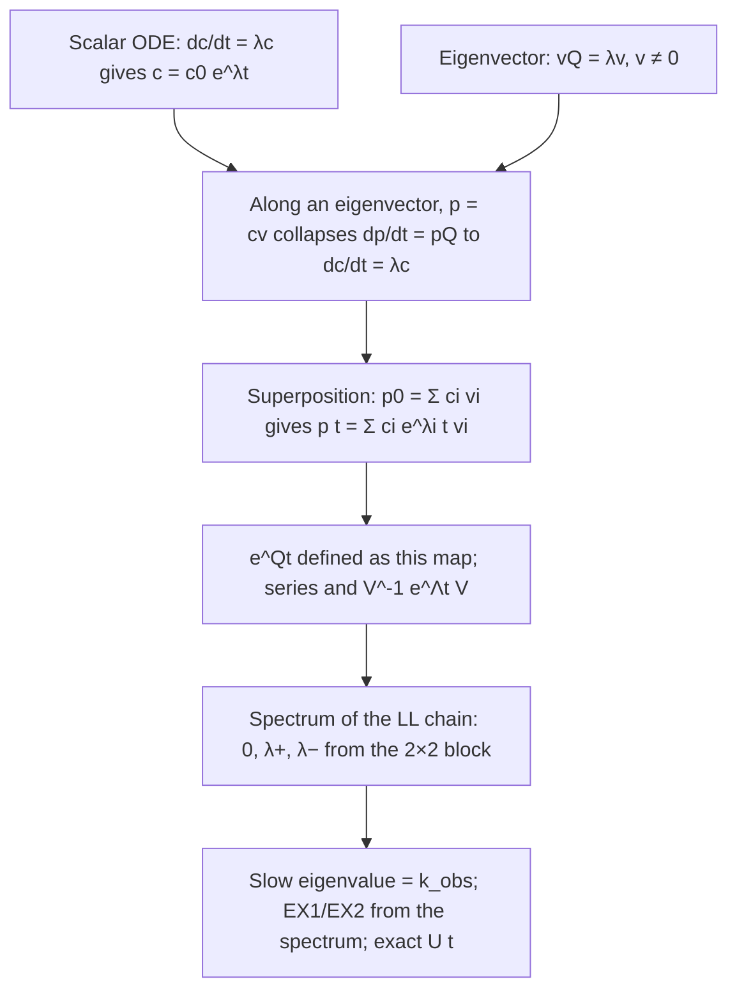

> [!quote] YOU

> [!note] SKILL loaded: teach

Continue the lesson "EX1 vs EX2 from the master equation" (slug: m-hdx-ex1-ex2). Time budget: 30 min.

> [!abstract] PI

Picking up where the lesson left off: the two limits are in place (EX2 with $k_{obs} = K_{op}k_{ch}$, EX1 with $k_{obs} = k_{op}$). Today's stretch is the bridge between them: the steady-state trick for a short-lived open state, which gives the general $k_{obs} = \dfrac{k_{op}k_{ch}}{k_{op}+k_{cl}+k_{ch}}$ with both limits falling out of one formula. One quick warm-up on the EX2 derivation first, since it was marked shaky.

> [!question] Question
> Anything you want to discuss before the first question?
>
> Plan for 30 min: one warm-up on EX2, then the steady-state node (R2), then the general $k_{obs}$ formula (D3). The envelope-shape goal waits for next time if we run out.
>
> 1. Ready, ask the first question
> 2. I want to discuss first

> [!example] Answer
> 1. Ready, ask the first question

> [!abstract] PI

Quick guess before the next node, no derivation. We're about to look at what the open state $O$ does when it is short-lived.

> [!question] Recall — Predict
> $C \rightleftharpoons O \to X$, $k_{op} = 1$, $k_{cl} = 100$, $k_{ch} = 10$ per second, all in $C$ at $t=0$. After the first ~0.05 s, what does $O$ do over the next seconds? (a) grows until $O \approx C$; (b) sits nearly constant at a small value while $C$, $X$ slowly change; (c) oscillates. One letter, one line why.
>
> *Quick guess: one line, under two minutes, no derivation. Being wrong is fine; committing is the point.*

> [!success] Recall — correct ✓ (85%)
> Your answer: b) because the in the kcl >> kch zone the system will become well mixed by the time exchange begins. This is because the flow between C and O dominate since closing rate is so much larger than exchange and opening
> Confidence: 60% · 295s
> Read as: The learner chose (b). Their reason: because $k_{cl}$ is much larger than $k_{ch}$ and $k_{op}$, the $C \rightleftharpoons O$ interconversion dominates, so $C$ and $O$ become 'well mixed' (quickly equilibrated) before the slow conversion to $X$ matters.
>
> Correct choice, and the core reason is right: the fast closing rate $k_{cl}$ makes $O$ settle quickly against $C$ on a timescale much shorter than the conversion to $X$. Your explanation does not say why the settled value of $O$ is small; that comes from $k_{cl} \gg k_{op}$, so the outflow from $O$ greatly exceeds the inflow. 'Well mixed' is also a loose description of that quasi-steady balance.

> [!abstract] PI

## Reading — Steady state of a short-lived intermediate: dO/dt ≈ 0

## Why we need this now

You have two limits of the chain $C \rightleftharpoons O \to X$ and each came from a different argument. EX2 ($k_{ch} \ll k_{cl}$) used "the $C \rightleftharpoons O$ balance is barely disturbed", giving $k_{obs} = K_{op}k_{ch}$. EX1 ($k_{ch} \gg k_{cl}$) used "every opening exchanges", giving $k_{obs} = k_{op}$. Two separate stories is exactly the disconnected-facts situation. We want one formula that produces both. The tool that does it is a single approximation about $O$, and you just predicted it: **$O$ never piles up**.

## The idea, discovered

Write the exact balance for $O$ straight from the rate matrix you already own. Inflow is openings from $C$; outflow is closings and exchanges from $O$:

$$\frac{dO}{dt} = k_{op}\,C \;-\; (k_{cl} + k_{ch})\,O .$$

Now ask: how long does a molecule stay in $O$ once it gets there? Its total exit rate is $k_{cl} + k_{ch}$, so its mean lifetime is $1/(k_{cl}+k_{ch})$. Compare that to how fast $C$ itself changes, which is at most on the timescale $1/k_{op}$ (that's how fast $C$ is being drained). If

$$k_{cl} + k_{ch} \;\gg\; k_{op},$$

then $O$ relaxes far faster than $C$ moves. Picture a bucket ($O$) with a tiny inlet ($k_{op}C$) and a huge drain ($(k_{cl}+k_{ch})O$). The water level settles in a blink to whatever height makes drain equal inlet, and from then on it just *tracks* the slowly changing inlet. Settled means not changing:

$$\frac{dO}{dt} \approx 0 \quad\Longrightarrow\quad O \approx \frac{k_{op}}{k_{cl}+k_{ch}}\,C .$$

That is the **steady-state (quasi-stationary) approximation**. It does not say $O$ is constant forever; it says $O$ is always at its settled value *for the current* $C$. The error you make is the brief initial transient, of duration about $1/(k_{cl}+k_{ch})$, during which the bucket fills.

Notice what the condition does **not** require. It does not need $k_{cl} \gg k_{ch}$ (EX2) or $k_{ch} \gg k_{cl}$ (EX1). Either exit can be the big one. All it needs is that the *sum* of exits from $O$ dwarfs the inflow rate constant $k_{op}$. For backbone amides that is essentially always true: openings are rare, and an open amide either snaps shut or exchanges within milliseconds to seconds.

## One worked instance

Take $k_{op} = 1$, $k_{cl} = 100$, $k_{ch} = 10$ per second, all sites in $C$ at $t = 0$.

1. Total exit rate from $O$: $k_{cl}+k_{ch} = 110$ per second. Mean lifetime of an open state: $1/110 \approx 0.009$ s. *Reason: lifetime is the reciprocal of the total exit rate, the $1/k$ you already have.*
2. Compare with the inflow rate constant $k_{op} = 1$ per second: $110 \gg 1$, so the approximation applies. *Reason: $O$ drains about a hundred times faster than $C$ can be depleted.*
3. Settled value: $O \approx \dfrac{1}{110}\,C \approx 0.0091\,C$. *Reason: set $dO/dt = 0$ in the balance and solve.*
4. Check it is small and tracks $C$: at the start $C \approx 1$ so $O \approx 0.009$. When later $C$ has dropped to $0.5$, $O$ has already followed down to $\approx 0.0045$, because the re-settling takes only $\sim 0.01$ s while $C$ halving takes seconds.

Your prediction (b) was exactly this: a small, nearly constant $O$ that slides down with $C$.

## What it hangs off

Only $R1$: the balance equation for $O$ is the $O$-row of the master equation $\dot p = pQ$ you wrote with numbers, and "lifetime $= 1/(\text{total exit rate})$" is the same fact as $Q_{OO} = -(k_{cl}+k_{ch})$ being minus the total exit rate. The new ingredient is one move: when a state's exits are much faster than its inflow, set its time derivative to zero and solve algebraically. Next node, we feed this $O$ into $dX/dt = k_{ch}O$ and get $k_{obs}$ for every regime at once.

> [!example] Reading — read ✓
> Read it; ready for the question.

> [!abstract] PI

Closing this node. Fresh numbers, two short parts.

> [!question] Recall — Explain it back
> $C \rightleftharpoons O \to X$ with $k_{op} = 2$, $k_{cl} = 30$, $k_{ch} = 70$ per second. (1) Write the settled value of $O$ in terms of $C$, as a number times $C$. (2) In one sentence: what single comparison of rates justifies setting $dO/dt \approx 0$ here, given that $k_{cl}$ is *not* the biggest rate?

> [!failure] Recall — incorrect ✗ (15%)
> Your answer (photo):
> ![[work-20261014-205227.png|500]]
> Confidence: 70% · 365s
> Read as: (1) $\frac{dO}{dt} = C\,k_{cl} - (k_{ch}+k_{op})\,O \approx 0$, then $= 30C - 72O \approx 0$, boxed $O \approx \frac{3}{7}C$. (2) "that $k_{op} \ll k_{cl}$, so $C$ decays slowly, rate limited by $k_{op}$."
> First error: In the first line, $\frac{dO}{dt} = C\,k_{cl} - (k_{ch}+k_{op})\,O$ treats $k_{cl}$ as the inflow into $O$ and $k_{op}$ as an exit from $O$. The directions of opening and closing are reversed.
>
> Setting $\frac{dO}{dt} \approx 0$ and solving for $O$ as a multiple of $C$ is the right approach. However, your balance equation has $k_{cl}$ feeding $O$ and $k_{op}$ draining it, which reverses the scheme $C \to O$ (rate $k_{op}$) and $O \to C$ (rate $k_{cl}$). That makes $O \approx \frac{3}{7}C$ wrong; it also doesn't match your own $\frac{30}{72}$. In (2), comparing $k_{op}$ with $k_{cl}$ alone is not the comparison that justifies the approximation, because $k_{ch}$ also drains $O$ and you left it out.

> [!abstract] PI

The method was right; the arrows got swapped. $k_{op}$ is the arrow $C \to O$ (it *feeds* $O$), $k_{cl}$ is $O \to C$ and $k_{ch}$ is $O \to X$ (both *drain* $O$). So inflow to $O$ is $k_{op}C$ and the total exit is $(k_{cl}+k_{ch})O$. Same numbers, one step only:

> [!question] Recall — Recall
> $k_{op} = 2$, $k_{cl} = 30$, $k_{ch} = 70$ per second. Write $dO/dt$ as (inflow term) minus (outflow term), with the numbers in, then set it to zero and give $O$ as a number times $C$.

> [!success] Recall — correct ✓ (95%)
> Your answer (photo):
> ![[work-20261014-205626.png|500]]
> Confidence: 100% · 211s
> Read as: The learner wrote the generator matrix $Q = \begin{pmatrix} -2 & 2 & 0 \\ 30 & -100 & 70 \\ 0 & 0 & 0 \end{pmatrix}$, then $\frac{dO}{dt} = 2C - 100\,O \simeq 0$, and boxed $O = \frac{1}{50}C$. A stray "50" appears to the left of the box, apparently from rearranging $2C = 100\,O$. The symbol before $0$ is a wavy equals, read as setting to (steady state) zero.
>
> Correct: the inflow is $2C$, the outflow is $(30+70)O = 100\,O$, and the steady state is $O = \frac{1}{50}C = 0.02\,C$. As a minor note, the $Q$ matrix row $(30, -100, 70)$ makes clear where the $100$ comes from.

> [!abstract] PI

Nice: writing $Q$ first and reading the $O$-row off it is exactly the right habit, and the $-100$ on the diagonal is the total exit rate. Saving this node and a card, then on to the general formula.

> [!abstract] PI

## Reading — The general k_obs = k_op k_ch / (k_op + k_cl + k_ch)

## Why now

We have the settled $O$. Exchange happens only from $O$ at rate $k_{ch}$ ($R1$: $dX/dt = k_{ch}O$). Put the two together and $k_{obs}$ drops out for *any* values of the three rates. EX1 and EX2 will then be two corners of one formula instead of two separate stories.

## The derivation

Unexchanged sites are $U = C + O$. Since $O$ is tiny compared with $C$ under the steady-state condition, $U \approx C$. The exchange flux is

$$\frac{dX}{dt} = k_{ch}\,O \approx k_{ch}\,\frac{k_{op}}{k_{cl}+k_{ch}}\,C \approx \frac{k_{op}k_{ch}}{k_{cl}+k_{ch}}\,U .$$

So $U$ decays as $dU/dt = -k_{obs}U$ with

$$k_{obs} \approx \frac{k_{op}\,k_{ch}}{k_{cl}+k_{ch}} .$$

Two readings of the same expression, both worth holding:

- **Product form:** $k_{obs} = k_{op}\cdot\dfrac{k_{ch}}{k_{cl}+k_{ch}}$. Openings happen at $k_{op}$; each opening exchanges with probability $\dfrac{k_{ch}}{k_{cl}+k_{ch}}$, the share of exits from $O$ that go to $X$ rather than back to $C$. (You used exactly this share when you found $k_{op}/2$ for $k_{ch} = k_{cl}$.)
- **Limits:** if $k_{ch} \ll k_{cl}$ the share is $\approx k_{ch}/k_{cl}$ and $k_{obs} \to K_{op}k_{ch}$ (EX2). If $k_{ch} \gg k_{cl}$ the share is $\approx 1$ and $k_{obs} \to k_{op}$ (EX1). Both earlier nodes fall out.

The full textbook formula has one more term in the denominator:

$$k_{obs} = \frac{k_{op}\,k_{ch}}{k_{op}+k_{cl}+k_{ch}} .$$

Where does the extra $k_{op}$ come from? From dropping the approximation $U \approx C$. Exactly, $U = C + O = C\left(1 + \frac{k_{op}}{k_{cl}+k_{ch}}\right) = C\,\frac{k_{op}+k_{cl}+k_{ch}}{k_{cl}+k_{ch}}$, so $C = U\,\frac{k_{cl}+k_{ch}}{k_{op}+k_{cl}+k_{ch}}$. Substituting into $dX/dt = k_{ch}\frac{k_{op}}{k_{cl}+k_{ch}}C$ gives the three-term denominator. When $k_{op} \ll k_{cl}+k_{ch}$, which is the steady-state condition itself, the extra term is negligible and the two forms agree. So the three-term formula is just the two-term one with the small correction for the few sites sitting in $O$ counted as still unexchanged.

## Worked instance

$k_{op} = 2$, $k_{cl} = 30$, $k_{ch} = 70$ per second (your numbers from the last node).

1. Exchange share per opening: $\dfrac{70}{30+70} = 0.7$. *Reason: of every 100 exits from $O$, 70 go to $X$.*
2. $k_{obs} = k_{op}\times 0.7 = 1.4$ per second. *Reason: openings at 2/s, 70% of them exchange.*
3. Three-term check: $\dfrac{2\cdot 70}{2+30+70} = \dfrac{140}{102} \approx 1.37$ per second. *Reason: the $2$ in the denominator is the $O$ correction, a 2% effect because $k_{op}$ is 2% of the exits.*
4. Regime: neither limit cleanly. $k_{ch} > k_{cl}$ so it leans EX1 ($k_{obs}$ is 70% of $k_{op}$, not 100%), and far from EX2 ($K_{op}k_{ch} = 4.7$/s would be badly wrong).

## What it hangs off

$R1$ supplies $dX/dt = k_{ch}O$. $R2$ supplies $O \approx \frac{k_{op}}{k_{cl}+k_{ch}}C$. $D1$ and $D2$ are the two corners you had already derived separately; now they are consequences, not assumptions. The only move added is multiplying the two and recognising the result as a first-order decay of $U$.

> [!example] Reading — read ✓
> Read it; ready for the question.

> [!abstract] PI

Check for this node: a confident argument with possibly one wrong step. Find it if it's there.

> [!question] Recall — Find the flaw
> Here is an argument. "Sites open at rate $k_{op}$. Once open, the site exchanges at $k_{ch}$ and closes at $k_{cl}$, so the fraction of openings that end in exchange is $k_{ch}/k_{cl}$. Hence $k_{obs} = k_{op}\cdot k_{ch}/k_{cl}$ for all values of the rates. With $k_{op}=2$, $k_{cl}=30$, $k_{ch}=70$ per second this gives $k_{obs} = 4.7$ per second." Is this right? If not, where does it go wrong, and what is the correct number?

> [!success] Recall — correct ✓ (95%)
> Your answer (photo):
> ![[work-20261014-211342.png|500]]
> Confidence: 75% · 859s
> Read as: (a) The fraction of opened sites that exchange is $\frac{k_{ch}}{k_{ch}+k_{cl}}$ (boxed). (b) So $k_{obs} \approx k_{op}\cdot\frac{k_{ch}}{k_{ch}+k_{cl}}$ since $k_{op} \ll k_{cl}, k_{ch}$; $k_{obs} = 2\cdot\frac{70}{100} = \frac{140}{100} = 1.4\ \mathrm{s}^{-1}$ (boxed).
>
> You located the error exactly: the share of openings that end in exchange is $k_{ch}/(k_{ch}+k_{cl})$, exchange out of all exits from the open state, not $k_{ch}/k_{cl}$. That gives $k_{obs} \approx 2 \times 0.7 = 1.4\ \mathrm{s}^{-1}$, and your condition $k_{op} \ll k_{cl}, k_{ch}$ rightly qualifies the 'for all values' claim. You never explicitly state that the original argument is wrong, but your corrected share makes the rejection clear.

> [!abstract] PI

Session paused. Two nodes landed today.

- **Confirmed:** the steady state of the open state, $O \approx \dfrac{k_{op}}{k_{cl}+k_{ch}}C$, and the general $k_{obs} = k_{op}\cdot\dfrac{k_{ch}}{k_{cl}+k_{ch}}$, with EX1 and EX2 now falling out as corners of one formula. You found the planted share error without help.
- **One thing to watch:** in the first explain-back the arrows got swapped, with $k_{cl}$ feeding $O$ and $k_{op}$ draining it. Writing $Q$ first and reading the $O$-row off it fixed that immediately, so keep doing it that way.
- **Still shaky:** the EX2 node from the earlier session never got its fresh explain-back. Next time opens with the two limits derived from the general formula, which covers it, then the race between $k_{cl}$ and $k_{ch}$, pH raising $k_{ch}$, and the envelope shapes.

Three review cards were saved. Your $Q$ matrix today also closed out the old diagonal-entry misconception.

> [!quote] YOU

lets continue learning

> [!abstract] PI

Continuing. Next up: a warm-up deriving both limits from the general formula you built, then the race between closing and exchange, how pH enters, and finally the envelope shapes.

> [!question] Question
> Anything you want to discuss before the first question?
>
> Plan: warm-up on the two limits of $k_{obs} = k_{op}\,\frac{k_{ch}}{k_{cl}+k_{ch}}$, then D4 (the race and pH), then G (envelope shapes).
>
> 1. Ready, ask the first question
> 2. I want to discuss first

> [!example] Answer
> 1. Ready, ask the first question

> [!abstract] PI

## Reading — The race k_cl vs k_ch picks the regime; pH turns the k_ch knob

## Why now

The general formula is in hand:

$$k_{obs} = k_{op}\cdot\frac{k_{ch}}{k_{cl}+k_{ch}} .$$

The second factor is the whole story of EX1 versus EX2. It is the probability that an open site exchanges before it closes, and it is decided by a **race** between two exits from $O$: closing at $k_{cl}$ and exchange at $k_{ch}$. Whichever is faster wins most of the time. This node makes that race explicit and then asks the practical question: in an experiment, which of these rates can you actually turn?

## The race, from the formula

Look at the share $\dfrac{k_{ch}}{k_{cl}+k_{ch}}$ as a function of the single ratio $r = k_{ch}/k_{cl}$:

$$\text{share} = \frac{r}{1+r}.$$

- $r \ll 1$ (closing wins): share $\approx r = k_{ch}/k_{cl}$, so $k_{obs} \approx k_{op}k_{ch}/k_{cl} = K_{op}k_{ch}$. **EX2.** A site opens and closes many times before one opening finally exchanges. $k_{obs}$ is proportional to $k_{ch}$, and it reports the *equilibrium* $K_{op}$, i.e. the stability $\Delta G_{op} = -RT\ln K_{op}$.
- $r \gg 1$ (exchange wins): share $\approx 1$, so $k_{obs} \approx k_{op}$. **EX1.** The first opening exchanges. $k_{obs}$ no longer depends on $k_{ch}$ at all, and it reports the *kinetics* of opening.
- $r = 1$: share $= 1/2$, the crossover. This is the $k_{op}/2$ you computed when $k_{ch} = k_{cl}$.

So the regime is not a property of the protein alone and not of the chemistry alone. It is a property of the ratio $k_{ch}/k_{cl}$.

## Which knob can you turn? pH

$k_{op}$ and $k_{cl}$ belong to the protein's dynamics; you can nudge them with temperature or denaturant, but not cleanly. $k_{ch}$ is different: it is the chemistry of an exposed amide, and above about pH 3 it is **base-catalysed**: the rate-limiting step is attack by $\mathrm{OH^-}$ on the amide N–H. Since $[\mathrm{OH^-}]$ rises ten-fold per pH unit,

$$k_{ch} \propto [\mathrm{OH^-}] \quad\Longrightarrow\quad k_{ch} \text{ increases about } 10\times \text{ per pH unit.}$$

Orders of magnitude to hold: for a fully exposed amide at room temperature, $k_{ch}$ is of order $1$–$10$ per second at pH 7, about ten-fold more per unit above, and it bottoms out near pH 2.5–3 (which, together with $0\,^\circ$C, is why the quench in HDX-MS slows exchange by roughly four to five orders of magnitude).

Consequence: raising pH pushes **every** site toward EX1, because $k_{ch}$ climbs while $k_{cl}$ stays put. The pH at which a given site crosses over is the pH where $k_{ch}$ reaches that site's $k_{cl}$. Experimentally this is the standard test: if $k_{obs}$ scales ten-fold per pH unit, the site is EX2; if $k_{obs}$ stops responding to pH, it has gone EX1.

## Worked instance

A site with $k_{op} = 0.01$ per second and $k_{cl} = 100$ per second ($K_{op} = 10^{-4}$, a well-protected amide). Take $k_{ch} = 10$ per second at pH 7.

1. **pH 7:** $r = 10/100 = 0.1$. Share $= 0.1/1.1 \approx 0.09$. $k_{obs} = 0.01 \times 0.09 \approx 9\times10^{-4}$ per second. *Reason: closing wins 10 to 1; EX2, and indeed $K_{op}k_{ch} = 10^{-4}\times 10 = 10^{-3}$ is within 10%.*
2. **pH 8:** $k_{ch} = 100$ per second, $r = 1$. Share $= 0.5$. $k_{obs} = 0.005$ per second. *Reason: the crossover; one pH unit multiplied $k_{ch}$ by 10 but $k_{obs}$ by only about 5, the first sign of leaving EX2.*
3. **pH 9:** $k_{ch} = 1000$ per second, $r = 10$. Share $\approx 0.91$. $k_{obs} \approx 0.0091$ per second. *Reason: exchange now wins 10 to 1; EX1, $k_{obs} \to k_{op} = 0.01$.*
4. **pH 10:** $k_{ch} = 10^4$, share $\approx 0.99$, $k_{obs} \approx 0.0099$. *Reason: saturated at $k_{op}$; another pH unit changed $k_{obs}$ by 9%.*

Across pH 7 to 10, $k_{ch}$ rose a thousand-fold but $k_{obs}$ rose only eleven-fold, from $9\times10^{-4}$ to $0.0099$ per second, and flattened. That flattening *is* the EX2 to EX1 transition, and its location told you $k_{cl} \approx 100$ per second.

## What it hangs off

Entirely off D3. Nothing new is derived; the share $k_{ch}/(k_{cl}+k_{ch})$ is simply reread as the outcome of a race, and one external fact is attached: $k_{ch}$ is the only one of the three rates with a clean experimental knob, and that knob is pH, ten-fold per unit.

> [!example] Reading — read ✓
> Read it; ready for the question.

> [!abstract] PI

Check for this node, which also stands in for the EX2 warm-up. Fresh numbers.

> [!question] Recall — Explain it back
> A site has $k_{op} = 0.05$ and $k_{cl} = 20$ per second. At pH 7 its $k_{ch} = 2$ per second. (1) Give $k_{obs}$ at pH 7 and at pH 9, and name the regime at each. (2) In one sentence: why does raising pH move a site from EX2 toward EX1, and not the other way?

> [!warning] Recall — partial ◐ (45%)
> Your answer (photo):
> ![[work-20261014-213210-1.png|500]]
> ![[work-20261014-213210-2.png|500]]
> Confidence: 70% · 594s
> Read as: Part (1), first line labelled pH 7: $k_{obs} = \frac{0.05\cdot 2}{20+2} = \frac{5\times10^{-2}}{11} = \frac{5}{1100}$ (boxed). The denominator digits are ambiguous: they could read '16'/'1600' or '11'/'1100'. The parallel simplification in the next line suggests 11/1100. Second line, also labelled 'pH 7' but using $k_{ch}=200$: $k_{obs} = \frac{0.05\cdot200}{20+200} = \frac{0.05\cdot2}{2.2} = \frac{0.05}{1.1} \approx 0.045$ (boxed). Part (2): 'because it doesn't change the $k_{ch}/k_{op}$ ratio'. The subscript could also be read as $k_{cl}/k_{op}$.
> First error: No regime is named for either pH, and part (2) does not state that pH raises only $k_{ch}$ so that exchange outcompetes closing.
>
> Your setup $k_{obs} = k_{op}k_{ch}/(k_{cl}+k_{ch})$ is right, and $\approx 0.045$/s at pH 9 is correct. The pH 7 value is right if your boxed denominator is $1100$, but it is hard to read and could be $1600$. Neither EX2 nor EX1 is named. The reason in (2) misses the mechanism: as written, $k_{ch}/k_{op}$ does change with pH, and nothing is said about $k_{ch}$ growing relative to $k_{cl}$.

> [!abstract] PI

Both numbers are right ($5/1100 \approx 0.0045$ and $0.045$ per second). The gap is the reason: the regime is decided by the race between the two exits from $O$, closing at $k_{cl}$ and exchange at $k_{ch}$, so the ratio that matters is $k_{ch}/k_{cl}$, not $k_{ch}/k_{op}$. One step only:

> [!question] Recall — Recall
> Going from pH 7 to pH 9, which of the three rates $k_{op}, k_{cl}, k_{ch}$ change, and what happens to the ratio $k_{ch}/k_{cl}$? Then one line: why does that push the site toward EX1 rather than EX2?

> [!success] Recall — correct ✓ (92%)
> Your answer: only kch changes. 
> k_ch/kcl gets larger as ph increases. Which means the exchange rate per opening is becoming almost garunteed with increased pH (depending on the numbers and how hard you push), so it will eventually look like exchange per opening event which is EX1.
> Confidence: 100% · 141s
> Read as: The learner says only $k_{ch}$ changes, $k_{ch}/k_{cl}$ grows with pH, so exchange per opening becomes nearly guaranteed, which makes the kinetics look like one exchange per opening event, i.e. EX1.
>
> Correct: only $k_{ch}$ changes, $k_{ch}/k_{cl}$ grows, and each opening becomes almost certain to give exchange, so the rate is set by opening (EX1). As a note, the size of the rise ($10\times$ per pH unit, so $100\times$ from pH 7 to 9) is not stated, and neither is the reason $k_{op}$ and $k_{cl}$ stay fixed (they are protein motions, not base-catalysed).

> [!abstract] PI

## Reading — Envelope shape: gradual shift (EX2) versus bimodal (EX1)

## Why now

Everything so far was one amide. A mass spectrometer sees a **peptide** with $N$ exchangeable amides, and what it reports is the isotope envelope: a histogram of how many deuterons each peptide molecule carries. The question this whole lesson was aimed at: why does EX2 produce an envelope that slides gradually to higher mass, while EX1 produces two peaks whose heights trade places? The answer is a direct consequence of the race, applied to $N$ sites that open together.

## The setup

Take a segment of $N$ amides that opens and closes **as a unit** (a cooperative unfolding event: the whole helix or hairpin frays at once). Every opening exposes all $N$ sites at the same time, for a lifetime of order $1/(k_{cl}+k_{ch})$. Ask of one opening event: how many of the $N$ sites exchange before the segment closes?

Each exposed site independently runs its own race against the same closing clock. The probability a given site exchanges during this opening is the share $s = \dfrac{k_{ch}}{k_{cl}+k_{ch}}$.

## EX1: all or nothing per opening

$k_{ch} \gg k_{cl}$, so $s \approx 1$. In a single opening, essentially **all $N$ sites exchange**. A peptide molecule is therefore in one of two states: never yet opened (mass $+0$) or opened at least once (mass $+N$). Nothing in between exists, because an opening is never partial. The fraction that has opened by time $t$ is $1 - e^{-k_{op}t}$, so the envelope is **two peaks at fixed positions**, $+0$ and $+N$, with the low-mass peak draining into the high-mass peak at rate $k_{op}$. That is the bimodal signature. The peaks do not move; only their heights change.

## EX2: a tiny bite per opening

$k_{ch} \ll k_{cl}$, so $s \ll 1$. In a single opening, each site exchanges with small probability $s$, independently of its neighbours. A typical opening exchanges zero or one site. Exchange is accumulated over **many** openings ($\sim 1/s$ of them per site), and because each site's successes are independent coin flips across openings, after time $t$ each site is exchanged with probability

$$p(t) = 1 - e^{-k_{obs}t}, \qquad k_{obs} = K_{op}k_{ch},$$

independently of the others. The number of deuterons on a peptide is then **binomial**, $\mathrm{Bin}(N, p)$: a single hump centred at $Np$ with width $\sqrt{Np(1-p)}$. As $t$ grows the hump **slides** from $0$ to $N$ through every intermediate position. That is the gradual, unimodal shift.

The key dependency: independence of sites comes from $s \ll 1$. When each opening exchanges at most one site, which sites exchange is uncorrelated, and a sum of $N$ independent coin flips is a binomial. When $s \approx 1$, every opening exchanges all sites, the coin flips are perfectly correlated, and the distribution collapses to two spikes. Both envelopes have the **same centroid**, $N(1 - e^{-k_{obs}t})$; only the shape distinguishes them. Centroid-only analysis cannot tell EX1 from EX2. The envelope width can.

## Worked instance

$N = 10$ sites, $t$ chosen so that half the exchange is done, $k_{obs}t = \ln 2$ (e.g. $k_{obs} = 0.01$ per second, $t \approx 69$ s).

- **EX2:** $p = 0.5$ for each site. Deuteron count $\sim \mathrm{Bin}(10, 0.5)$: mean $5$, standard deviation $\sqrt{10\times0.25} \approx 1.6$. One peak centred at $+5$, spanning roughly $+2$ to $+8$. *Reason: 10 independent fair coins.*
- **EX1:** with $k_{op} = 0.01$ per second, half the molecules have opened. Half the intensity at $+0$, half at $+10$, nothing at $+5$. *Reason: each opening exchanges all 10 sites, so each molecule is all-or-nothing.* Centroid also $+5$.

Same centroid, opposite shapes. In an experiment, a stretched or bimodal envelope that persists over several time points, especially at raised pH, is the fingerprint of EX1 and hence of a cooperative opening whose $k_{op}$ you can read directly.

## What it hangs off

D4 supplies the share $s$ and the fact that pH pushes $s \to 1$. D2 supplies "every opening exchanges" for EX1 and D1 "many openings per exchange" for EX2. The one new idea is statistical: $N$ sites that open together are $N$ coin flips with success probability $s$ per opening, independent when $s \ll 1$ and perfectly correlated when $s \approx 1$. Independent flips give a binomial hump; correlated flips give two spikes.

> [!quote] YOU

we can label this as known for me. I have a VERY good understanding of this because I wrote a paper specifically for this. However this is just for the bimodal case, as there exists the possibility of many modalities if there are several slowely interchanging conformations in ex2 or in folding events at ex1 conditions.

> [!question] Question
> Ready for the question?
>
> 1. Ready, ask me
> 2. I have another question

> [!example] Answer
> 1. Ready, ask me

> [!example] Recall — ended
> Recall phase ended; starting the lesson.

> [!abstract] PI

On to the lesson. Every node except the envelope-shape goal is confirmed; that one is recorded as known on your word, with a card saved so it still comes up in review.

> [!quote] YOU

> [!note] SKILL loaded: teach

Continue the lesson "EX1 vs EX2 from the master equation" (slug: m-hdx-ex1-ex2). RECALL PHASE ENDED BY THE LEARNER: he wants to learn something new now. No warm-up re-check, no review cards, no checks on earlier nodes. Go straight to teaching the first pending (new) node.

> [!abstract] PI

The lesson has no new nodes left: everything is confirmed except the envelope-shape goal, which you know from your own paper. So I'll close it, record the HDX milestone, and find the next thing to learn.

> [!question] Question
> The EX1/EX2 lesson is done and the HDX milestone is recorded. What next?
>
> The scheduler's pick is the MD milestone, since everything it needs is in place. The HDX spine continues with the bleed-forward model (back-exchange and quench) if you'd rather stay in HDX.
>
> 1. Dissect one of your own OpenMM/Amber setups and defend every choice (Recommended)
> 2. Next HDX milestone: the bleed-forward model
> 3. Taylor series with remainder
> 4. Chain rule, Jacobians, reverse-mode autodiff

> [!example] Answer
> 2. Next HDX milestone: the bleed-forward model

> [!question] Question
> Shall we do that lesson: solve $\dot p = pQ$ exactly with the matrix exponential, eigendecomposition included, and get EX1/EX2 from the eigenvalues of your 3-state $Q$?
>
> It unlocks the bleed-forward milestone. I'll start with a short probe on linear algebra (a few questions) to see where to begin.
>
> 1. Yes, start with the probe
> 2. Yes, but skip the probe and assume I know no eigendecomposition
> 3. Something else

> [!example] Answer
> 1. Yes, start with the probe

> [!abstract] PI

Mapping the linear-algebra strand, starting low.

> [!question] Recall — Recall
> In one or two lines: what does it mean for a vector $v$ to be an eigenvector of a square matrix $A$ with eigenvalue $\lambda$? Write the defining equation and say in words what $A$ does to $v$.

> [!warning] Recall — partial ◐ (75%)
> Your answer: it means that there exists a scalar value to rescale a vector that produces the product of that same vector times a matrix. Which means A just rescales v
> Confidence: 20% · 64s
> Read as: The learner says there is a scalar $\lambda$ such that scaling $v$ by it gives the same result as multiplying $v$ by the matrix, i.e. $Av = \lambda v$ stated in words, and concludes that $A$ just rescales $v$.
> First error: The requirement $v \neq 0$ is never stated.
>
> Your description is right: a scalar multiple $\lambda v$ equals $Av$, so $A$ only rescales $v$ and does not change its direction. However, the definition is missing the condition $v \neq 0$. Without it, $v = 0$ would satisfy $Av = \lambda v$ for every $\lambda$.

> [!abstract] PI

Good, that's the idea (just add $v \neq 0$ so it isn't trivially true). Same strand, a sharp step up: can you compute them?

> [!question] Recall — Problem
> Find both eigenvalues of $$A = \begin{pmatrix} -1 & 1 \\ 4 & -4 \end{pmatrix}.$$ Show the equation you solve. If you don't know how, say so.
>
> Work it on paper and send a photo from your phone, or type your answer.

> [!warning] Recall — partial ◐ (70%)
> Your answer (photo):
> ![[work-20261014-215253.png|500]]
> Confidence: 20% · 506s
> Read as: The learner wrote "I'm rusty but I think it's: $\det(A - I\lambda) = 0$", formed $\begin{pmatrix} -(1+\lambda) & 1 \\ 4 & -(4+\lambda) \end{pmatrix}$, wrote $(1+\lambda)(4+\lambda) - 4 = 0$, expanded to $4 - 4 + 5\lambda + \lambda^2 = 0$, simplified to $5\lambda + \lambda^2 = 0$, and boxed $\lambda = -5$ as the final answer.
> First error: Going from $5\lambda + \lambda^2 = 0$ to the boxed $\lambda = -5$ drops the root $\lambda = 0$.
>
> Your setup $\det(A - \lambda I) = 0$ and the expansion to $\lambda^2 + 5\lambda = 0$ are both correct. The final step only reports $\lambda = -5$, though. The equation $\lambda^2 + 5\lambda = 0$ has two solutions, and the root $\lambda = 0$ was lost.

> [!abstract] PI

You can compute them (note $\lambda^2 + 5\lambda = 0$ also has $\lambda = 0$; that root will matter later). Now the bridge to kinetics.

> [!question] Quiz
> For the master equation $\dot p = pQ$, where do the eigenvalues of $Q$ show up in the solution $p(t)$?
>
> 1. As the coefficients: p(t) = Σᵢ λᵢ e^(-t) vᵢ
> 2. As the stationary populations: p(∞)ᵢ = λᵢ after normalising
> 3. As the exponents: p(t) is a sum of terms cᵢ e^(λᵢ t)
> 4. As the per-step jump probabilities between states

> [!failure] Quiz — incorrect ✗
> Your answer: 2. As the stationary populations: p(∞)ᵢ = λᵢ after normalising
> Correct answer: 3
> Confidence: 0% · 178s
>
> Along an eigenvector direction, $Q$ acts as a number $\lambda_i$, so that component obeys the scalar equation $\dot c = \lambda_i c$ and decays as $e^{\lambda_i t}$. The populations are weighted sums of these modes. Eigenvalues are rates (per second), not populations or probabilities.

> [!abstract] PI

That's the edge: eigenvalues of $Q$ are rates, not populations. Units tell you: $Q$'s entries are per second, so its eigenvalues are per second too. One step on the mechanism, using only the scalar ODE you already own:

> [!question] Recall — Recall
> Suppose at some moment $p$ happens to be a multiple of a left eigenvector: $p(t) = c(t)\,v$ with $vQ = \lambda v$. Substitute into $\dot p = pQ$ and write the ODE that $c(t)$ obeys, then its solution.

> [!failure] Recall — incorrect ✗ (10%)
> Your answer (photo):
> ![[work-20261015-193346-1.png|500]]
> ![[work-20261015-193346-2.png|500]]
> Confidence: 0% · 77825s
> Read as: The learner wrote $\dot p(t) = pQ = c(t)\vec v$, then $\frac{dp}{dt} = pQ$, $e^{\ln p} = e^{Qt}$, $p(t) = e^{Qt}$, $\dot p(t) = Qe^{Qt}$, $c(t)\vec v \approx Qe^{Qt}$, and boxed $c(t) = \frac{Qe^{Qt} v^T}{\|\vec v\|}$ (the denominator could be $\|\vec v\|$ or $\|\vec v\|^2$; the bar over $v$ is read as a vector arrow).
> First error: The first line writes $pQ = c(t)\vec v$, which mixes up $p = c\,v$ with $pQ$. After that, $vQ = \lambda v$ is never used.
>
> You correctly started from $\dot p = pQ$ and tried to solve for $c(t)$. However, $p = c\,v$ was never substituted into both sides, and the eigenvector relation $vQ = \lambda v$ was never used, so the work never reaches a scalar ODE for $c$. Treating the matrix equation like a scalar one ($\ln p$, $p = e^{Qt}$) leaves $Q$ in the final answer where a scalar rate belongs, and the initial value $c(0)$ is missing.

> [!abstract] PI

Your photo came in. The slip at the top was writing $pQ = c\,v$ where the assumption is $p = c\,v$; after that the eigenvector relation never got used, and the matrix got treated as a scalar. That is exactly the step the whole next lesson is built on, so here it is worked once, with numbers.

**Worked example of the step.** Take $Q = \begin{pmatrix} -1 & 1 \\ 4 & -4 \end{pmatrix}$, the matrix you found eigenvalues for. Its left eigenvector for $\lambda = -5$ is $v = (1, -1)$, because $vQ = (1\cdot(-1) + (-1)\cdot 4,\; 1\cdot 1 + (-1)\cdot(-4)) = (-5, 5) = -5\,v$. Now assume $p(t) = c(t)\,v$, a scalar times a fixed vector. Left side of $\dot p = pQ$: $\dot p = \dot c\, v$, since $v$ is constant. Right side: $pQ = c\,(vQ) = c\,(-5 v) = -5c\,v$. Both sides are multiples of the same $v$, so the equation is $\dot c\, v = -5c\, v$, which is just $\dot c = -5c$. That is the scalar ODE you own: $c(t) = c(0)e^{-5t}$. So any population difference along $(1,-1)$ decays at $5$ per second, and the matrix never appears in the answer, only its eigenvalue.

That is the map: eigenvector definition and $2\times2$ eigenvalues are there (rusty), the matrix exponential is a name without a mechanism, and eigenvalues-as-rates is the gap. Here is the plan.

**Approach.** Everything is built on one move you just saw: along an eigenvector, the matrix equation collapses to $\dot c = \lambda c$. Add linearity and you get the full solution as a sum of modes. The matrix exponential is then *defined* as the thing that does this, so $p(t) = p(0)e^{Qt}$ is not a formula to trust but a name for the sum of modes. Finally we apply it to your three-state $Q$: eigenvalue $0$ for the absorbing state, two negative eigenvalues from the $2\times 2$ block, and the slow one is $k_{obs}$. EX1 and EX2 fall out of the spectrum with no steady-state trick at all. I verified the eigenvalue formula numerically before writing it down. Likely two or three sessions.

> [!question] Question
> Does this plan work? Roots are the scalar ODE and the eigenvector definition, both of which you already hold.
>
> 1. Yes, go
> 2. Change something

> [!example] Answer
> 1. Yes, go

> [!abstract] PI

Plan registered (I merged the two roots into one node, since you hold both). Quick guess before the first reading.

> [!question] Recall — Predict
> $Q = \begin{pmatrix} -1 & 1 \\ 4 & -4 \end{pmatrix}$ has eigenvalues $0$ and $-5$. Quick guess: what physical thing is the left eigenvector with eigenvalue $0$ (a row $v$ with $vQ = 0$), and what does $\lambda = 0$ say about how it changes in time?
>
> *Quick guess: one line, under two minutes, no derivation. Being wrong is fine; committing is the point.*

> [!warning] Recall — partial ◐ (65%)
> Your answer: SOrry, I walked away.
>
> I don't know what the physcial thing is but for this it coule be counts/population and if lambda is 0 then it means it must be entirely static?
> Confidence: 0% · 686s
> Read as: The learner apologised for stepping away, then guessed the left eigenvector could be counts or populations, and that $\lambda = 0$ means it is "entirely static." Their stated confidence was 0/100.
> First error: You identified $v$ only vaguely as "counts/population," not as the specific distribution over states that stays fixed.
>
> You are right that $\lambda = 0$ means nothing changes along this direction, since $e^{0\cdot t} = 1$, and populations are the right kind of quantity. What is missing is what makes this vector special. It is not just any set of populations: it is the one particular split between the two states that holds still under $Q$, and you did not say why it stays put.

> [!abstract] PI

## Reading — The two handles: the scalar ODE and the eigenvector equation

## Why these two, now

Everything in this lesson is built by combining exactly two facts you already own, so it is worth stating them in the precise form we will use. Nothing else is needed: no new theorems, no linear algebra beyond what these say.

## Handle 1: the scalar linear ODE

$$\frac{dc}{dt} = \lambda c \quad\Longrightarrow\quad c(t) = c(0)\,e^{\lambda t}.$$

This is $dS/dt = -kS$ with $\lambda = -k$. Two things to hold explicitly:

- **It is the only solution.** If $c(0)$ is given, $c(t)$ is fixed for all $t$. (Reason: the ODE tells you the slope at every point, so from the starting value the curve is traced out with no freedom. Formally, $\frac{d}{dt}\left(c\,e^{-\lambda t}\right) = \dot c e^{-\lambda t} - \lambda c e^{-\lambda t} = 0$, so $c\,e^{-\lambda t}$ is constant, equal to $c(0)$.)
- **The sign of $\lambda$ is the whole story.** $\lambda < 0$: decays at rate $|\lambda|$, lifetime $1/|\lambda|$. $\lambda = 0$: $c$ stays at $c(0)$ forever. $\lambda > 0$: grows. For rate matrices only the first two occur.

## Handle 2: the eigenvector equation, in the row convention

For the master equation you write populations as a **row** $p = (p_C, p_O, p_X)$ and $\dot p = pQ$, with $Q_{ij}$ the rate from $i$ to $j$. Because $p$ multiplies from the left, the relevant eigenvectors are **left** eigenvectors, rows $v$ with

$$vQ = \lambda v, \qquad v \neq 0.$$

In words: $Q$ acting on $v$ gives back $v$, scaled by the number $\lambda$. The direction survives, only the length changes. ($v \neq 0$ is required because $0 \cdot Q = \lambda \cdot 0$ for every $\lambda$, which would make every number an eigenvalue.) Left and right eigenvectors have the same eigenvalues, since $\det(Q - \lambda I) = \det(Q^T - \lambda I)$, so the characteristic polynomial you computed yesterday is the same either way. Only the vectors differ.

Eigenvalues of a rate matrix carry the units of $Q$: per second. Keep that in view; it is the fastest way to catch "eigenvalue = population" type errors.

## One worked instance

$Q = \begin{pmatrix} -1 & 1 \\ 4 & -4 \end{pmatrix}$ per second, two states, rates $1 \to 2$ at $1$/s and $2 \to 1$ at $4$/s. You found $\lambda^2 + 5\lambda = 0$, so $\lambda = 0$ and $\lambda = -5$.

1. **Left eigenvector for $\lambda = 0$.** Solve $vQ = 0$ with $v = (a, b)$: first component $-a + 4b = 0$, so $a = 4b$. Take $v_0 = (4, 1)$. *Reason: $vQ = 0$ is the same as $\dot p = 0$ for $p \propto v$, so this row is the stationary split: 80% in state 1, 20% in state 2. Check the flux balance: $1 \times 4 = 4 \times 1$.* That is your prediction made precise: the $\lambda = 0$ direction is not any population, it is the one split that balances every flux.
2. **Left eigenvector for $\lambda = -5$.** Solve $vQ = -5v$: first component $-a + 4b = -5a$, so $4a = -4b$, $b = -a$. Take $v_1 = (1, -1)$. Check the second component: $a - 4b = 1 + 4 = 5 = -5 \times (-1)$. *Reason: this row has total $0$; it moves population from state 2 to state 1 without changing the sum. It is the "imbalance" direction.*
3. **Lifetime.** Along $v_1$, Handle 1 says the imbalance decays as $e^{-5t}$: relaxation time $0.2$ s. Notice $5 = 1 + 4$, the sum of the two rates, as you would expect for a two-state relaxation.

## What it hangs off

Handle 1 is the $k\,dt$ rule integrated. Handle 2 is the eigenvector definition you gave yesterday, restated for rows because $p$ sits on the left of $Q$. The next node puts them together: what happens to $\dot p = pQ$ when $p$ points along $v_1$.

> [!example] Reading — read ✓
> Read it; ready for the question.

> [!abstract] PI

Short close on the handles, fresh matrix.

> [!question] Recall — Explain it back
> $Q = \begin{pmatrix} -2 & 2 \\ 3 & -3 \end{pmatrix}$ per second. Find a left eigenvector $v = (a, b)$ with $vQ = 0$, and say in one line what that row means physically.

> [!success] Recall — correct ✓ (92%)
> Your answer (photo):
> ![[work-20261015-204756-1.png|500]]
> ![[work-20261015-204756-2.png|500]]
> Confidence: 65% · 1997s
> Read as: Learner solves $\det(Q-\lambda I) = \lambda^2 + 5\lambda = 0$, giving $\lambda = 0, -5$, and notes a stationary distribution exists since $\lambda = 0$ is a root. Then writes $(a,b)Q = (-2a+3b,\ 2a-3b) = 0$, gets $4a - 6b = 0$, boxes $a = \tfrac{3}{2}b$ (a sign in front is crossed out), checks $(-3b+3b,\ 3b-3b) = 0$, and concludes $v = b(\tfrac{3}{2}, 1)$. Physical meaning: "this is the population that results in no change in the distribution after any step."
>
> Correct: the components $-2a+3b$ and $2a-3b$ of $vQ$, the relation $a = \tfrac{3}{2}b$, and $v \propto (\tfrac{3}{2},1) \propto (3,2)$ are all right, and the check by substitution is good. Your reading of $v$ as the split that does not change is the stationary distribution. Minor notes: $Q$ is a per-second rate, so "no change at any time" ($\dot p = 0$) fits better than "after any step", and the normalized split ($60\%/40\%$) was not stated.

> [!abstract] PI

R confirmed. Saving a card and moving to the key step.

> [!abstract] PI

## Reading — Along an eigenvector, the matrix equation collapses to the scalar one

## Why now

$\dot p = pQ$ is three coupled equations: $\dot p_C$ depends on $p_O$, $\dot p_O$ on $p_C$, and so on. You cannot solve one without the others. The scalar handle $\dot c = \lambda c$ is uncoupled and trivial. The question that drives this whole lesson is: **is there any starting population for which the coupled system behaves like the uncoupled one?** If so, we have a foothold.

## The discovery

Guess the simplest possible shape: all populations proportional to one fixed row, $p(t) = c(t)\,v$, with $v$ constant and only the overall scale $c(t)$ changing. Feed that guess into both sides of $\dot p = pQ$ and see what it demands.

- **Left side.** $v$ does not depend on time, so $\dot p = \dot c\,v$.
- **Right side.** $pQ = (c\,v)Q = c\,(vQ)$. For the guess to close, $vQ$ must again be a multiple of $v$, otherwise the right side points in a new direction and $p$ cannot stay proportional to $v$. So the guess works **exactly when $v$ is a left eigenvector**: $vQ = \lambda v$. Then $pQ = c\lambda\,v$.

Both sides are multiples of the same row $v$, so match the multipliers:

$$\dot c\,v = \lambda c\,v \quad\Longrightarrow\quad \dot c = \lambda c \quad\Longrightarrow\quad c(t) = c(0)\,e^{\lambda t}.$$

The matrix has vanished. Along an eigenvector, the three coupled equations are one scalar equation whose rate is the eigenvalue. The eigenvector is the **shape** that is preserved; the eigenvalue is the **rate** at which that shape's amplitude decays. That is why the eigenvalues of $Q$ are rates (per second) and never populations.

Notice what was *not* allowed: writing $e^{Qt}$ and treating $Q$ as a number. We never divided by $Q$ or took its logarithm. We only used $vQ = \lambda v$ to replace a matrix product by a scalar product, and then Handle 1.

## Worked instance

$Q = \begin{pmatrix} -1 & 1 \\ 4 & -4 \end{pmatrix}$ per second, with $v_1 = (1, -1)$ and $v_1 Q = -5\,v_1$ from the last page.

Start at $p(0) = 0.1\,v_1 = (0.1, -0.1)$. (Negative population is fine here: this is a *deviation* from the stationary split, and deviations can have either sign. We add the stationary part back in the next node.)

1. Assume $p(t) = c(t)\,(1,-1)$ with $c(0) = 0.1$. *Reason: trying the one shape that $Q$ preserves.*
2. $\dot p = \dot c\,(1,-1)$. *Reason: the row is constant.*
3. $pQ = c\,(1,-1)Q = c\,(-5)(1,-1) = -5c\,(1,-1)$. *Reason: the eigenvector equation, verified on the last page.*
4. Match: $\dot c = -5c$, so $c(t) = 0.1\,e^{-5t}$. *Reason: Handle 1.*
5. Therefore $p(t) = (0.1\,e^{-5t},\ -0.1\,e^{-5t})$. Check at $t = 0.2$ s: $c = 0.1\,e^{-1} \approx 0.037$. The deviation has shrunk to 37% of its start in one lifetime $1/5$ s, both components together, shape intact.

Compare with what a wrong move gives: writing $p(t) = e^{Qt}$ with $Q$ left as a matrix produces no number at all for $p_1(0.2)$. The eigenvector route gives $0.037$.

## What it hangs off

Handle 2 ($vQ = \lambda v$) is what lets the right side be rewritten as a scalar times $v$. Handle 1 then solves the scalar equation. The only new idea is the *guess* $p = c\,v$, motivated by asking which starting shapes make the coupled system uncoupled. Next node: a general $p(0)$ is not an eigenvector, but it is a sum of them, and the equation is linear.

> [!quote] YOU

I'm not following. it seems like you set the initial population to be only non-zero. which zeros out the rest of the derivatives and results in what, a single eigenvalue to come out of the equation? how is that useful

> [!question] Question
> Ready for the question on this node?
>
> 1. Ready, ask me
> 2. I have another question

> [!example] Answer
> Other: you didn't answer my first question: "'m not following. it seems like you set the initial population to be only non-zero. which zeros out the rest of the derivatives and results in what, a single eigenvalue to come out of the equation? how is that useful"

> [!question] Question
> Does that answer it? If so, ready for the check on this node?
>
> 1. Yes, ask me
> 2. Still not clear, let me say what's missing

> [!example] Answer
> Other: no, your response is literally missing. look at the history of cards and you will see

> [!question] Question
> Here is the answer in full (it seems my chat text didn't reach your page). Does it answer your question?
>
> Your sentence, clause by clause:
>
> 1. "You set the initial population to be only [along one vector]." Yes, on purpose. We chose a special start $p(0) = c(0)\,v$ with $v$ an eigenvector. A deliberate special case, not the general situation.
>
> 2. "Which zeros out the rest of the derivatives." No. No derivative is zero. In the example $p(0) = (0.1, -0.1)$, both entries are nonzero and $\dot p_1 = -0.5$, $\dot p_2 = +0.5$ at $t=0$. What is zero is the part of the change pointing in any direction other than $v$. The state moves, but only by shrinking along $v$; its shape (the ratio $p_1 : p_2 = 1 : -1$) never changes. Start with any other ratio, e.g. $(1,0)$, and the ratio drifts, so one number can't describe the state.
>
> 3. "And results in a single eigenvalue coming out." Yes. That special start evolves as one exponential $e^{\lambda t}$, and $\lambda$ is the eigenvalue belonging to $v$. One preserved shape, one rate. A $3\times 3$ $Q$ has three shapes and three rates.
>
> 4. "How is that useful." Two ways. (a) Building block: $\dot p = pQ$ is linear, so if $p(0)$ is a sum of eigenvectors, $p(t)$ is the same sum with each piece multiplied by its own $e^{\lambda_i t}$. Every real start is such a sum. Example: $(1,0) = 0.2\,(4,1) + 0.2\,(1,-1)$, so $p(t) = 0.2\,(4,1) + 0.2\,e^{-5t}(1,-1)$, i.e. $p_1(t) = 0.8 + 0.2e^{-5t}$, the exact solution with no coupled equations solved. (b) Physical: at long times every fast piece has died and only the slowest eigenvalue survives, so the slowest eigenvalue of your 3-state $Q$ is $k_{obs}$; EX1 and EX2 are two limits of that one eigenvalue.
>
> So this node alone proves only "eigenvector start gives single-exponential decay at rate $\lambda$". Its use arrives in the next node, when we add the pieces up.
>
> 1. Yes, that answers it. Ask me the check.
> 2. Still not clear, let me say what's missing

> [!example] Answer
> 1. Yes, that answers it. Ask me the check.

> [!question] Question
> Ready for the check on this node? (The system needs this exact confirmation before it lets me pose it.)
>
> 1. Ready, ask me
> 2. I have another question

> [!example] Answer
> 1. Ready, ask me

> [!abstract] PI

Check for this node. From now on everything you need is inside the question itself.

> [!question] Recall — Explain it back
> $Q = \begin{pmatrix} -2 & 2 \\ 3 & -3 \end{pmatrix}$ per second, and $v = (1, -1)$ satisfies $vQ = -5\,v$ (you may use this). Start at $p(0) = 0.3\,v$. Assume $p(t) = c(t)\,v$. Substitute into $\dot p = pQ$, show the step where the matrix disappears, and give $c(t)$ and $p(t)$.
>
> Work it on paper and send a photo from your phone, or type your answer.

> [!warning] Recall — hint requested
> No attempt yet; asked for a hint.

> [!abstract] PI

Hint: write the two sides separately. Left side: differentiate $c(t)\,v$ in time, remembering $v$ is a constant row. Right side: $(c\,v)Q = c\,(vQ)$, and you are told what $vQ$ equals. Then compare the two sides.

> [!question] Recall — Explain it back
> $Q = \begin{pmatrix} -2 & 2 \\ 3 & -3 \end{pmatrix}$ per second, and $v = (1, -1)$ satisfies $vQ = -5\,v$ (you may use this). Start at $p(0) = 0.3\,v$. Assume $p(t) = c(t)\,v$. Substitute into $\dot p = pQ$, show the step where the matrix disappears, and give $c(t)$ and $p(t)$.
>
> Work it on paper and send a photo from your phone, or type your answer.

> [!note] Recall — not graded
> You wrote: lkj
> Not an answer, so not graded; the tutor replies instead.
